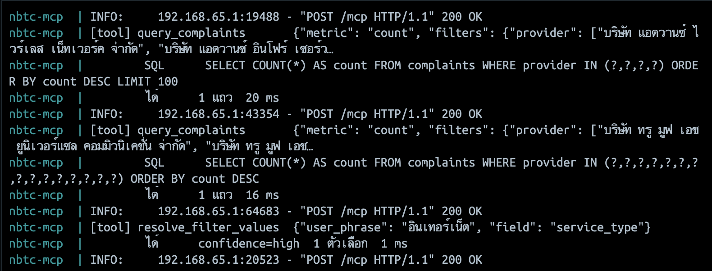
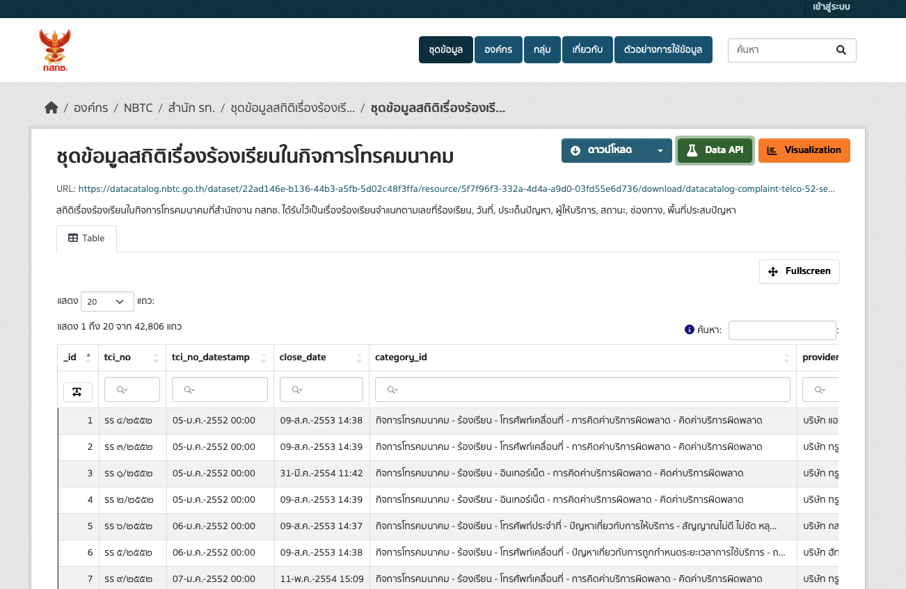
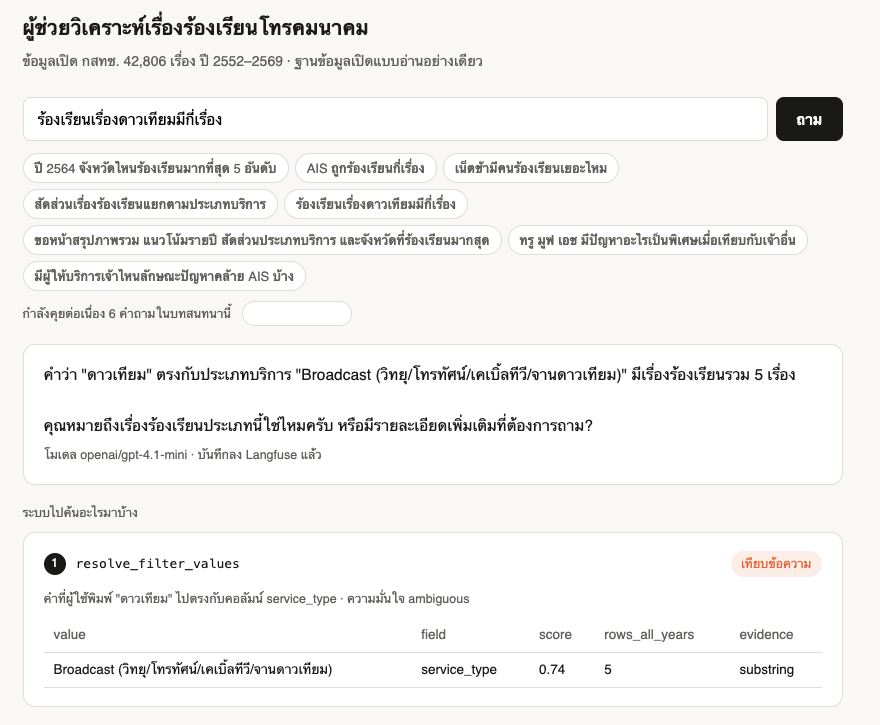

# ผู้ช่วยวิเคราะห์เรื่องร้องเรียนโทรคมนาคม · Agentic AI บนข้อมูลเปิด กสทช.

**KDAI · NLP Project (พฤศจิกายน 2569)**


รับคำถามภาษาไทย ตัดสินใจเองว่าจะเรียกเครื่องมือไหน สืบค้นฐานข้อมูลแบบอ่านอย่างเดียว
แล้วตอบพร้อม SQL ที่ใช้จริง ถ้าคำถามกำกวมจะถามกลับแทนการเดา

ข้อมูลจาก [ชุดข้อมูลสถิติเรื่องร้องเรียนในกิจการโทรคมนาคม กสทช.](https://datacatalog.nbtc.go.th/dataset/dataset_12_05)
**42,806 เรื่อง ปี พ.ศ. 2552 ถึง 2569**

> **ผลสรุปหนึ่งบรรทัด** ระบบตอบถูก 0.90 ถึง 0.92 และตัวเลขในคำตอบสืบที่มาได้ 0.98 ถึง 0.99
> แต่ **การเพิ่มชั้นค้นค่าด้วย BM25 และ cross-encoder ยังพิสูจน์ไม่ได้ว่าทำให้ดีขึ้น**
> เพราะส่วนต่างระหว่างขาเล็กกว่าความแปรปรวนของการรันซ้ำคอนฟิกเดียวกัน


---

## ทำไมถึงเรียกว่า Agentic ไม่ใช่ pipeline

การมีเครื่องมือหลายตัวไม่ได้ทำให้ระบบเป็น Agentic ส่วนที่ทำให้เป็นคือ
**LLM เลือกเองว่าจะเรียกอะไร ด้วยพารามิเตอร์อะไร และจะหยุดเมื่อไหร่**
ส่วนโค้ดของเราทำหน้าที่ตรวจและปฏิเสธเมื่อเลือกผิด

| ปัญหาที่เจอจริง | วิธีแก้ในระบบนี้ | ผลที่วัดได้ |
| --- | --- | --- |
| LLM เดาชื่อบริษัทเอง ได้ SQL ที่ถูก syntax แต่ตอบผิด | บังคับผ่าน `resolve_filter_values` ก่อนเสมอ และคืน `use_in_filters` มาทั้งก้อน | กลุ่ม resolve ได้ C 0.88 ถึง 1.00 |
| LLM แต่งตัวเลขขึ้นมาเอง | ทุกตัวเลขต้องมาจาก `query_complaints` และวัดด้วย faithfulness | F 0.98 ถึง 0.99 ทุกขา |
| คำถามกำกวมแล้วระบบเดาให้ | `resolve` คืน `confidence` สามระดับ ถ้า `ambiguous` ต้องถามกลับ | กลุ่ม clarify ได้ C 0.83 ถึง 1.00 |
| LLM ส่งพารามิเตอร์ผิดแล้วระบบพัง | ทุก tool คืน `code` กับ `how_to_fix` ให้ LLM แก้แล้วเรียกใหม่ | ทดสอบ 12 กรณี ไม่มีกรณีไหนที่ LLM แก้ต่อไม่ได้ |
| บั๊กของเราถูกห่อเป็นคำแนะนำ แล้ว LLM วนลูป | แยก error สองระดับ ระดับที่สองพิมพ์ traceback แล้ว raise ต่อ | จับ `ModuleNotFoundError` ได้ทันทีตอนทดสอบ |
| ผลถูกตัดตาม `limit` แบบเงียบ | เตือนทุก metric พร้อมบอกจำนวนกลุ่มจริงและค่า `limit` ที่ต้องใช้ | รายอำเภอ 100 จาก 861 มี warning ทุกครั้ง |

---

## สถาปัตยกรรม

```
ผู้ใช้ (ภาษาไทย)
      |
      v
Agent Core  agent.py                       ----HTTPS---->  OpenRouter
  ประกอบ messages = system + history + user                 gpt-4.1-mini
  ตัดสินใจว่าจะเรียก tool ไหน                                function calling
  วนจนกว่าจะได้คำตอบ หรือครบ 8 รอบ
      |
      | MCP protocol (streamable-http)
      v
MCP Server  Docker container  port 8000
  resolve_filter_values     แปลคำผู้ใช้เป็นค่าจริง
  explore_relations         เดินกราฟความสัมพันธ์
  query_complaints          ประกอบ SQL แล้วรันแบบอ่านอย่างเดียว
  analyze_results           คำนวณสถิติจากผลที่ดึงมา
  render_chart              วาดกราฟ
  generate_dashboard        รวมหลายกราฟเป็นหน้าสรุป
      |
      v
complaints.db   mount แบบ :ro
```

**การตัดสินใจอยู่ที่ Agent Core ที่เดียว** ส่วน tool ทำงานที่กำหนดไว้เท่านั้น ไม่มี tool ไหนเรียก tool อื่น



ทุกการเรียก tool ถูกพิมพ์ลง log พร้อม SQL ที่รันจริง จำนวนแถว และเวลาที่ใช้

---

## หน้าเว็บ


ใต้คำตอบมีการ์ดบอกว่าระบบไปค้นอะไรมาบ้าง แต่ละการ์ดแสดง tool ที่เรียก วิธีที่ใช้หาค่า
SQL ที่รัน และคำเตือนที่เกิดขึ้น — ตรวจที่มาของทุกตัวเลขได้โดยไม่ต้องเปิดโค้ด

---

## สารบัญ

1. [ชุดข้อมูลและการตัดสินใจเรื่อง พ.ศ.](#1-ชุดข้อมูล)
2. [เครื่องมือทั้ง 6 ตัว และ contract](#2-เครื่องมือทั้ง-6-ตัว)
3. [กลไกอ่านอย่างเดียว 4 ชั้น](#3-กลไกอ่านอย่างเดียว-4-ชั้น)
4. [การตัดสินใจถามกลับ](#4-การตัดสินใจถามกลับ)
5. [ชั้นค้นค่าสามขั้น](#5-ชั้นค้นค่าสามขั้น)
6. [กราฟความสัมพันธ์](#6-กราฟความสัมพันธ์)
7. [การประเมินผล](#7-การประเมินผล)
8. [บั๊กที่เจอระหว่างทำ](#8-บั๊กที่เจอระหว่างทำ)

---

## 1. ชุดข้อมูล



ดึงผ่าน CKAN API ของ กสทช. แล้วแปลงเป็น SQLite 20 คอลัมน์ 58 MB

| คอลัมน์ที่ใช้บ่อย | ค่าไม่ซ้ำ | หมายเหตุ |
| --- | --- | --- |
| `year` | 18 | พ.ศ. 2552 ถึง 2569 |
| `provider` | 56 | ชื่อนิติบุคคลเต็ม ไม่ใช่ชื่อแบรนด์ |
| `province` | 78 | |
| `district` | 861 | |
| `problem_group` | 25 | กลุ่มปัญหา |
| `problem_detail` | 106 | รายละเอียดปัญหา เป็นประโยคยาว |
| `service_type` | 12 | |

### ทำไมเก็บปีเป็น พ.ศ.

ร่างแรกแปลงเป็น ค.ศ. ตอนสร้างฐานข้อมูล ซึ่ง**ขัดกับที่เขียนไว้เองว่าข้อมูลตรงกับต้นฉบับ**
จึงรื้อสร้างใหม่ให้เก็บ พ.ศ. ตามที่ กสทช. เผยแพร่ และเก็บสตริงวันที่ต้นฉบับไว้ใน
`received_date_raw` กับ `closed_date_raw` ด้วย

การรื้อครั้งนั้นทำให้เจอบั๊กที่ร้ายแรงกว่า คือ `datetime(2559, 2, 29)` โยน `ValueError`
เพราะวันอธิกสุรทินอิงปฏิทิน ค.ศ. **ข้อมูล 39 แถวหายไปเงียบ ๆ**
แก้โดยตรวจความถูกต้องของวันในปฏิทิน ค.ศ. ก่อน แล้วค่อยบวก 543 ตอนแสดงผล

---

## 2. เครื่องมือทั้ง 6 ตัว

| กลุ่ม | Tool | หน้าที่ |
| --- | --- | --- |
| ตีความคำถาม | `resolve_filter_values` | แปลงคำผู้ใช้เป็นค่าจริงในฐานข้อมูล พร้อมระดับความมั่นใจ |
| สำรวจความสัมพันธ์ | `explore_relations` | เดินกราฟที่สร้างจากฐานข้อมูล ตอบว่าค่าหนึ่งพบร่วมกับอะไรบ่อย |
| ดึงข้อมูล | `query_complaints` | ประกอบ SQL ภายในแล้วรันแบบอ่านอย่างเดียว คืนทั้งผลและ SQL ที่ใช้ |
| วิเคราะห์ | `analyze_results` | คำนวณสถิติจากแถวที่ดึงมาแล้ว ไม่ไปหาข้อมูลใหม่ |
| นำเสนอ | `render_chart` | วาดกราฟหนึ่งรูป |
| นำเสนอ | `generate_dashboard` | รวมหลายกราฟเป็นหน้า HTML เดียว ฝังรูปไว้ในไฟล์ |

### contract ของทุก tool

ทุก tool เขียน docstring แบบเดียวกัน คือบอกว่าใช้เมื่อไหร่ **ห้ามใช้เมื่อไหร่**
และจะคืนอะไรเมื่อผิดพลาด

**ตรวจก่อนใช้** เขียนไว้ในฟังก์ชันเอง ไม่ฝากกับ type hint เพราะถ้าชั้น protocol
ปฏิเสธก่อนเข้ามา LLM จะได้ข้อความดิบที่แก้ต่อไม่ได้

```python
if not 1 <= limit <= MAX_LIMIT:
    raise db.SchemaError("limit ต้องอยู่ระหว่าง 1 ถึง %d ได้รับ %d" % (MAX_LIMIT, limit))
```

**ตรวจหลังได้ผล** คืน `warnings` ที่บอกสิ่งที่ LLM ต้องแจ้งผู้ใช้ เช่นจำนวนแถวที่ถูกตัดทิ้ง

**แยก error สองระดับ**

| ระดับ | เงื่อนไข | ผลลัพธ์ |
| --- | --- | --- |
| 1 แก้ต่อได้ | `SchemaError` หรือ `ValueError` | คืน `{ok: false, code, error, how_to_fix}` ให้ LLM ลองใหม่ |
| 2 บั๊กของเรา | ข้อผิดพลาดอื่นทั้งหมด | พิมพ์ traceback แล้ว raise ต่อ ให้คนเห็น |

ถ้าไม่แยก บั๊กอย่าง `ModuleNotFoundError` จะถูกห่อเป็น `how_to_fix` ส่งให้ LLM
แล้ว LLM ก็จะลองใหม่วนไปโดยไม่มีใครรู้ว่าลืมติดตั้ง package

### ผลทดสอบ contract

รัน `python -m tests.test_contract` ยิงค่าผิด 12 แบบผ่าน MCP จริง

| กรณี | ใครปฏิเสธ | code |
| --- | --- | --- |
| `limit` นอกช่วงหรือใหญ่เกิน | โค้ดเรา | `INVALID_ARG` |
| `metric` ที่ไม่มีอยู่ | โค้ดเรา | `INVALID_ARG` |
| คอลัมน์ที่ไม่มีอยู่ | โค้ดเรา | `INVALID_ARG` |
| `filters` เป็นข้อความธรรมดา | โค้ดเรา | `INVALID_ARG` |
| `result_id` ที่ไม่มีอยู่ | โค้ดเรา | `RESULT_NOT_FOUND` |
| ค่าที่ไม่มีในกราฟ | โค้ดเรา | `VALUE_NOT_IN_GRAPH` |
| `group_by` เป็นสตริง | รับเข้ามาแล้วเตือน | — |

**ไม่มีกรณีไหนที่ถูกชั้น protocol ตัดทิ้งก่อนถึงโค้ดเรา**

---

## 3. กลไกอ่านอย่างเดียว 4 ชั้น

| ชั้น | กลไก | ป้องกันอะไร |
| --- | --- | --- |
| 1 | LLM ไม่เคยเขียน SQL ส่งเฉพาะพารามิเตอร์ | prompt injection ที่สั่งให้เขียน SQL |
| 2 | whitelist คอลัมน์จาก `DIMENSIONS` dict และใช้ parameterized query | SQL injection ผ่านค่าที่ผู้ใช้พิมพ์ |
| 3 | `sqlite3.connect("file:...?mode=ro", uri=True)` | คำสั่งเขียนที่หลุดมาถึงชั้นนี้ |
| 4 | Docker mount `./data/complaints.db:/data/complaints.db:ro` | kernel ปฏิเสธการเขียนทั้งหมด |

ทดสอบแล้วว่า `DELETE` `UPDATE` `DROP` `CREATE` ถูกปฏิเสธทั้งหมดด้วย
`attempt to write a readonly database`

ชั้นที่ 2 ขับด้วย dict ไม่ได้เขียนเงื่อนไขทีละ tool เพิ่มคอลัมน์ใหม่ก็ครอบคลุมทันที

---

## 4. การตัดสินใจถามกลับ



`resolve_filter_values` คืน `confidence` สามระดับ และ prompt กำหนดว่าต้องทำอะไรกับแต่ละระดับ

| `confidence` | ความหมาย | agent ต้องทำ |
| --- | --- | --- |
| `high` | ตรงชัดเจน | ใช้ `use_in_filters` ที่ให้มาทั้งก้อน |
| `ambiguous` | ตรงได้หลายค่า | **หยุด ถามกลับ** พร้อมบอกจำนวนเรื่องของแต่ละตัวเลือก |
| `none` | ไม่มีค่านี้ | บอกตรง ๆ และเสนอเฉพาะค่าที่มีจริง |

กรณีที่ออกแบบไว้เป็นพิเศษคือ **คำเดียวตรงได้หลายคอลัมน์** เช่น "เน็ตช้า"
ตรงทั้ง `service_type = อินเทอร์เน็ต` และ `problem_group = คุณภาพสัญญาณ`

สองอันนี้ตอบคนละคำถาม กรองที่ประเภทบริการได้ทุกเรื่องของเน็ตรวมค่าบริการผิด
ส่วนกรองที่กลุ่มปัญหาได้เฉพาะเรื่องสัญญาณ ตัวเลขต่างกันหลายพัน แต่ SQL ถูกทั้งคู่
ระบบจึงถูกบังคับให้ถามกลับแทนการเลือกข้าง

---

## 5. ชั้นค้นค่าสามขั้น

เรียงจากของถูกไปของแพง แต่ละขั้นทำงานเฉพาะเมื่อขั้นก่อนหน้าหาคำตอบไม่พบ

| ขั้น | วิธี | เกณฑ์รับค่า |
| --- | --- | --- |
| 1 | ไฟล์ `aliases.yaml` ที่คนเขียน | ตรงคำเป๊ะ |
| 2 | เทียบตัวอักษร | เป็นคำย่อยของกัน 0.70 · คล้ายกัน 0.78 |
| 3 | BM25 หลังตัดคำไทยด้วย `pythainlp` | คะแนน 2.0 |
| 4 | cross-encoder `bge-reranker-v2-m3` | คะแนน 0.02 และต้องนำอันดับสอง 0.20 |

**เกณฑ์ทุกตัวตั้งจากคะแนนที่วัดกับค่าจริง ไม่ใช่ค่าที่กำหนดขึ้นเอง**

เกณฑ์ BM25 ที่ 2.0 มาจากช่องว่างระหว่างคำกว้างอย่าง "บริการ" ที่ได้ 1.37
กับคำที่จับถูกซึ่งได้ตั้งแต่ 2.28 ขึ้นไป

เกณฑ์ cross-encoder ที่ 0.02 มาจากช่องว่างระหว่างเคสที่อันดับหนึ่งผิด
(0.0006 ถึง 0.0137) กับเคสที่อันดับหนึ่งถูก (0.0248 ขึ้นไป)

### ทำไมถึงเปลี่ยนจาก bi-encoder เป็น cross-encoder

ร่างแรกใช้ `multilingual-e5-small` แบบ bi-encoder วัดแล้วไม่ผ่าน

| คำทดสอบ | bi-encoder | cross-encoder |
| --- | --- | --- |
| ดาวอังคาร (คำที่ไม่เกี่ยวเลย) | 0.774 | **0.0006** |
| เน็ตช้า ไปหา คุณภาพสัญญาณ | ไม่ติด 3 อันดับแรก | **0.6624** นำอันดับสอง 0.268 |
| โดนคิดเงินเกิน | 0.838 นำ 0.010 | **0.7028** นำ **0.688** |

bi-encoder ให้ช่วงคะแนนทั้งสเกลแค่ 0.774 ถึง 0.873 ระยะห่างระหว่างคำตอบถูกกับผิด
เหลือราว 0.010 ซึ่งตั้งเกณฑ์ไม่ได้

คลังค่าของเรามีอย่างมาก 106 ค่าต่อคอลัมน์ จึงให้คะแนนทุกค่าได้หมด
ไม่ต้องมีขั้นคัดกรองก่อน แปลว่า**ไม่มีคำตอบไหนหลุดก่อนถูกพิจารณา**
ซึ่งเป็นข้อจำกัดปกติของ reranker ที่งานนี้ไม่เจอเพราะคลังเล็ก

### ชั้นที่สามและสี่ไม่แตะคอลัมน์ชื่อเฉพาะ

วัดแล้วพบว่า "เมืองกรุง" ได้ นครนายก 0.808 แซง กรุงเทพมหานคร 0.807 ห่างกัน 0.001
ชื่อจังหวัดและชื่อนิติบุคคลจึงต้องพึ่ง alias กับการเทียบตัวอักษรเท่านั้น

อีกเคสที่เจอคือ BM25 ตัด "เน็ตช้า" เป็น `เน็ต|ช้า` แล้วคำว่า "เน็ต" ไปชนกับ
"ไตร**เน็ต**" ในชื่อบริษัท ตอบ `บริษัท ดีแทค ไตรเน็ต จำกัด` แบบมั่นใจเต็มที่

---

## 6. กราฟความสัมพันธ์

สร้างจากฐานข้อมูลเดียวกันด้วย `networkx` ได้ **271 node 1,903 edge**
node คือค่าจริงในคอลัมน์ edge คือจำนวนเรื่องที่ค่าสองค่าปรากฏอยู่ในแถวเดียวกัน

ตัวเลขที่ใช้จริงคือ `lift` ไม่ใช่จำนวนดิบ เพราะผู้ให้บริการรายใหญ่ย่อมมีเรื่องเยอะไปหมด
ทุกหมวด `lift` เทียบกับค่าเฉลี่ยทั้งระบบ จึงบอกได้ว่าเรื่องไหนเยอะผิดปกติสำหรับเจ้านั้น

| ค่าที่ถาม | พบร่วมกับ | จำนวน | สัดส่วน | lift |
| --- | --- | --- | --- | --- |
| ทรู มูฟ เอช | ปัญหาข้อความสั้น SMS | 1,402 | 46.5% | **3.19** |
| อินเทอร์เน็ต | การยกเลิกบริการ | 5,386 | 55.7% | **3.26** |

`mode="similar"` เทียบว่าค่าอื่นในคอลัมน์เดียวกันมีรูปแบบปัญหาคล้ายกันแค่ไหน
วัดจากสัดส่วนไม่ใช่ขนาดองค์กร ทำให้เจ้าเล็กกับเจ้าใหญ่เทียบกันได้

---

## 7. การประเมินผล

วัดสองแกนด้วย Langfuse

| แกน | นิยาม | จับอะไรได้ |
| --- | --- | --- |
| correctness | คำตอบตรงกับเฉลยที่คำนวณจาก SQL ไหม | ตอบผิด |
| faithfulness | ตัวเลขทุกตัวในคำตอบสืบที่มาจาก context ได้ไหม | แต่งตัวเลขขึ้นเอง |


ชุดคำถาม 30 ข้อ แบ่งสามกลุ่ม direct 12 ข้อ resolve 12 ข้อ clarify 6 ข้อ

### ผลสามขา

| ขา | `RAG_MODE` | correctness | faithfulness |
| --- | --- | --- | --- |
| ไม่มี RAG | `off` | 0.975 | 0.986 |
| BM25 | `bm25` | 0.900 | 0.981 |
| มี RAG rerank | `rerank` | 0.917 | 0.990 |

### แต่ตัวเลขพวกนี้สรุปไม่ได้

ระหว่างทางเกิดความผิดพลาดที่กลายเป็นข้อมูลสำคัญ คือลืมแก้ `.env`
ทำให้รันสามรอบด้วย `RAG_MODE=off` เหมือนกันหมด ได้ผลดังนี้

| รอบ | correctness | faithfulness |
| --- | --- | --- |
| ครั้งที่ 1 | 0.975 | 0.986 |
| ครั้งที่ 2 | 0.850 | 0.992 |
| ครั้งที่ 3 | 0.908 | 0.997 |

**คอนฟิกเดียวกันแกว่ง 0.125 ส่วนเบี่ยงเบนราว 0.063**

ขา BM25 ที่ได้ 0.900 และขา rerank ที่ได้ 0.917 **ตกอยู่ในช่วงนี้ทั้งคู่**
จึงยังสรุปไม่ได้ว่าชั้นค้นค่าทำให้ดีขึ้นหรือแย่ลง ถ้าต้องการสรุปต้องรันแต่ละขาหลายรอบ

ตัวอย่างที่ชัดคือ `c03 ค่ายไหนบริการแย่ที่สุด` ได้ 1.00 ในครั้งหนึ่ง แต่ 0.00 ในอีกครั้ง
โดยที่คำถาม ฐานข้อมูล โมเดล และคอนฟิกเหมือนกันทุกอย่าง ต่างกันแค่โมเดลเลือกคนละเส้นทาง

faithfulness ต่างออกไป ค่านิ่งทุกขาแกว่งแค่ 0.006 เพราะไม่ได้ขึ้นกับวิธีค้นค่า
แต่ขึ้นกับกลไกที่บังคับให้ทุกตัวเลขผ่าน `query_complaints`

รายละเอียดอยู่ใน [`eval/variance_note.md`](eval/variance_note.md)

### ข้อจำกัดของชุดคำถาม

ตรวจย้อนแล้วพบว่า**คำที่ต้องแปลงทั้ง 12 คำในชุดคำถาม จบที่ alias หรือการเทียบตัวอักษรก่อน
ถึงชั้น BM25 ทุกคำ** ชั้น BM25 จึงไม่เคยถูกเรียกใช้เลยสักครั้ง

คะแนนที่เท่ากันจึงไม่ได้แปลว่า BM25 ไม่มีประโยชน์ แต่แปลว่า**ชุดคำถามนี้วัดมันไม่ได้**
ซึ่งเป็นข้อจำกัดของการทดลอง ไม่ใช่ของระบบ

---

## 8. บั๊กที่เจอระหว่างทำ

| บั๊ก | อาการ | ทำไมอันตราย |
| --- | --- | --- |
| แปลง พ.ศ. เป็น ค.ศ. โดยไม่ได้ตกลงกัน | ข้อมูลไม่ตรงต้นฉบับ | เอกสารเขียนว่าตรงต้นฉบับ ขัดกันเอง |
| `datetime(2559, 2, 29)` โยน `ValueError` | ข้อมูล 39 แถวหายเงียบ | ไม่มี error ให้เห็น |
| warning ตอนผลถูกตัดอยู่ใน `if share_pct` | ถามรายอำเภอได้ 100 จาก 861 แบบเงียบ | **ตัวเลขทุกตัวสืบที่มาได้ faithfulness จึงจับไม่ได้** |
| `except Exception` ดักหมดทุก tool | บั๊กของเราถูกห่อเป็นคำแนะนำ | LLM วนลูปโดยไม่มีใครรู้ |
| `group_by` เป็นสตริงถูก SDK ตัดก่อนเข้า tool | LLM ได้ข้อความดิบที่แก้ต่อไม่ได้ | ข้อความแนะนำที่เขียนไว้ไม่เคยถูกใช้ |
| `observability` ถูก import ก่อน `load_dotenv` | tracer ปิดตัวเองเงียบ | eval 90 ข้อไม่มี trace เลยสักอัน |
| `set_current_trace_io` ไม่มีในบางเวอร์ชัน | ทุกคำถามพังตอนปิด trace | เงียบจนกว่าจะเปิด Langfuse แล้วว่าง |
| ลืมแก้ `.env` ก่อนรัน eval | สามขาเป็นคอนฟิกเดียวกัน | **เกือบรายงานว่า RAG ดีกว่า ทั้งที่ไม่ได้เปิด RAG** |

บั๊กสองอันที่อันตรายที่สุดคืออันที่ **ตัวเลขทุกตัวถูกต้องแต่คำตอบผิด**
เพราะเครื่องมือวัดฝั่งคำตอบจับไม่ได้ ต้องแก้ที่ tool เท่านั้น

ตอนนี้ `run_eval` อ่าน `RAG_MODE` จาก MCP Server เอง ถ้าชื่อรอบไม่ตรงกับโหมดจริงจะหยุดทันที

---

## วิธีรัน

### 1. เตรียมฐานข้อมูล ทำครั้งเดียว

```bash
pip install -r requirements.txt
python 01_fetch_explore.py      # ดึงจาก CKAN API ของ กสทช.
python 02_build_db.py           # สร้าง data/complaints.db
```

### 2. ใส่คีย์

```bash
cp .env.example .env
```

เติม `OPENROUTER_API_KEY` และคีย์ Langfuse ถ้าต้องการบันทึกผล
ไฟล์ `.env` อยู่ใน `.gitignore` แล้ว

### 3. เปิดทั้งระบบ

```bash
docker compose up -d --build
```

เปิด `http://localhost:8080` แล้วถามได้เลย ดู log ด้วย `docker compose logs -f mcp`

### 4. ทดสอบ

```bash
python -m tests.test_rag          # ชั้นค้นค่าสามขั้น
python -m tests.test_contract     # ยิงค่าผิด 12 แบบผ่าน MCP
python -m tests.test_model        # โมเดลไหนเรียก tool เป็น
python -m tests.test_langfuse     # ตรวจการเชื่อมต่อ Langfuse
```

### 5. ประเมินผล

```bash
python -m eval.run_eval --selftest        # ตรวจเครื่องวัด ต้องได้ 1.00
python -m eval.run_eval --selftest-bad    # ต้องได้ 0.00
```

สลับโหมดใน `.env` แล้วรันทีละขา ทุกครั้งต้อง `docker compose up -d --build mcp` ก่อน

```bash
python -m eval.run_eval --label "ไม่มี RAG"       # RAG_MODE=off
python -m eval.run_eval --label "BM25"            # RAG_MODE=bm25
python -m eval.run_eval --label "มี RAG rerank"   # RAG_MODE=rerank
python -m eval.plot_quadrant
```

---

## โครงสร้างไฟล์

```
nbtc-agent/
├── 01_fetch_explore.py      ดึงข้อมูลจาก CKAN API
├── 02_build_db.py           สร้าง SQLite เก็บปีเป็น พ.ศ.
├── agent.py                 Agent Core วนรอบเรียก tool
├── observability.py         ห่อ Langfuse ต่อตอนใช้ครั้งแรก
├── aliases.yaml             กลุ่มชื่อผู้ให้บริการที่คนเขียน
├── tools/
│   ├── db.py                whitelist คอลัมน์ และการต่อแบบอ่านอย่างเดียว
│   ├── resolve.py           แปลคำผู้ใช้เป็นค่าจริง สามขั้น
│   ├── bm25.py              ตัดคำไทยแล้วนับคำซ้ำ
│   ├── rerank.py            cross-encoder ให้คะแนนทุกค่า
│   ├── graph.py             กราฟความสัมพันธ์ และ lift
│   ├── query.py             ประกอบ SQL และ warnings
│   ├── analyze.py           คำนวณสถิติจากผลที่ดึงมา
│   ├── chart.py             วาดกราฟ รองรับฟอนต์ไทย
│   └── dashboard.py         รวมกราฟเป็นหน้า HTML เดียว
├── mcp_server/server.py     ประกาศ 6 tool และ resource
├── web/                     FastAPI และหน้าเว็บที่แสดง trace
├── eval/                    ชุดคำถาม เฉลย เครื่องวัด และแผนภาพ
├── tests/                   ทดสอบแต่ละชั้น
└── docker-compose.yml       mcp และ web
```

---

## ข้อจำกัดและงานต่อไป

- [x] บังคับให้ทุกตัวเลขผ่าน `query_complaints`
- [x] แยก error สองระดับ
- [x] ชั้นค้นค่าสามขั้น พร้อมเกณฑ์จากข้อมูลจริง
- [x] กราฟความสัมพันธ์พร้อม lift
- [x] หน้าเว็บที่แสดงที่มาของทุกตัวเลข
- [x] วัด correctness และ faithfulness
- [x] บันทึกความแปรปรวนของการรันซ้ำ
- [ ] รันแต่ละขาหลายรอบเพื่อสรุปผลของ RAG ได้จริง
- [ ] เพิ่มคำถามที่ใช้คำพูดของคน เพื่อให้วัดชั้น BM25 และ reranker ได้
- [ ] ตรวจย้อนว่า `filters` ที่ใช้ตรงกับที่ `resolve` คืนมาจริงไหม
- [ ] ชุดคำถามที่ต้องเดินกราฟหลายทอด เพื่อวัด `explore_relations`

**ข้อจำกัดที่ต้องพูดให้ชัด** คะแนนที่ได้ไม่ได้สะท้อนแค่คุณภาพของการค้นค่า
แต่ติดความสามารถในการเรียก tool ของโมเดลที่เลือกใช้ด้วย
และด้วยชุดคำถาม 30 ข้อกับการรันขาละรอบ ตัวเลขทั้งหมดจึงเป็นแนวโน้ม
ไม่ใช่ผลสรุปเชิงสถิติ

เอกสารนี้เป็นงานเรียน ไม่ใช่ระบบที่พร้อมใช้งานจริง
