# ผู้ช่วยวิเคราะห์เรื่องร้องเรียนโทรคมนาคม — Agentic AI Application

ช่วยคนที่ต้องตอบคำถามจากสถิติเรื่องร้องเรียนของ กสทช. ให้ถามเป็นภาษาไทยธรรมดาแล้วได้ตัวเลขจริง
พร้อม SQL ที่ใช้คำนวณแนบมาทุกครั้ง ถ้าคำถามกำกวมระบบจะถามกลับแทนการเดา

**KDAI · NLP Project (พฤศจิกายน 2569)**


[Overview](#1-overview) · [Demo](#2-demo) · [Key Features](#3-key-features) · [Agent Workflow](#4-agent-workflow) · [System Architecture](#5-system-architecture) · [Quick Start](#6-quick-start) · [Usage Examples](#7-usage-examples) · [Evaluation](#8-evaluation--limitations) · [Roadmap](#9-roadmap)

> **ผลสรุปหนึ่งบรรทัด** ระบบตอบถูก 0.85 ถึง 0.93 และตัวเลขในคำตอบสืบที่มาได้ 0.99 ถึง 1.00
> แต่ **การเพิ่มชั้นค้นค่าด้วย BM25 และ cross-encoder ยังพิสูจน์ไม่ได้ว่าทำให้ดีขึ้น**
> เพราะส่วนต่างระหว่างขาเล็กกว่าความแปรปรวนของการรันซ้ำคอนฟิกเดียวกัน
> ตัวเลขเต็ม กราฟ และเงื่อนไขการประเมินอยู่ใน [หัวข้อ 8](#8-evaluation--limitations)

---

## 1. Overview

### ปัญหาที่ต้องการแก้

กสทช. เปิดเผยสถิติเรื่องร้องเรียนในกิจการโทรคมนาคมเป็นข้อมูลเปิด **42,806 เรื่อง ปี พ.ศ. 2552 ถึง 2569**
แต่การจะตอบคำถามง่าย ๆ อย่าง *"ปัญหาเรื่องมือถือในภาคเหนือมีกี่เรื่อง"* ต้องเขียน SQL เองทุกครั้ง

อุปสรรคที่แท้จริงไม่ใช่การเขียน SQL แต่เป็น**ช่องว่างระหว่างคำที่คนพูดกับค่าที่ฐานข้อมูลเก็บ**

| คนพิมพ์ | ฐานข้อมูลเก็บว่า |
| --- | --- |
| AIS | `บริษัท แอดวานซ์ ไวร์เลส เน็ทเวอร์ค จำกัด` และอีก 3 บริษัทในเครือ |
| มือถือ | `โทรศัพท์เคลื่อนที่` |
| โทรศัพท์บ้าน | `โทรศัพท์ประจำที่` |
| เน็ตช้า | `อินเทอร์เน็ต` หรือ `คุณภาพสัญญาณ` — ตรงทั้งสองคอลัมน์ |

ถ้าตอบด้วย LLM เฉย ๆ โมเดลจะเดาค่าเหล่านี้แล้วแต่งตัวเลขออกมาอย่างมั่นใจ
โจทย์ของโครงการจึงเป็น **ทำให้ตัวเลขทุกตัวในคำตอบสืบที่มากลับไปหา SQL ได้จริง และกำกวมเมื่อไหร่ต้องถาม ไม่ใช่เดา**

#### ตัวเลขอย่างเดียวไม่พอ ต้องรู้ด้วยว่ากฎหมายว่าอย่างไร

สถิติบอกได้ว่า *มีคนร้องเรียนเรื่องอะไรมากที่สุด* แต่ตอบไม่ได้ว่า
*เรื่องแบบนี้ผิดกฎหมายข้อไหน* หรือ *แก้ช้าเกินกรอบเวลาที่กฎหมายกำหนดหรือเปล่า*

ระบบจึงมีคลังกฎหมาย กสทช. อีกชั้นหนึ่ง คัดจากชุดข้อมูลกฎหมายเปิดของสำนักงาน กสทช.
เฉพาะที่เกี่ยวกับการร้องเรียนและการคุ้มครองผู้ใช้บริการ ทำให้ตอบคำถามสามแบบนี้เพิ่มได้

| คำถาม | ตอบด้วยอะไร |
| --- | --- |
| เรื่องที่ร้องเรียนมา **ตรงกับกฎหมายข้อไหน** | ค้นคลังกฎหมายด้วยคำที่ผู้ใช้พิมพ์ แล้วคืนเลขข้อพร้อมตัวบท |
| **แก้เสร็จตามกรอบเวลาไหม** | เอากรอบเวลาจากตัวบท มาเทียบกับ `days_to_close` ในฐานข้อมูล |
| **เอาผิดได้ไหม ใครมีหน้าที่** | เดินกราฟจากข้อที่เจอ ไปหาฐานอำนาจและบทกำหนดโทษที่อยู่คนละฉบับ |

ตัวอย่างที่ทำได้เพราะมีทั้งสองชั้น ประกาศ กสทช. เรื่องกระบวนการรับและพิจารณาเรื่องร้องเรียน พ.ศ. 2559
**ข้อ ๑๗ กำหนดให้แจ้งผลภายในสามสิบวัน** ส่วนฐานข้อมูลเก็บว่าแต่ละเรื่องใช้เวลาปิดกี่วัน พอเอามาเทียบกัน

| | |
| --- | --- |
| เรื่องที่ปิดแล้วและมีวันปิด | 42,206 เรื่อง |
| ใช้เวลาเฉลี่ย | **115.3 วัน** |
| นานที่สุด | 2,072 วัน |
| **ใช้เวลาเกิน 30 วัน** | **26,533 เรื่อง คิดเป็น 63%** |

> **ระบบไม่ตัดสินว่าใครผิดกฎหมาย** เพราะข้อ ๑๗ ใช้กับเรื่องที่เลขาธิการได้รับมอบให้พิจารณาวินิจฉัย
> ซึ่งเป็นกรณีเฉพาะ และ `days_to_close` นับจากวันรับเรื่องถึงวันปิด ซึ่งอาจไม่ตรงกับนาฬิกาตามกฎหมาย
> สิ่งที่ระบบทำคือ **วางตัวบทคู่กับตัวเลขจริง แล้วให้คนอ่านตัดสิน** พร้อมบอกข้อจำกัดนี้ทุกครั้ง

#### ระบบนี้แก้ปัญหาอะไร ให้ใคร

ปัญหาที่เกิดขึ้นจริงมีสามแบบ และแต่ละแบบมีคนที่เดือดร้อนต่างกัน

**หนึ่ง ผู้บริหารต้องรอรายงานจากฝ่ายข้อมูล**
คำถามที่ตอบได้ภายในนาทีเดียวถ้าเขียน SQL เป็น กลายเป็นคำขอที่ต้องเข้าคิวรอหลายวัน
พอได้รายงานมาแล้วเกิดคำถามต่อเนื่องอีกข้อ ก็ต้องส่งกลับไปเข้าคิวใหม่
ระบบนี้ตัดวงจรนั้นออก ถามต่อได้ทันทีในบทสนทนาเดียว

**สอง ผู้ใช้ทั่วไปเขียน SQL ไม่ได้ จึงค้นข้อมูลเองไม่ได้เลย**
ข้อมูลเปิดที่เปิดแล้วแต่ใช้ไม่ได้ ก็เท่ากับยังไม่ได้เปิด
ระบบนี้ให้พิมพ์ภาษาไทยธรรมดาแล้วได้ตัวเลขจริงพร้อม SQL ที่ใช้คำนวณแนบมาด้วยทุกครั้ง
คนที่เขียน SQL ไม่เป็นก็ใช้ได้ ส่วนคนที่เขียนเป็นก็ตรวจสอบย้อนกลับได้

**สาม พนักงานหน้างานกับผู้ดูภาพรวมไม่รู้ว่าปัญหากระจุกอยู่ที่ไหน**
พนักงานที่ต้องลงไปแก้ปัญหาในแต่ละภูมิภาค ต้องรู้ว่าพื้นที่ของตัวเองเจอปัญหาแบบไหนมากที่สุด
ส่วนคนที่ดูภาพรวมต้องเห็นว่าจังหวัดไหนหรือผู้ให้บริการรายไหนผิดปกติ
ระบบนี้ตอบทั้งสองมุมได้จากข้อมูลชุดเดียวกัน เพราะจัดกลุ่มตาม `region`, `province`, `district`
และตัดขวางกับ `problem_group` หรือ `provider` ได้ในคำถามเดียว

### กลุ่มผู้ใช้และกรณีใช้งานหลัก

| ใคร | ใช้ทำอะไร |
| --- | --- |
| เจ้าหน้าที่ดูแลเรื่องร้องเรียน | ถามยอดรายจังหวัด รายค่าย รายปี โดยไม่ต้องเขียน SQL |
| พนักงานที่แก้ปัญหาในพื้นที่ | รู้ว่าภูมิภาคหรือจังหวัดที่ตัวเองรับผิดชอบ เจอปัญหาแบบไหนมากที่สุด |
| ผู้บริหารที่ดูภาพรวม | เห็นว่าพื้นที่ไหนหรือผู้ให้บริการรายไหนผิดปกติ โดยไม่ต้องรอรายงาน |
| นักวิเคราะห์นโยบาย | หาว่าปัญหาแบบไหนเยอะผิดปกติกับผู้ให้บริการรายไหน |
| ผู้สื่อข่าวหรือนักวิจัย | ขอตัวเลขพร้อมที่มาที่ตรวจสอบย้อนกลับได้ |

### ทำไมถึงเป็น Agentic AI

การมีเครื่องมือหลายตัวไม่ได้ทำให้ระบบเป็น Agentic ส่วนที่ทำให้เป็นคือ
**LLM เลือกเองว่าจะเรียกอะไร ด้วยพารามิเตอร์อะไร และจะหยุดเมื่อไหร่**

| สิ่งที่ตัดสินใจ | ใครตัดสิน |
| --- | --- |
| จะเรียก tool ไหน เรียงลำดับยังไง | LLM |
| พารามิเตอร์ที่ส่งเข้า tool | LLM |
| จะเรียกซ้ำอีกรอบ หรือพอแล้ว | LLM |
| จะถามกลับหรือจะตอบ | LLM ตามสัญญาที่ tool คืนมา |
| ค่าไหนใช้ได้ ค่าไหนไม่ได้ | **โค้ดเรา ไม่ใช่ LLM** |

เส้นแบ่งอยู่ตรงบรรทัดสุดท้าย — LLM ตัดสินใจเรื่องเส้นทาง แต่ไม่เคยตัดสินใจเรื่องความถูกต้องของข้อมูล

---

## 2. Demo

### สาธิตหนึ่งรอบเต็ม ตั้งแต่เปิดหน้าเว็บจนได้คำตอบ

> [!IMPORTANT]
> **หกคำถามที่ต้องตอบได้เมื่อตรวจ Agent**
>
> 1. คำถามนี้เรียก **tool อะไร**
> 2. ส่ง **argument อะไร** ไป
> 3. ไปใช้ **ข้อมูลภายนอก** อะไร
> 4. ผลที่ได้กลับมา **ไปรวมอยู่ตรงไหนของ context**
> 5. context ที่ได้กลับมา **เกี่ยวกับสิ่งที่ถามไปจริงไหม**
> 6. **คำตอบของ LLM เป็นไปตามที่คาดหวังไหม**
>
> หัวข้อนี้ตอบทั้งหกข้อ ด้วยภาพจาก trace จริงหนึ่งรอบ ไม่ใช่ภาพประกอบที่วาดขึ้น

หลักที่ใช้ตรวจคือ **LLM เป็นส่วนหนึ่งของ Agent ไม่ใช่ตัว Agent ทั้งหมด**
LLM ทำหน้าที่อ่าน context แล้วสร้าง output ส่วน Agent คือระบบที่เอา LLM มาทำงานร่วมกับ tool และโค้ดควบคุม

จุดที่สำคัญที่สุดคือ **LLM เป็นผู้สร้างคำขอใช้ tool ส่วนโค้ดควบคุมของเราเป็นผู้เรียก tool จริง**
โค้ดควบคุมรู้ว่า LLM เลือกอะไรได้จากที่เดียวเท่านั้น คือ output ที่ LLM generate ออกมา

---

#### องค์ประกอบของหน้าเว็บ

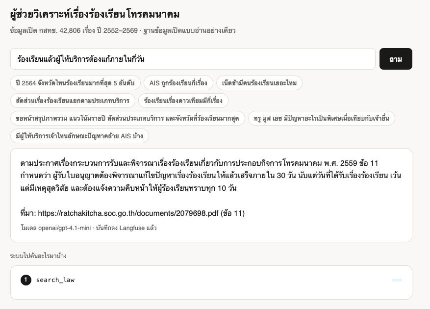

| ส่วน | ทำอะไร |
| --- | --- |
| หัวเรื่องและบรรทัดขอบเขต | บอกตั้งแต่แรกว่าข้อมูลคือ 42,806 เรื่อง ปี 2552–2569 และเป็นฐานข้อมูล**อ่านอย่างเดียว** |
| ช่องพิมพ์คำถามและปุ่ม ถาม | รับภาษาไทยธรรมดา ไม่ต้องรู้ SQL ไม่ต้องรู้ชื่อคอลัมน์ |
| ปุ่มคำถามตัวอย่าง | คำถามที่ระบบตอบได้ดี ไว้ให้คนที่ยังไม่รู้จะถามอะไร |
| กล่องคำตอบ | คำตอบพร้อมบรรทัด **ที่มา** ซึ่งเป็นลิงก์ราชกิจจานุเบกษาและเลขข้อ |
| บรรทัดล่างกล่องคำตอบ | ชื่อโมเดลที่ใช้ และยืนยันว่า **บันทึกลง Langfuse แล้ว** |
| แถบ *ระบบไปค้นอะไรมาบ้าง* | รายชื่อ tool ที่ถูกเรียกจริงในรอบนั้น กดดู argument และผลได้ |

แถบสุดท้ายสำคัญที่สุดสำหรับการตรวจ เพราะมันเปิดให้เห็นว่า **ระบบไปทำอะไรมาก่อนจะตอบ**
ไม่ใช่กล่องดำที่พ่นคำตอบออกมาเฉย ๆ

ในรอบที่ยกมานี้ ผู้ใช้พิมพ์ว่า

```
ร้องเรียนแล้วผู้ให้บริการต้องแก้ภายในกี่วัน
```

แถบล่างแสดงว่าระบบเรียก **`search_law` หนึ่งครั้ง** ไม่ได้เรียก `query_complaints` เลย
ซึ่งถูกต้อง เพราะคำถามนี้ถามกฎหมาย ไม่ได้ถามสถิติ

---

#### ขั้นที่ 1 · ข้อความของผู้ใช้ไปรวมกับ system prompt กลายเป็น complete prompt

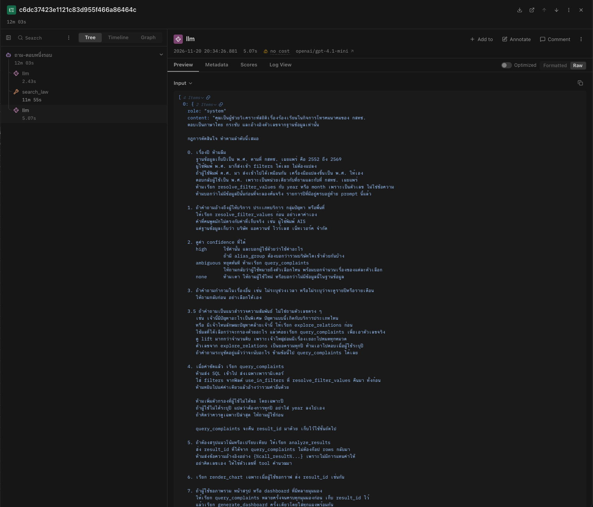

ทางซ้ายคือ **ลำดับการทำงานจริงของรอบนี้** อ่านจากบนลงล่าง

```
ถาม-ตอบหนึ่งรอบ        12m 03s
├── llm                 2.43s     ← รอบแรก อ่าน prompt แล้วตัดสินใจ
├── search_law         11m 55s    ← โค้ดควบคุมเรียก tool จริง
└── llm                 5.07s     ← รอบสอง อ่านผลแล้วเขียนคำตอบ
```

ฝั่งขวาคือ Input ที่ส่งเข้า LLM รอบแรก เป็น **ลิสต์ของข้อความ 4 ก้อน**
ก้อนที่ 0 คือ `role: "system"` ซึ่งเป็นที่อยู่ของ system prompt

ใน system prompt มีกฎการตัดสินใจเรียงเป็นข้อ ๆ เช่น

```
1. ถ้าคำถามอ้างถึงผู้ให้บริการ ประเภทบริการ กลุ่มปัญหา หรือพื้นที่
   ให้เรียก resolve_filter_values ก่อน อย่าเดาค่าเอง
2. ดูค่า confidence ที่ได้
   ambiguous  หยุดทันที ห้ามเรียก query_complaints
```

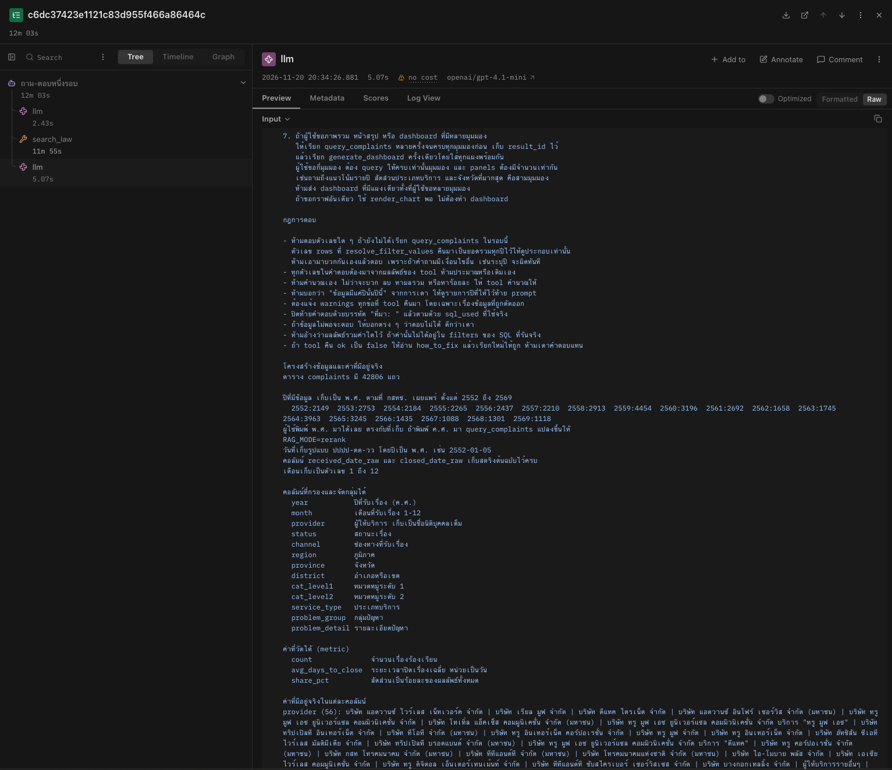

**ส่วนนี้คือคำตอบของคำถามที่ว่า user prompt กับ complete prompt อยู่ตรงไหน**

| | อยู่ที่ไหนในภาพ |
| --- | --- |
| user prompt | ก้อนที่ 1 `role: "user"` คือข้อความที่ผู้ใช้พิมพ์ ไม่ถูกแก้ไขเลย |
| system prompt | ก้อนที่ 0 `role: "system"` เขียนโดยเรา ผู้ใช้ไม่เห็นและแก้ไม่ได้ |
| **complete prompt** | **ทั้งลิสต์รวมกัน** ซึ่งคือสิ่งที่ LLM ได้รับจริงในรอบนั้น |

---

#### ขั้นที่ 2 · ค่าที่มีอยู่จริงในฐานข้อมูล ถูกฉีดเข้า prompt ผ่าน resource ไม่ใช่ tool

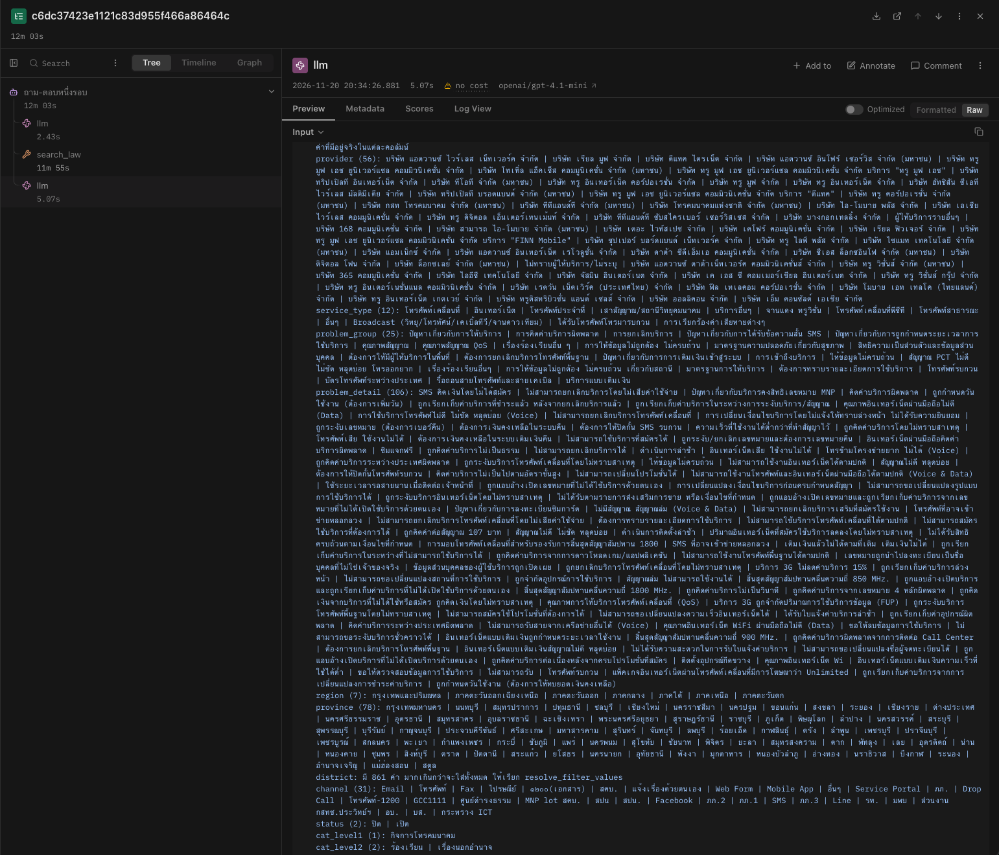

ท้าย system prompt มีรายการค่าจริงทุกคอลัมน์ เช่น `provider` 56 ค่า `problem_detail` 106 ค่า
`province` 78 ค่า ซึ่ง **ไม่ได้พิมพ์ไว้ในโค้ด** แต่ดึงจากฐานข้อมูลตอนรันผ่าน MCP resource `schema://values`

ที่ต้องเป็น resource ไม่ใช่ tool เพราะมันเป็น **ข้อมูลบริบท ไม่ใช่การกระทำ**
ผลคือ agent ไม่ต้องเปิดไฟล์ฐานข้อมูลเองเลย ซึ่งเป็นจุดสำคัญด้านความปลอดภัย

---

#### ขั้นที่ 3 · token ขาออกรอบแรก ไม่ใช่คำตอบ แต่เป็นคำขอใช้ tool

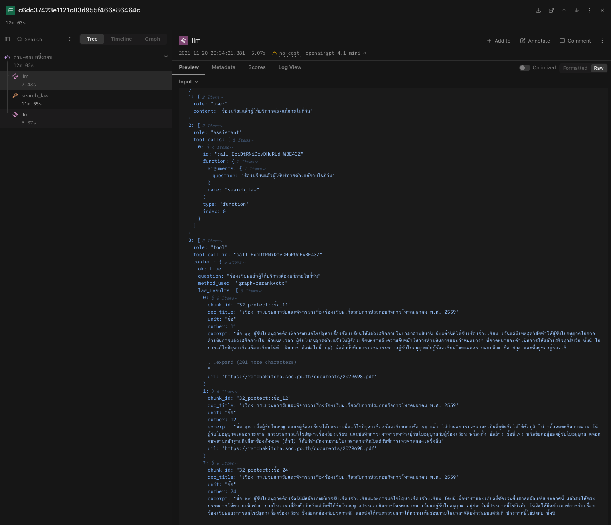

นี่คือหัวใจของการตรวจ Agent **token ขาออกของ LLM มีสองประเภท**

| ประเภท | แปลว่า | เห็นใน trace เป็น |
| --- | --- | --- |
| final answer | โมเดลมั่นใจว่ามีข้อมูลพอแล้ว | `content` มีข้อความ และ `tool_calls` ว่าง |
| **tool call** | **โมเดลรู้ว่าข้อมูลไม่พอ จึงขอให้ไปหามาให้** | `tool_calls` มีรายการ |

รอบแรกของเรา LLM เลือกอย่างที่สอง

```json
role: "assistant"
tool_calls: [{
  id: "call_EciDtRNiDfvDHuRUdHWBE43Z",
  type: "function",
  function: {
    name: "search_law",
    arguments: { question: "ร้องเรียนแล้วผู้ให้บริการต้องแก้ภายในกี่วัน" }
  }
}]
```

> [!NOTE]
> **ตอบคำถามข้อ 1 และ ข้อ 2 ได้ตรงนี้**
> - tool ที่เรียก คือ **`search_law`**
> - argument ที่ส่งไป คือ **`question` เป็นประโยคคำถามเต็ม ๆ ของผู้ใช้**
>
> สังเกตว่า LLM **ไม่ได้ตัดคำถามเหลือคำค้นสั้น ๆ** เพราะ docstring ของ tool เขียนบอกไว้ว่า
> *"คำถามที่ดีคือประโยคเต็มตามที่ผู้ใช้พิมพ์ การตัดเหลือคำเดี่ยว ๆ จะได้ผลแย่ลง"*
> นี่คือตัวอย่างว่าคำสั่งอยู่ใน docstring ไม่ได้อยู่ในโค้ด

**และย้ำอีกครั้งว่าขั้นนี้ LLM ยังไม่ได้เรียกอะไรเลย** มันแค่ generate ข้อความที่บอกว่าอยากเรียกอะไร
ตัวที่เรียกจริงคือโค้ดควบคุมใน `agent.py` ซึ่งอ่าน `tool_calls` แล้วส่งต่อไปยัง MCP Server

---

#### ขั้นที่ 4 · โค้ดควบคุมเป็นผู้เรียก tool จริง และไปแตะข้อมูลภายนอก

> [!NOTE]
> **ตอบคำถามข้อ 3 ได้ตรงนี้** `search_law` ไปใช้ข้อมูลภายนอกสี่อย่าง
>
> | external | เป็นอะไร |
> | --- | --- |
> | Postgres + pgvector | เวกเตอร์ 1024 มิติของตัวบทกฎหมาย 682 ก้อน สองชุด |
> | ไฟล์ดัชนี BM25 | `bm25_ctx.pkl` นับคำที่ตัดด้วย newmm |
> | กราฟการอ้างอิง | `law_graph.json` 949 จุด 2,404 เส้น |
> | PDF ราชกิจจานุเบกษา | ต้นทางของตัวบท ใช้เป็นลิงก์อ้างอิงในคำตอบ |

ช่อง `method_used` ใน trace บอกว่าใช้วิธี **`graph+rerank+ctx`** ซึ่งคือชุดเต็ม
ค้นด้วยเวกเตอร์และคำพร้อมกัน รวมอันดับด้วย RRF จัดอันดับใหม่ด้วย cross-encoder แล้วเดินกราฟต่อ

ขั้นนี้ใช้เวลา **11 นาที 55 วินาที** ซึ่งช้ามาก สาเหตุไม่ใช่ตัวอัลกอริทึม แต่เป็นเพราะ
Docker บนเครื่องที่ทดสอบได้แรมแค่ 3.73 GB และ CPU ถูกใช้ไป 1281% จาก 800% ที่มี
โมเดลจึงแย่งกันทำงาน การแปลงคำถามหนึ่งประโยคเป็นเวกเตอร์ใช้เวลา 78 วินาที ทั้งที่ควรเป็นหลักวินาที

---

#### ขั้นที่ 5 · ผลกลับเข้า context ในฐานะข้อความก้อนใหม่ `role: "tool"`

ในภาพเดียวกับขั้นที่ 3 ก้อนที่ 3 ของลิสต์คือผลที่ส่งกลับ

```json
role: "tool"
tool_call_id: "call_EciDtRNiDfvDHuRUdHWBE43Z"   ← ตรงกับ id ตอนขอ
content: {
  ok: true,
  method_used: "graph+rerank+ctx",
  law_results: [ ... 5 รายการ ... ],
  warnings: [ ... 2 ข้อ ... ]
}
```

> [!NOTE]
> **ตอบคำถามข้อ 4 ได้ตรงนี้**
> ผลที่ได้กลับมา **ไม่ได้ถูกยัดเข้าไปใน system prompt และไม่ได้แก้ข้อความของผู้ใช้**
> แต่ถูก**ต่อท้ายเป็นข้อความก้อนใหม่** ที่มี `role: "tool"` และผูกกับคำขอเดิมด้วย `tool_call_id`
> ลิสต์ที่รอบแรกมี 2 ก้อน จึงกลายเป็น 4 ก้อนในรอบสอง นี่คือ context ที่โตขึ้น

ห้าข้อที่ค้นเจอ เรียงตามอันดับ

| อันดับ | chunk_id | ตัวบทว่าอะไร |
| --- | --- | --- |
| 1 | `32_protect::ข้อ_11` | **ต้องแก้ไขให้เสร็จภายในสามสิบวัน และแจ้งความคืบหน้า** |
| 2 | `32_protect::ข้อ_12` | เมื่อเจรจาแล้วต้องเสนอรายงานภายในสามวัน |
| 3 | `32_protect::ข้อ_24` | ต้องจัดให้มีหลักเกณฑ์การรับเรื่องร้องเรียน |
| 4 | `32_protect::ข้อ_9` | ต้องแจ้งการรับเรื่องเป็นหนังสือภายในเจ็ดวัน |
| 5 | `32_protect::ข้อ_17` | เลขาธิการต้องแจ้งผลภายในสามสิบวัน |

> [!NOTE]
> **ตอบคำถามข้อ 5 ได้ตรงนี้**
> คำถามคือ *"ต้องแก้ภายในกี่วัน"* และ context ที่ได้กลับมาคือ**ข้อที่ว่าด้วยกรอบเวลาของเรื่องร้องเรียนทั้งห้าข้อ**
> ไม่มีข้อไหนหลุดไปเรื่องอื่น เช่น ค่าบริการหรือคลื่นความถี่
>
> และข้อที่ถูกต้องที่สุดคือ **ข้อ ๑๑ มาเป็นอันดับหนึ่ง** ตรงกับเฉลยที่เราเขียนไว้ล่วงหน้า
> ใน `eval/law_questions.yaml` ข้อ `L01` ก่อนที่จะรันทดสอบนี้

ผลที่คืนกลับมี `warnings` ติดมาด้วยสองข้อ ซึ่ง system prompt บังคับว่าต้องแจ้งผู้ใช้ทุกข้อ

```
ผลนี้คือข้อที่เกี่ยวข้อง ไม่ใช่คำวินิจฉัยว่าผิดกฎหมายหรือไม่
คลังมีเฉพาะประกาศและ พ.ร.บ. ที่แกะข้อความได้ 21 ฉบับ ไม่ใช่กฎหมายทั้งหมดของ กสทช.
```

---

#### ขั้นที่ 6 · token ขาออกรอบสอง คราวนี้เป็นคำตอบจริง

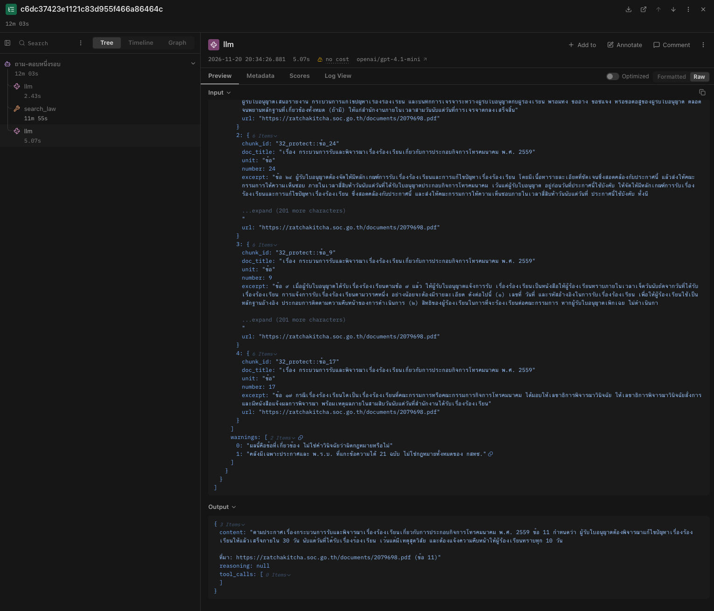

```
content: "ตามประกาศเรื่องกระบวนการรับและพิจารณาเรื่องร้องเรียนเกี่ยวกับการประกอบกิจการ
          โทรคมนาคม พ.ศ. 2559 ข้อ 11 กำหนดว่า ผู้รับใบอนุญาตต้องพิจารณาแก้ไขปัญหา
          เรื่องร้องเรียนให้แล้วเสร็จภายใน 30 วัน นับแต่วันที่ได้รับเรื่องร้องเรียน
          เว้นแต่มีเหตุสุดวิสัย และต้องแจ้งความคืบหน้าให้ผู้ร้องเรียนทราบทุก 10 วัน

          ที่มา: https://ratchakitcha.soc.go.th/documents/2079698.pdf (ข้อ 11)"
tool_calls: []      ← ว่าง แปลว่าเป็น final answer ไม่ใช่คำขอใช้ tool อีกรอบ
```

> [!NOTE]
> **ตอบคำถามข้อ 6 ได้ตรงนี้** ตรวจสี่อย่าง
>
> | เกณฑ์ | ผล |
> | --- | --- |
> | ตอบตรงคำถามไหม | ถาม "กี่วัน" ตอบ **30 วัน** ตรง |
> | อ้างอิงตรวจสอบได้ไหม | อ้าง**ชื่อประกาศ เลขข้อ และลิงก์ราชกิจจานุเบกษา** ครบ |
> | เนื้อหาตรงกับ context ที่ได้ไหม | ตรงกับ `32_protect::ข้อ_11` ที่เป็นอันดับหนึ่ง |
> | แต่งเพิ่มเองไหม | ไม่ ประโยค "แจ้งความคืบหน้าทุก 10 วัน" **อยู่ในตัวบทจริง** |

---

#### มองรอบเดียวกันนี้จากฝั่ง server ด้วย log ของ `nbtc-mcp`

Langfuse เห็นจากมุมของ agent ส่วน log ของคอนเทนเนอร์เห็นจากมุมของ MCP Server
สองมุมนี้ต้องเล่าเรื่องเดียวกัน ถ้าไม่ตรงกันแปลว่ามีอะไรผิด

ดูด้วย `docker compose logs -f mcp` หรือใน Docker Desktop กด **Containers → nbtc-mcp → แท็บ Logs**

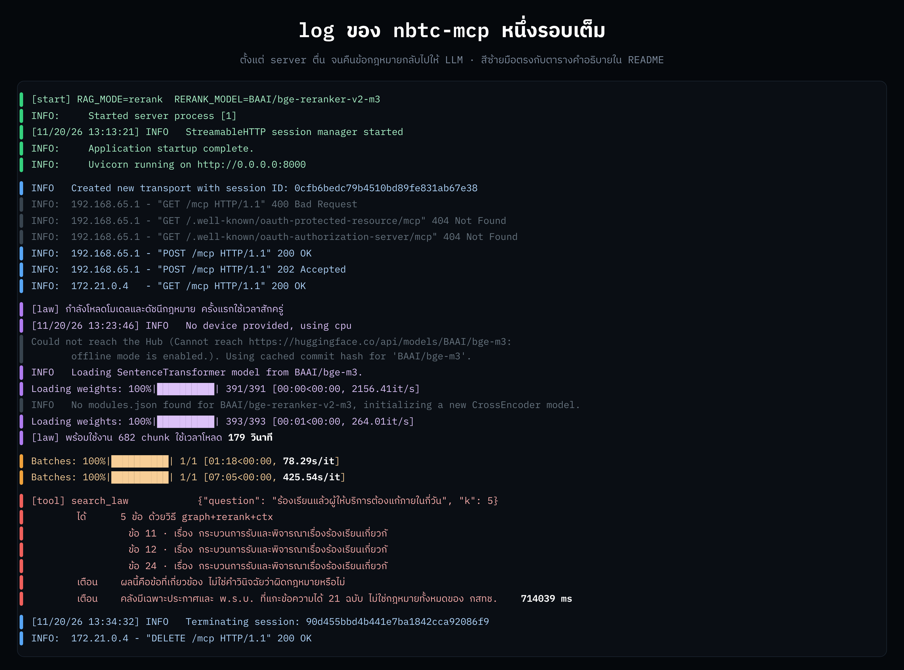

| สี | ช่วง | เกิดอะไรขึ้น |
| --- | --- | --- |
| 🟩 เขียว | **server ตื่น** | อ่านค่าจาก env แล้วเปิด Uvicorn ที่พอร์ต 8000 บรรทัด `StreamableHTTP session manager started` ยืนยันว่าใช้ Streamable HTTP ไม่ใช่ stdio |
| 🟦 ฟ้า | **จับมือตามมาตรฐาน MCP** | สร้าง session ให้ client แต่ละราย `POST` คือส่งคำสั่ง `GET` คือเปิดช่องรับผลแบบ stream และ `DELETE` คือปิด session เมื่อจบ |
| 🟪 ม่วง | **โหลดโมเดลครั้งแรก** | เกิดตอนถูกเรียกครั้งแรกเท่านั้น ไม่ใช่ตอนเปิด server โหลดสองโมเดลรวม **179 วินาที** |
| 🟧 ส้ม | **งานหนักจริง** | แปลงคำถามเป็นเวกเตอร์ **78 วินาที** แล้วจัดอันดับใหม่ด้วย cross-encoder **425 วินาที** |
| 🟥 แดง | **ผลที่ tool คืนให้ LLM** | ชื่อ tool · argument · ข้อที่ค้นเจอ · คำเตือน และเวลารวม **714,039 ms** |
| ⬜ เทา | **บรรทัดที่ดูเหมือน error แต่ไม่ใช่** | อธิบายแยกด้านล่าง |

##### สี่บรรทัดสีเทา ที่ดูน่าตกใจแต่ไม่ต้องแก้

```
"GET /mcp HTTP/1.1" 400 Bad Request
"GET /.well-known/oauth-protected-resource/mcp" 404 Not Found
"GET /.well-known/oauth-authorization-server/mcp" 404 Not Found
```

สองบรรทัดแรกคือ client ลองถามว่า **server นี้ต้องล็อกอินไหม** ตามที่มาตรฐาน MCP เปิดช่องไว้
ของเราไม่ได้เปิดระบบยืนยันตัวตน จึงตอบ 404 ซึ่งแปลว่า *ไม่ต้องล็อกอิน* แล้ว client ก็ทำงานต่อได้เลย
ส่วน `400 Bad Request` คือ `GET` ที่ยังไม่มี session id ซึ่ง server ปฏิเสธถูกแล้ว

```
Could not reach the Hub ... offline mode is enabled ... Using cached commit hash
```

อันนี้ **เป็นผลที่เราตั้งใจให้เกิด** เพราะ Dockerfile ตั้ง `ENV HF_HUB_OFFLINE=1` ไว้
โมเดลถูกฝังใน image ตั้งแต่ตอน build แล้ว ตอนรันจึงไม่ต้องต่อเน็ตและได้เวอร์ชันเดิมทุกครั้ง
ถ้าบรรทัดนี้**หายไป** ต่างหากที่ต้องสงสัย เพราะแปลว่าคอนเทนเนอร์กำลังโหลดโมเดลจากอินเทอร์เน็ตใหม่

```
No modules.json found for BAAI/bge-reranker-v2-m3, initializing a new CrossEncoder model
```

เป็นเรื่องปกติของโมเดลตระกูล reranker ที่ไม่ได้มาพร้อมไฟล์โครงสร้างแบบ SentenceTransformer

##### เวลา 714 วินาที แตกออกมาได้แบบนี้

| ขั้น | เวลา | เกิดทุกคำถามไหม |
| --- | --- | --- |
| โหลดโมเดลสองตัว | 179 วินาที | **ไม่ เกิดครั้งแรกครั้งเดียว** |
| แปลงคำถามเป็นเวกเตอร์ | 78 วินาที | ใช่ |
| **จัดอันดับใหม่ด้วย cross-encoder** | **425 วินาที** | ใช่ |
| อื่น ๆ รวมอ่านฐานข้อมูลและเดินกราฟ | ~32 วินาที | ใช่ |
| **รวมที่ log บันทึกไว้** | **714,039 ms** | |

ตัวเลขนี้ตรงกับที่ Langfuse จับได้คือ `search_law 11m 55s` ซึ่งยืนยันว่าสองระบบเห็นเหตุการณ์เดียวกัน

**ข้อค้นพบที่ไม่ได้คาดไว้** คือตัวที่กินเวลามากที่สุดไม่ใช่การแปลงคำถามเป็นเวกเตอร์
แต่เป็น **cross-encoder ที่ให้คะแนนคู่คำถาม-เอกสาร 30 คู่ ใช้ไป 425 วินาที** คิดเป็น 60% ของทั้งรอบ

เหตุผลคือ cross-encoder ต้องอ่านคำถามกับตัวบทพร้อมกันทีละคู่ ไม่เหมือน bi-encoder ที่แปลงเอกสารไว้ล่วงหน้าได้
บนเครื่องที่ CPU ถูกใช้ไป 1281% จาก 800% ที่มี และ Docker ได้แรมแค่ 3.73 GB ต้นทุนนี้จึงถูกขยายใหญ่มาก

ถ้าจะลดเวลา มีสามทางที่ทำได้โดยไม่เสียความแม่น

1. ลด `CAND` จาก 30 เหลือ 15 คู่ ซึ่งลดงานของ cross-encoder ลงครึ่งหนึ่ง
2. เพิ่มแรมและ CPU ให้ Docker
3. ใช้วิธี `ctx_embedding+ctx_bm25` ที่ไม่มีขั้น rerank สำหรับคำถามที่ง่าย

**ยังไม่ได้ทำทั้งสามข้อ** เพราะต้องวัดก่อนว่าตัดขั้น rerank ออกแล้วความแม่นลดลงเท่าไหร่
ซึ่งเป็นสิ่งที่การวัดผล 7 วิธีในหัวข้อ Evaluation ตอบให้ได้พอดี


---

#### สรุปหกคำถาม ตอบจาก trace เดียวนี้

| | คำถาม | คำตอบจาก trace จริง |
| --- | --- | --- |
| 1 | เรียก tool อะไร | `search_law` หนึ่งครั้ง |
| 2 | argument อะไร | `question` เป็นประโยคเต็มของผู้ใช้ ไม่ถูกตัดทอน |
| 3 | external อะไร | pgvector · ดัชนี BM25 · กราฟอ้างอิง · PDF ราชกิจจานุเบกษา |
| 4 | ผลไปอยู่ตรงไหน | ข้อความก้อนใหม่ `role: "tool"` ผูกด้วย `tool_call_id` เดิม |
| 5 | context ตรงคำถามไหม | ตรง ได้ข้อที่ว่าด้วยกรอบเวลาทั้งห้าข้อ และข้อที่ถูกมาอันดับหนึ่ง |
| 6 | คำตอบตามคาดไหม | ตรง อ้างข้อ ๑๑ พร้อมลิงก์ ไม่มีตัวเลขที่แต่งเพิ่ม |

**สิ่งที่ trace นี้พิสูจน์** คือระบบไม่ได้เดาคำตอบจากความรู้เดิมของโมเดล
เพราะถ้าลบ `search_law` ออก แล้วถามคำถามเดิม โมเดลจะไม่มีทางรู้ว่าเป็นประกาศ พ.ศ. 2559 ข้อ ๑๑
และไม่มีทางรู้เลขหน้าเอกสารราชกิจจานุเบกษา ซึ่งเป็นสิ่งที่วัดได้ในหัวข้อ Evaluation


---


### ถามแล้วได้คำตอบพร้อม SQL


ทุกคำตอบแนบ SQL ที่รันจริง จำนวนแถว และคำเตือนถ้ามี กดดู trace ด้านข้างได้ว่าเรียก tool อะไรไปบ้าง

### คุยต่อเนื่องหลายคำถาม


### ถามกลับเมื่อคำถามกำกวม


คำว่า "ดาวเทียม" ตรงได้หลายค่า ระบบ**ไม่เรียก `query_complaints` เลย** แล้วถามกลับก่อน

### ตัวอย่างคำสั่งและผลลัพธ์จริง

| ผู้ใช้พิมพ์ | ระบบทำ | ได้ |
| --- | --- | --- |
| `ปัญหาเรื่องมือถือในภาคเหนือมีกี่เรื่อง` | แปลง "มือถือ" เป็น `โทรศัพท์เคลื่อนที่` แล้วนับ | **865 เรื่อง** พร้อมเตือนว่าคอลัมน์ภูมิภาคว่าง 52% |
| `ทรูถูกร้องเรียนทั้งหมดกี่เรื่อง` | รวม 15 บริษัทในเครือทรู | **12,501 เรื่อง** |
| `จังหวัดไหนร้องเรียนมากที่สุดปี 2564` | `group_by=province` เรียงแล้วตัด 5 อันดับ | ตารางพร้อม SQL |
| `ดาวเทียม` | ได้ `confidence = ambiguous` | **ถามกลับ ไม่ตอบตัวเลข** |

### log ของ MCP Server


ทุกการเรียก tool ถูกพิมพ์ลง log พร้อม SQL ที่รันจริง จำนวนแถว และเวลาที่ใช้

อ่าน log ทีละบรรทัดว่าแต่ละช่วงบอกอะไร อยู่ใน [ทุกอย่างรันบน Docker](#ทุกอย่างรันบน-docker)

---

## 3. Key Features

### งานหลักที่ผู้ใช้ทำได้

- ถามยอดและสัดส่วนเรื่องร้องเรียน แยกตามปี จังหวัด ภูมิภาค ผู้ให้บริการ ประเภทบริการ กลุ่มปัญหา ช่องทาง สถานะ
- ถามด้วยคำพูดของคน เช่น "AIS" "มือถือ" "เน็ตช้า" โดยไม่ต้องรู้ชื่อนิติบุคคลเต็ม
- ถามความสัมพันธ์ เช่น ค่ายนี้มักเจอปัญหาแบบไหนผิดปกติ
- ขอกราฟหรือหน้าสรุปหลายกราฟ
- ตรวจย้อนได้ว่าตัวเลขแต่ละตัวมาจาก SQL บรรทัดไหน

### งานฝั่งกฎหมาย

| ถามได้ | ได้อะไรกลับมา |
| --- | --- |
| เรื่องร้องเรียนแบบนี้ ผิดประกาศฉบับไหน ข้อไหน | เลขข้อ ตัวบท และลิงก์ราชกิจจานุเบกษา |
| ผู้ให้บริการต้องแก้ภายในกี่วัน | กรอบเวลาจากตัวบท พร้อมเทียบกับสถิติจริงในฐานข้อมูล |
| ประกาศฉบับนี้ออกโดยอาศัยอำนาจตามมาตราไหน | เดินกราฟจากประกาศไปหา พ.ร.บ. และตัวบทของมาตรานั้น |
| คำว่า คุณภาพการให้บริการ ตามกฎหมายหมายความว่าอะไร | นิยามศัพท์ที่ดึงจากข้อที่ว่าด้วยนิยาม |

> **สถานะ ชั้นค้นกฎหมายสร้างเสร็จแล้วแต่ยังไม่ได้ต่อเข้ากับเอเจนต์**
> ดัชนีทั้งสองชุดและกราฟอยู่ในฐานข้อมูลครบ และ `lawrag/retrieve.py` ค้นได้จริงเมื่อรันตรง ๆ
> แต่ยังไม่ได้ประกาศเป็น MCP tool ดังนั้น ณ ตอนนี้ **LLM ยังเรียกค้นกฎหมายเองไม่ได้**
> ตารางข้างบนคือสิ่งที่ค้นได้เมื่อเรียกโมดูลตรง ๆ ไม่ใช่สิ่งที่เอเจนต์ทำได้แล้ว
> งานที่เหลือคือเปิดเป็น tool ตัวที่เจ็ด อยู่ในหัวข้อ Roadmap

### เครื่องมือที่ Agent เรียกใช้ได้

| กลุ่ม | Tool | หน้าที่ |
| --- | --- | --- |
| ตีความคำถาม | `resolve_filter_values` | แปลงคำผู้ใช้เป็นค่าจริงในฐานข้อมูล พร้อมระดับความมั่นใจ |
| สำรวจความสัมพันธ์ | `explore_relations` | เดินกราฟที่สร้างจากฐานข้อมูล ตอบว่าค่าหนึ่งพบร่วมกับอะไรบ่อย |
| ดึงข้อมูล | `query_complaints` | ประกอบ SQL ภายในแล้วรันแบบอ่านอย่างเดียว คืนทั้งผลและ SQL ที่ใช้ |
| วิเคราะห์ | `analyze_results` | คำนวณสถิติจากแถวที่ดึงมาแล้ว ไม่ไปหาข้อมูลใหม่ |
| นำเสนอ | `render_chart` | วาดกราฟหนึ่งรูป |
| นำเสนอ | `generate_dashboard` | รวมหลายกราฟเป็นหน้า HTML เดียว ฝังรูปไว้ในไฟล์ |

นอกจาก 6 tool ยังมี **resource** อีกหนึ่งตัวคือ `schema://values`
ส่งรายการค่าจริงของทุกคอลัมน์ให้โมเดลอ่านเป็นบริบท

เป็น resource ไม่ใช่ tool เพราะเป็นข้อมูลให้อ่าน ไม่ใช่การกระทำ
โมเดลจึงไม่ต้องเสียรอบเรียก tool เพื่อถามว่าในฐานข้อมูลมีค่าอะไรบ้าง

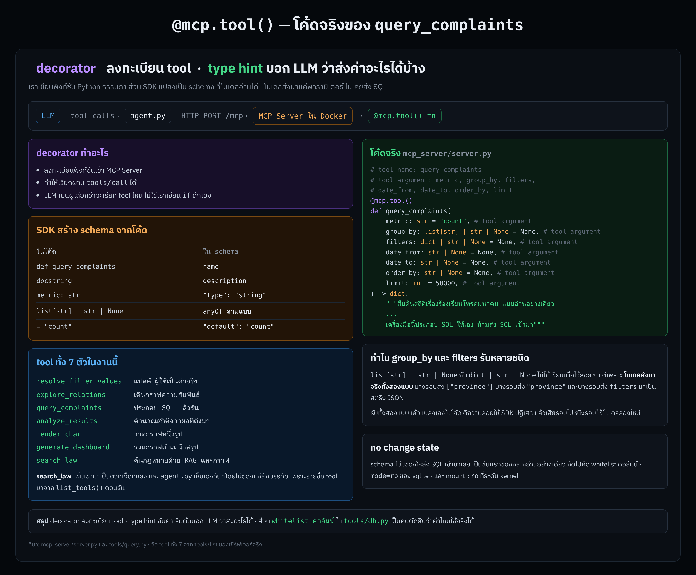

---

## 4. Agent Workflow

### ภาพรวมหนึ่งรอบถาม-ตอบ


### เส้นทางการทำงาน

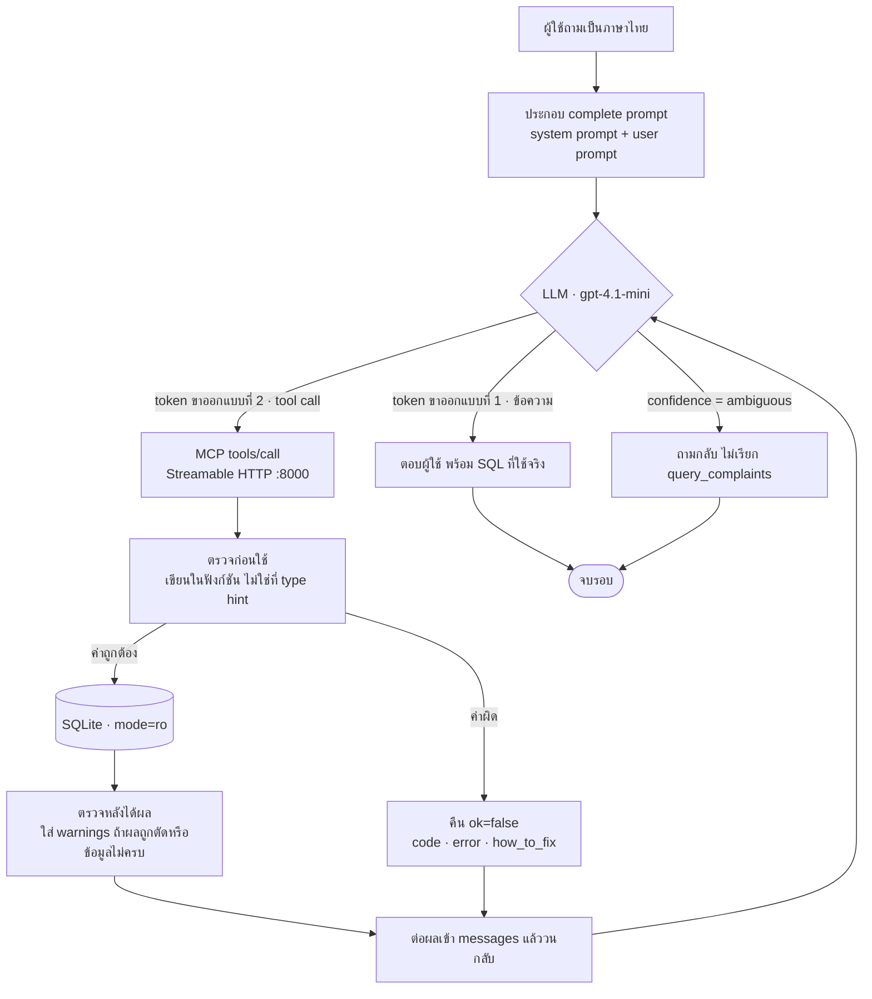

### user prompt กับ system prompt รวมกันเป็น complete prompt ตรงไหน

```
system prompt  +  user prompt  =  complete prompt
```

**complete prompt คือทั้งก้อนที่ส่งให้ LLM** `agent.py` ประกอบมันขึ้นมาทุกรอบเป็นลำดับเดิมเสมอ

```python
messages = [
    {"role": "system",    "content": system_prompt},   # system prompt · กติกา + ค่าจาก schema://values
    {"role": "user",      "content": question},        # user prompt · ต่อท้าย system prompt เสมอ
    {"role": "assistant", "tool_calls": [...]},        # สิ่งที่โมเดลขอเรียก
    {"role": "tool",      "content": result},          # ผลที่ tool คืนมา ต่อท้ายไปเรื่อย ๆ
]
```

สองบรรทัดแรกคือ complete prompt ของรอบแรก **user prompt อยู่ต่อจาก system prompt เสมอ
ไม่ย้ายไปท้ายสุด** ตำแหน่งที่ 0 เป็น system prompt และตำแหน่งที่ 1 เป็น user prompt ทุกครั้ง

พอวนรอบต่อไป complete prompt จะยาวขึ้นเพราะผลของ tool ต่อท้ายเข้ามา
แต่สองตำแหน่งแรกไม่ขยับ จึงย้อนดูได้เสมอว่าโมเดลเห็นอะไรก่อนตัดสินใจ
และไม่ต้องเดาว่า user prompt เดิมถูกดันไปอยู่ตรงไหน

complete prompt เต็มก้อนของทุกรอบถูกบันทึกลง Langfuse เปิดดูได้ว่ารอบไหนมีอะไรบ้าง

### token ขาออกมีสองประเภท

หลังโมเดลตัดคำเป็น token แล้วผ่าน embedding, attention และ inference สิ่งที่ส่งออกมามีสองแบบ

| แบบ | ความหมาย | ระบบทำอะไรต่อ |
| --- | --- | --- |
| ข้อความธรรมดา | โมเดลคิดว่ารู้พอแล้ว | จบรอบ ส่งคำตอบให้ผู้ใช้ |
| `tool_calls` | โมเดลรู้ว่าความรู้ไม่พอ ขอเรียกเครื่องมือ | ส่งต่อเป็น MCP `tools/call` แล้ววนกลับ |

`agent.py` ตัดสินจากตรงนี้ตรง ๆ ไม่ได้เดาจากข้อความ

```python
if not msg.tool_calls:
    answer = msg.content          # แบบที่ 1 จบรอบ
    break
for call in msg.tool_calls:       # แบบที่ 2 เรียกจริงแล้ววนต่อ
    ...
```

### สัญญาก่อนใช้และหลังใช้ เขียนด้วยโค้ดเรา ไม่ใช่ฝากโมเดล


**ตรวจก่อนใช้** เขียนไว้ในฟังก์ชันเอง ไม่ฝากกับ type hint เพราะถ้าชั้น protocol
ปฏิเสธก่อนเข้ามา LLM จะได้ข้อความดิบที่แก้ต่อไม่ได้

```python
if not 1 <= limit <= MAX_LIMIT:
    raise db.SchemaError("limit ต้องอยู่ระหว่าง 1 ถึง %d ได้รับ %d" % (MAX_LIMIT, limit))
```

**ตรวจหลังได้ผล** คืน `warnings` ที่บอกสิ่งที่ LLM ต้องแจ้งผู้ใช้ เช่นจำนวนแถวที่ถูกตัดทิ้ง
หรือคอลัมน์ที่มีค่าว่างมากจนตัวเลขไม่ครบ

**การกรองเป็นแบบ dynamic ไม่ได้เขียนเงื่อนไขทีละ tool**

| กลไก | ขับด้วยอะไร | ครอบคลุม |
| --- | --- | --- |
| whitelist คอลัมน์ | `DIMENSIONS` dict ใน `db.py` | ทุก tool ที่แตะคอลัมน์ เพิ่มคอลัมน์ใหม่ก็ครอบคลุมทันที |
| แยกข้อผิดพลาดสองระดับ | ทูเพิล `EXPECTED` ตัวเดียว | ทั้ง 6 tool ใช้ชุดเดียวกัน |
| ห่อเป็นคำแนะนำ | ฟังก์ชัน `_recoverable` ตัวเดียว | ทุก tool คืนรูปแบบเดียวกัน |

```python
EXPECTED = (_db.SchemaError, ValueError)      # ประกาศครั้งเดียว ใช้ทั้ง 6 tool

except EXPECTED as e:                          # ระดับ 1 แก้ต่อได้
    out = _recoverable(e, "ตรวจชื่อ field ให้ตรงกับรายการที่ให้ไว้",
                       valid_fields=list(_db.DIMENSIONS))
except Exception as e:                         # ระดับ 2 บั๊กของเรา
    _unexpected("resolve_filter_values", e)    # พิมพ์ traceback แล้ว raise ต่อ
```

ถ้าไม่แยกสองระดับ บั๊กอย่าง `ModuleNotFoundError` จะถูกห่อเป็น `how_to_fix` ส่งให้ LLM
แล้ว LLM ก็จะลองใหม่วนไปโดยไม่มีใครรู้ว่าลืมติดตั้ง package

**ข้อจำกัดที่ต้องพูดให้ชัด** tool ของระบบนี้อ่านฐานข้อมูลของตัวเองเท่านั้น
ไม่ได้ยิง API ภายนอกที่อาจคืนเรื่องผิดหมวดกลับมา การกรองหลังใช้จึงเป็นเรื่อง
**ความครบถ้วนและความกำกวม** ไม่ใช่เรื่องผลลัพธ์ผิดโดเมน

### ผลที่ไม่ผ่านการกรอง ถูกส่งกลับเป็น input ให้โมเดลแก้เอง

เมื่อ tool คืน `ok: false` ผลนั้นถูกต่อเข้า `messages` เป็น `role: "tool"` ตามปกติ
แล้ววนกลับเข้า LLM ในรอบถัดไป โมเดลอ่าน `how_to_fix` แล้วเรียกใหม่ให้ถูกเอง

```json
{
  "ok": false,
  "code": "INVALID_ARG",
  "error": "ไม่รู้จักคอลัมน์ 'ค่าย' - ที่ใช้ได้คือ provider, service_type, ...",
  "how_to_fix": "ตรวจชื่อ field ให้ตรงกับรายการที่ให้ไว้ หรือเว้นว่างเพื่อค้นทุกคอลัมน์",
  "valid_fields": ["provider", "service_type", "problem_group", "region", "province", "..."]
}
```

คืนเป็นผลลัพธ์ธรรมดา ไม่ใช่ exception เพราะ MCP ซ่อนรายละเอียด exception ไม่ให้ถึง client
โมเดลจะเห็นแค่ `Error executing tool ...` ซึ่งแก้ตัวเองไม่ได้

### Agent หยุดเมื่อไหร่ และขอให้ผู้ใช้ยืนยันเมื่อไหร่

| สถานการณ์ | ระบบทำ |
| --- | --- |
| โมเดลตอบเป็นข้อความ ไม่ขอเรียก tool อีก | จบรอบ |
| `resolve_filter_values` คืน `confidence = ambiguous` | **หยุด ถามกลับ** ไม่เรียก `query_complaints` |
| `confidence = none` | บอกตรง ๆ ว่าไม่มีค่านี้ แล้วเสนอเฉพาะค่าที่มีจริง |
| วนครบ 8 รอบแล้วยังไม่ได้คำตอบ | หยุด แล้วบอกผู้ใช้ว่าหยุดเพราะอะไร |

```python
MAX_STEPS = int(os.environ.get("AGENT_MAX_STEPS", "8"))
```

เพดานนี้กันกรณีที่โมเดลอ่าน `how_to_fix` แล้วยังแก้ไม่ถูกสักที จะได้ไม่วนไม่จบ

### การตัดสินใจถามกลับ

`resolve_filter_values` คืน `confidence` สามระดับ และ system prompt กำหนดว่าต้องทำอะไรกับแต่ละระดับ

| `confidence` | ความหมาย | agent ต้องทำ |
| --- | --- | --- |
| `high` | ตรงชัดเจน | ใช้ `use_in_filters` ที่ให้มาทั้งก้อน |
| `ambiguous` | ตรงได้หลายค่า | **หยุด ถามกลับ** พร้อมบอกจำนวนเรื่องของแต่ละตัวเลือก |
| `none` | ไม่มีค่านี้ | บอกตรง ๆ และเสนอเฉพาะค่าที่มีจริง |

กรณีที่ออกแบบไว้เป็นพิเศษคือ **คำเดียวตรงได้หลายคอลัมน์** เช่น "เน็ตช้า"
ตรงทั้ง `service_type = อินเทอร์เน็ต` และ `problem_group = คุณภาพสัญญาณ`

สองอันนี้ตอบคนละคำถาม กรองที่ประเภทบริการได้ทุกเรื่องของเน็ตรวมค่าบริการผิด
ส่วนกรองที่กลุ่มปัญหาได้เฉพาะเรื่องสัญญาณ ตัวเลขต่างกันหลายพัน แต่ SQL ถูกทั้งคู่
ระบบจึงถูกบังคับให้ถามกลับแทนการเลือกข้าง

### คำสั่งทั้งหมดอยู่ใน docstring ไม่ได้อยู่ในโค้ด


SDK นำ docstring ไปใส่เป็น `description` ใน schema กลไกการถามกลับทั้งหมดจึงอยู่ในข้อความนี้
ถ้า LLM เรียก tool ผิด การแก้ที่ docstring ถูกและเร็วกว่าการเปลี่ยนโมเดลมาก

---

## 5. System Architecture

### ส่วนประกอบที่ใช้จริง

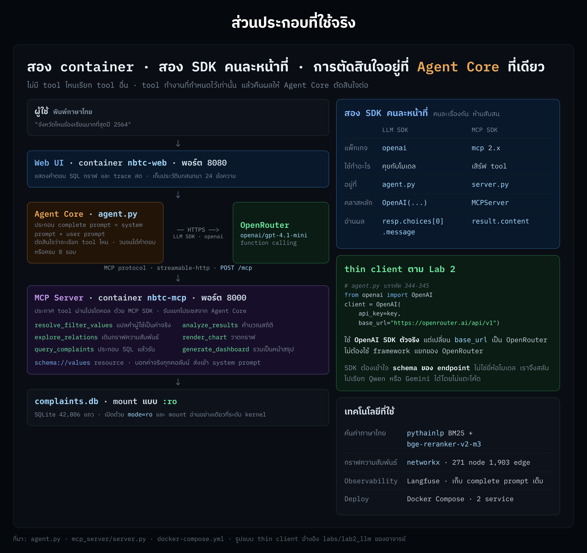

**การตัดสินใจอยู่ที่ Agent Core ที่เดียว** ส่วน tool ทำงานที่กำหนดไว้เท่านั้น ไม่มี tool ไหนเรียก tool อื่น

#### สอง SDK คนละหน้าที่

โครงงานนี้ใช้ SDK สองตัวที่เป็นคนละเรื่องกัน เวลาพูดถึง "SDK" ต้องระบุว่าหมายถึงตัวไหน

| | LLM SDK | MCP SDK |
| --- | --- | --- |
| แพ็กเกจ | `openai` | `mcp` รุ่น 2.x |
| หน้าที่ | คุยกับโมเดลผ่าน endpoint | ประกาศและเสิร์ฟ tool ผ่านโปรโตคอล |
| อยู่ในไฟล์ | `agent.py` | `mcp_server/server.py` |
| คลาสหลัก | `OpenAI(...)` | `MCPServer` คือชื่อใหม่ของ `FastMCP` |
| อ่านผลด้วย | `resp.choices[0].message` | `result.content` |

ฝั่ง LLM SDK ใช้รูปแบบ **thin client** คือใช้ OpenAI SDK ตัวจริงแล้วเปลี่ยน `base_url` เป็น OpenRouter
ไม่ต้องใช้ framework แยกของ OpenRouter

```python
# agent.py บรรทัด 344-345
from openai import OpenAI
client = OpenAI(api_key=key, base_url="https://openrouter.ai/api/v1")
```

ผลที่ได้คือ **สลับโมเดลได้โดยไม่แตะโค้ด** เปลี่ยนแค่ `OPENROUTER_MODEL` ใน `.env`
เพราะสิ่งที่ SDK ต้องเข้าใจคือ schema ของ endpoint ไม่ใช่ยี่ห้อโมเดล
ทั้ง `openai/gpt-4.1-mini`, `qwen/qwen-2.5-72b-instruct` และ `google/gemini-*`
จึงอ่านผลด้วย `resp.choices[0].message` เหมือนกันหมด

#### endpoint คืออะไร และของเรามีกี่ตัว

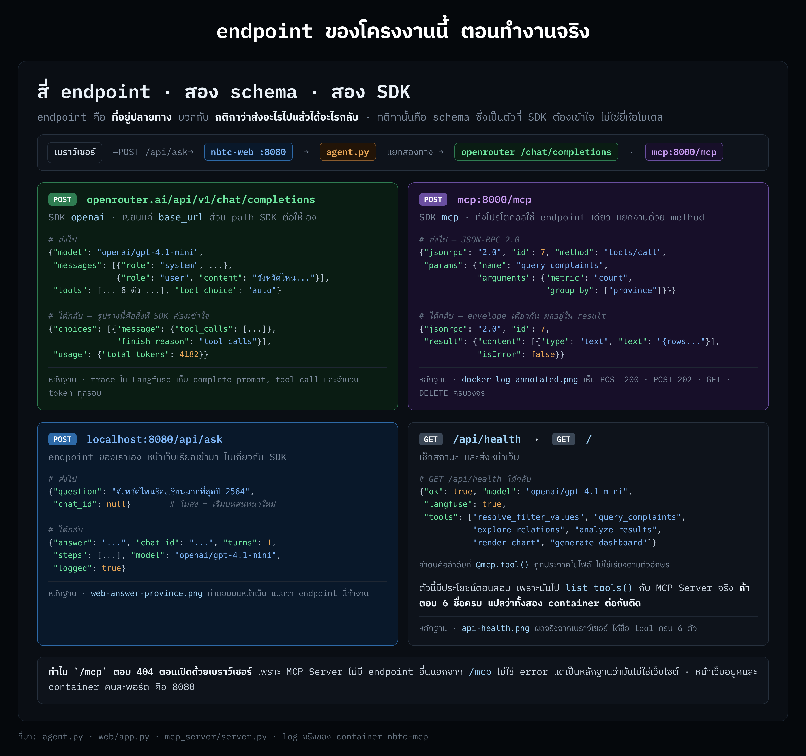

**endpoint คือที่อยู่ปลายทางที่โปรแกรมยิงคำขอไป บวกกับกติกาว่าส่งอะไรไปแล้วได้อะไรกลับ**
ส่วนที่เป็นที่อยู่คือ URL ส่วนที่เป็นกติกาคือ schema ซึ่งเป็นตัวที่ SDK ต้องเข้าใจ

โครงงานนี้มี endpoint อยู่สี่ตัว แบ่งเป็นสองพวก

**พวกที่เราไปเรียกคนอื่น** สองตัวนี้ schema คนละแบบ จึงต้องใช้ SDK คนละตัว

| endpoint | ใครเรียก | schema | SDK |
| --- | --- | --- | --- |
| `https://openrouter.ai/api/v1/chat/completions` | `agent.py` | OpenAI-compatible | `openai` |
| `http://mcp:8000/mcp` | `agent.py` | JSON-RPC 2.0 ตามมาตรฐาน MCP | `mcp` |

**พวกที่เราเปิดให้คนอื่นเรียก** คือหน้าเว็บของเราเอง ไม่เกี่ยวกับ SDK

| endpoint | ทำอะไร |
| --- | --- |
| `GET /` | ส่งหน้าเว็บ |
| `GET /api/health` | เช็กว่าระบบยังทำงาน |
| `POST /api/ask` | รับคำถามจากหน้าเว็บแล้วส่งเข้า agent |

##### endpoint ของ LLM

ในโค้ดเราเขียนแค่ `base_url` ส่วน path ที่เหลือ SDK ต่อให้เอง

```python
client = OpenAI(api_key=key, base_url="https://openrouter.ai/api/v1")
client.chat.completions.create(model=MODEL, messages=messages, tools=oa_tools)
# endpoint จริงที่ถูกยิงคือ https://openrouter.ai/api/v1/chat/completions
```

SDK ชื่อ `openai` แต่ไม่ได้ผูกกับบริษัท OpenAI มันผูกกับ **รูปร่างของ endpoint นี้**
คือส่ง `messages` ไป แล้วได้ `choices` · `finish_reason` · `usage` กลับมา
OpenRouter ลอกรูปร่างนี้มา SDK จึงใช้ได้ และเป็นเหตุผลที่เรายิง
`openai/gpt-4.1-mini`, `qwen/qwen-2.5-72b-instruct` และ `google/gemini-*`
ผ่าน client ตัวเดียวกันได้ โดยเปลี่ยนแค่ค่า `model`

ถ้าเปลี่ยน `base_url` ไปที่ `https://api.anthropic.com/v1/messages` ตรง ๆ SDK ตัวนี้จะพัง
เพราะ endpoint นั้นคืน `content` กับ `stop_reason` ไม่ใช่ `choices` กับ `finish_reason`

##### endpoint ของ MCP

```python
MCP_URL = os.environ.get("MCP_URL", "http://127.0.0.1:8000/mcp")
```

MCP ทั้งโปรโตคอลใช้ **endpoint เดียว** คือ `/mcp` แล้วแยกงานด้วย HTTP method กับเนื้อ JSON-RPC ข้างใน

| method ที่ยิงไป `/mcp` | ใช้ทำอะไร |
| --- | --- |
| `POST` | ส่ง request เช่น `initialize` · `tools/list` · `tools/call` · `resources/read` |
| `POST` ที่เป็น notification | ไม่ต้องรอคำตอบ ได้ `202 Accepted` |
| `GET` | ช่องที่ server ส่งข้อความกลับมาหา client ได้เอง |
| `DELETE` | ปิด session |

ใน `docker-compose.yml` ค่านี้ถูกตั้งเป็น `http://mcp:8000/mcp` โดย `mcp` คือ**ชื่อ service ใน Compose
ไม่ใช่ชื่อโดเมนบนอินเทอร์เน็ต** Docker แปลงให้เป็น IP ภายในซึ่งคือ `172.21.0.x` ที่เห็นใน log

หลักฐานว่า `/mcp` เป็น endpoint เดียวจริง ดูได้จาก log ตอนมีคนเปิด `localhost:8000` ด้วยเบราว์เซอร์

```
INFO:  192.168.65.1:62835 - "GET / HTTP/1.1" 404 Not Found
INFO:  192.168.65.1:62835 - "GET /favicon.ico HTTP/1.1" 404 Not Found
```

ได้ `404` เพราะเซิร์ฟเวอร์ตัวนั้นไม่มี endpoint อื่นนอกจาก `/mcp` ไม่ใช่ error
แต่เป็นการยืนยันว่า MCP Server ไม่ใช่เว็บไซต์ หน้าเว็บอยู่ที่พอร์ต 8080

##### หลักฐานว่าแต่ละ endpoint ทำงานจริง

| endpoint | ภาพหลักฐาน | เห็นอะไร |
| --- | --- | --- |
| `POST /mcp` | [log ของ nbtc-mcp](#อ่าน-log-ของ-nbtc-mcp) | `POST 200` · `POST 202 Accepted` · `GET` · `DELETE` ครบวงจร session พร้อมบรรทัด `[tool] query_complaints` |
| `POST /api/ask` | 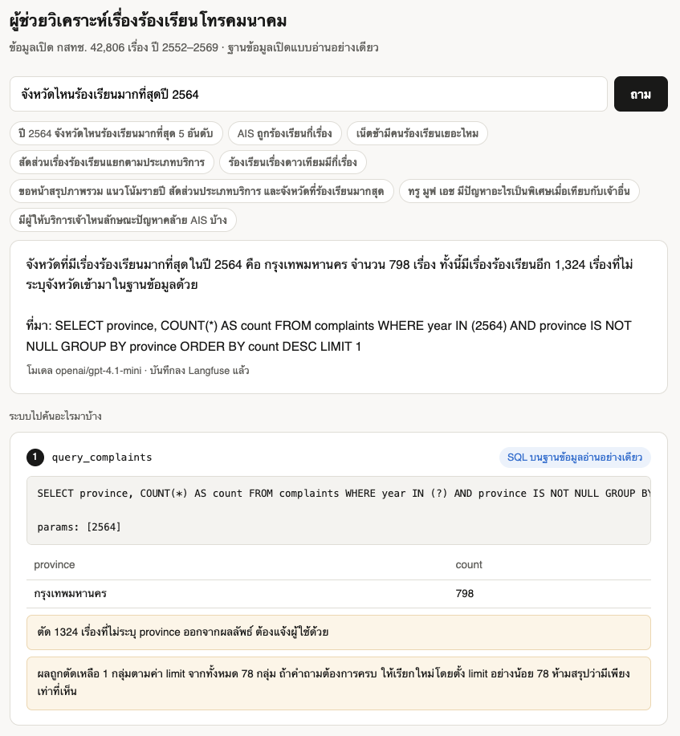 | คำตอบขึ้นบนหน้าเว็บพร้อมคำเตือนที่ tool ส่งกลับมา แปลว่า endpoint นี้ทำงานครบเส้นทาง |
| `POST /chat/completions` | [trace ใน Langfuse](#วิธีวัด) | complete prompt · reasoning · tool call และจำนวน token ทุกรอบ |
| `GET /` ที่พอร์ต 8000 | [log ของ nbtc-mcp](#อ่าน-log-ของ-nbtc-mcp) | `404 Not Found` ซึ่งยืนยันว่า MCP Server มี endpoint เดียวคือ `/mcp` |
| `GET /api/health` | `docs/images/api-health.png` | ได้ `ok: true` พร้อมชื่อ tool ครบ 6 ตัว ซึ่งมาจากการ `list_tools()` ข้าม container จริง |

ถ้าอยากเช็กด้วยตัวเองว่าทั้งสอง container ต่อกันติดไหม เปิด `http://localhost:8080/api/health`
endpoint นี้จะไป `list_tools()` กับ MCP Server จริง **ถ้าได้ชื่อ tool กลับมาครบ 6 ตัว แปลว่าเส้นทางทั้งหมดใช้งานได้**

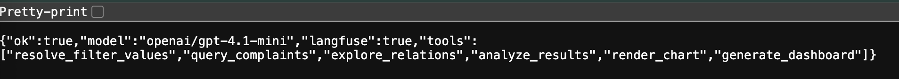

ลำดับชื่อ tool ที่คืนมาคือลำดับที่ `@mcp.tool()` ถูกประกาศในไฟล์ ไม่ได้เรียงตามตัวอักษร

```bash
curl -s http://localhost:8080/api/health
```

```json
{"ok":true,"model":"openai/gpt-4.1-mini","langfuse":true,"tools":
["resolve_filter_values","query_complaints","explore_relations","analyze_results","render_chart","generate_dashboard"]}
```

#### FastMCP กับ MCPServer คือตัวเดียวกัน

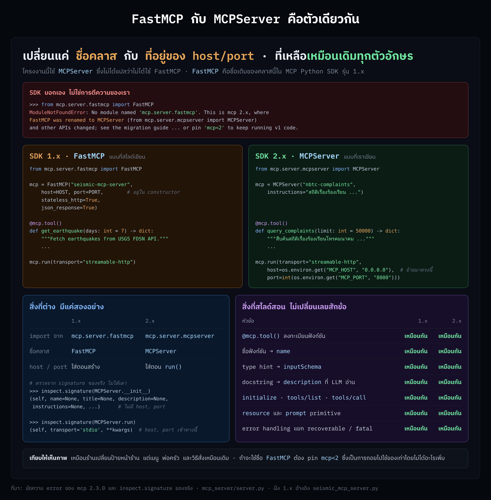

โครงงานนี้เขียนว่า `MCPServer` ไม่ใช่ `FastMCP` ซึ่ง**ไม่ได้แปลว่าใช้คนละอย่าง**
`FastMCP` คือชื่อเดิมของคลาสนี้ใน MCP Python SDK รุ่น 1.x พอขึ้นรุ่น 2.x ถูกเปลี่ยนชื่อเป็น `MCPServer`
ตัว SDK เองบอกไว้ในข้อความ error ตอน import แบบเก่า

```
>>> from mcp.server.fastmcp import FastMCP
ModuleNotFoundError: No module named 'mcp.server.fastmcp'. This is mcp 2.x, where
FastMCP was renamed to MCPServer (from mcp.server.mcpserver import MCPServer)
and other APIs changed; see the migration guide ... or pin 'mcp<2' to keep running v1 code.
```

ท่าเขียนเหมือนเดิมทุกอย่าง ทั้ง `@mcp.tool()` การสร้าง schema จาก type hint กับ docstring
และ `mcp.run(transport=...)` โครงงานนี้ตรึงไว้ที่ `mcp>=2.3.0` ใน `mcp_server/requirements.txt`

สิ่งที่ต่างจริง ๆ มีสองอย่าง คือชื่อคลาสกับ path ที่ import และตำแหน่งของ `host` กับ `port`
ซึ่งรุ่น 1.x ใส่ตอนสร้าง ส่วนรุ่น 2.x ย้ายไปใส่ตอน `run()` ตรวจได้จาก signature ของจริง

```python
>>> inspect.signature(MCPServer.__init__)
(self, name=None, title=None, description=None, instructions=None, ...)   # ไม่มี host, port

>>> inspect.signature(MCPServer.run)
(self, transport='stdio', **kwargs)                                       # host, port เข้าทางนี้
```

#### ตรงกับเช็กลิสต์ของวิชา

| หัวข้อในสไลด์ | ของเรา | ดูได้ที่ |
| --- | --- | --- |
| Python environment และ FastMCP installation | `mcp>=2.3.0` ลงใน image ตอน build ไม่ใช่ลงบนเครื่อง | `mcp_server/requirements.txt` · `mcp_server/Dockerfile` |
| Decorator pattern `@mcp.tool` | ใช้ครบทั้ง 6 tool | `mcp_server/server.py` |
| Docstrings สำหรับ AI understanding | ครบทั้ง 6 หัวข้อที่สไลด์แนะนำ | [docstring](#คำสั่งทั้งหมดอยู่ใน-docstring-ไม่ได้อยู่ในโค้ด) |
| Error handling แยก recoverable กับ fatal | `EXPECTED` · `_recoverable()` · `_unexpected()` | [สัญญาก่อนใช้และหลังใช้](#สัญญาก่อนใช้และหลังใช้-เขียนด้วยโค้ดเรา-ไม่ใช่ฝากโมเดล) |
| Transport เป็น Streamable HTTP | `MCP_TRANSPORT=streamable-http` สลับเป็น stdio ได้ | [Data Layer กับ Transport Layer](#data-layer-กับ-transport-layer) |
| MCP Server รันผ่าน Docker แบบ containerized | container `nbtc-mcp` แยกจาก `nbtc-web` | [ทุกอย่างรันบน Docker](#ทุกอย่างรันบน-docker) |

**สองจุดที่ต่างจากตัวอย่างในสไลด์ โดยตั้งใจ**

ชื่อคีย์ของ error สไลด์ใช้ `error` · `code` · `hint` ส่วนของเราใช้ `ok` · `code` · `error` · `how_to_fix`
แล้วแนบค่าที่ใช้ได้จริงไปด้วย เช่น `valid_columns` คีย์ `ok` มีไว้ให้โมเดลเช็คก่อนใช้ผล
และ `how_to_fix` คือ `hint` ที่เปลี่ยนชื่อให้อ่านแล้วรู้ทันทีว่าต้องทำอะไรต่อ

MCP Host ของเราคือหน้าเว็บของโครงงานเอง ไม่ใช่ Claude Desktop
จึงไม่มีไฟล์ `claude_desktop_config.json` เพราะ Client ต่อ MCP Server ตรงด้วย
`streamable_http_client` ใน `agent.py` ไม่ต้องผ่าน `mcp-remote`

### เทคโนโลยีและหน้าที่ของแต่ละส่วน

| ส่วน | เทคโนโลยี | หน้าที่ |
| --- | --- | --- |
| UI | เว็บใน container `web` | รับคำถาม แสดงคำตอบ SQL กราฟ และ trace |
| Agent Core | Python + OpenAI client | ประกอบ complete prompt วนรอบเรียก tool ตัดสินใจหยุด |
| LLM | `openai/gpt-4.1-mini` ผ่าน OpenRouter | เลือก tool และเขียนคำตอบ |
| Tool layer | MCP SDK 2.x `MCPServer` | ประกาศ tool ตรวจ schema เสิร์ฟผ่าน Streamable HTTP |
| ตรรกะ | Python ใน `tools/` | ตรวจค่า ประกอบ SQL คำนวณ วาดกราฟ |
| ฐานข้อมูล | SQLite เปิดแบบ `mode=ro` | เก็บเรื่องร้องเรียน 42,806 แถว |
| ค้นค่าภาษาไทย | `pythainlp` BM25 + `bge-reranker-v2-m3` | แปลงคำพูดคนเป็นค่าจริง |
| กราฟความสัมพันธ์ | `networkx` | 271 node 1,903 edge |
| Observability | Langfuse | เก็บ complete prompt เต็ม tool call SQL และคะแนน |
| Deploy | Docker Compose | สอง service คือ `mcp` และ `web` |

### ทุกอย่างรันบน Docker

ระบบไม่ได้รันจาก `python` บนเครื่องโดยตรง แต่ถูกแยกเป็นสอง container ที่คุยกันผ่านเครือข่ายของ Compose
ทำแบบนี้เพราะมาตรฐาน MCP แยก Client กับ Server ออกจากกันอยู่แล้ว การแยก container ทำให้แยกจริงในระดับโปรเซสและเครือข่าย
ไม่ใช่แค่แยกไฟล์ และทำให้ข้อ 4 ของกลไกอ่านอย่างเดียวบังคับได้ที่ระดับ kernel

| service | container | พอร์ต | รันอะไร | บทบาทตามมาตรฐาน MCP |
| --- | --- | --- | --- | --- |
| `mcp` | `nbtc-mcp` | 8000 | `python -m mcp_server.server` | **MCP Server** ประกาศ 6 tool และ 1 resource |
| `web` | `nbtc-web` | 8080 | `uvicorn web.app:app` | **MCP Host + Client** หน้าเว็บและ `agent.py` |

`web` ต่อ `mcp` ด้วยชื่อ service ไม่ใช่ `localhost`

```yaml
environment:
  MCP_URL: http://mcp:8000/mcp
depends_on:
  - mcp
```

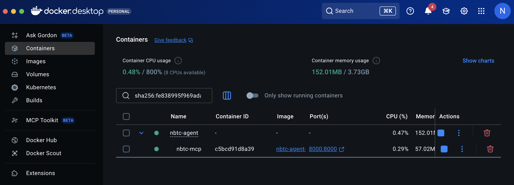

ภาพนี้คือหน้า Containers ของ Docker Desktop หลังสั่ง `docker compose up -d`
แถวบนชื่อ `nbtc-agent` คือกลุ่มของ Compose ไม่ใช่ container แถวในคือ `nbtc-mcp` id `c5bcd91d8a39`
image `nbtc-agent-mcp:latest` เปิดพอร์ต `8000:8000`
ทั้งกลุ่มใช้ CPU **0.47%** และ RAM **152 MB** ทั้งที่ image ของ `mcp` ใหญ่หลาย GB
เพราะน้ำหนักส่วนใหญ่คือไฟล์โมเดลที่อยู่บนดิสก์ ไม่ได้ถูกโหลดขึ้น RAM ทั้งก้อน

---

#### คำสั่งที่ใช้จริง

```bash
docker compose up -d --build       # build image ทั้งสองตัวแล้วรันเบื้องหลัง
docker compose ps                  # ดูว่า container ไหนขึ้นแล้ว พอร์ตอะไร
docker compose logs -f mcp         # ตามดู log ของ MCP Server สด
docker compose down                # หยุดและลบ container
docker images                      # ดูขนาด image
```

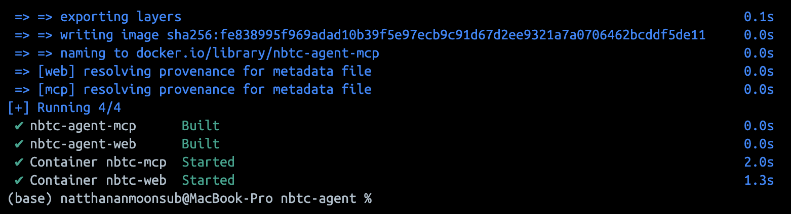

ตอน build ขั้นที่กินเวลาที่สุดคือขั้นดาวน์โหลด `torch` รุ่น CPU กับขั้นฝังโมเดลจัดอันดับลง image
สองขั้นนี้ถูก cache ไว้ รอบต่อไปที่แก้แค่โค้ดจึงขึ้นเร็ว เพราะ `COPY tools/` อยู่ล่างสุดของ Dockerfile

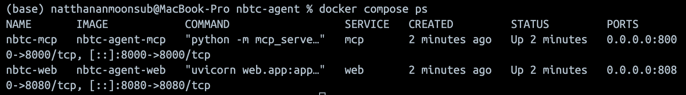

---

#### สามข้อที่ตั้งใจทำใน `mcp_server/Dockerfile`

| บรรทัด | ทำอะไร | ทำไมต้องทำ |
| --- | --- | --- |
| `pip install torch --index-url .../whl/cpu` | ลง torch รุ่น CPU จาก index ของ PyTorch เอง | ถ้าปล่อยให้ลงจาก PyPI จะได้รุ่น CUDA ที่ใหญ่กว่าสิบเท่า ทั้งที่เครื่องไม่มีการ์ดจอ |
| `RUN python -c "CrossEncoder(...)"` + `ENV HF_HUB_OFFLINE=1` | ดาวน์โหลดโมเดลจัดอันดับฝังลง image ตั้งแต่ตอน build | ตอนรันไม่ต้องต่ออินเทอร์เน็ต และได้โมเดลเวอร์ชันเดิมทุกครั้ง ผลวัดจึงเทียบกันได้ |
| `apt-get install fonts-thai-tlwg` | ลงฟอนต์ไทยใน image | ไม่งั้น `matplotlib` วาดตัวอักษรไทยออกมาเป็นสี่เหลี่ยม |


**ฐานข้อมูลไม่ได้ถูก copy เข้า image** แต่ mount เข้ามาตอนรัน

```yaml
volumes:
  - ./data/complaints.db:/data/complaints.db:ro     # อ่านอย่างเดียวที่ระดับ kernel
  - ./charts:/charts                                # โฟลเดอร์เดียวที่เขียนได้
```

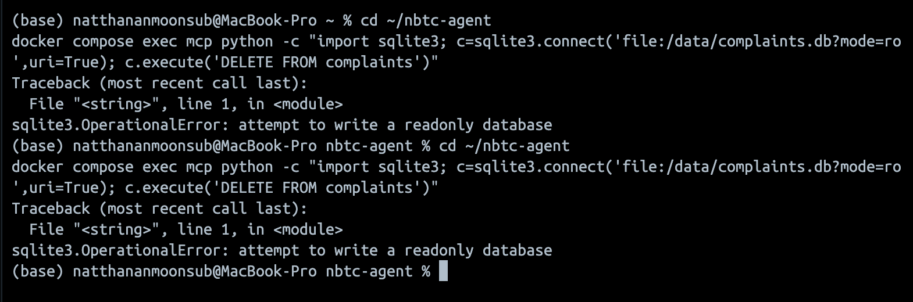

เข้าไปลองเขียนไฟล์ฐานข้อมูลใน container ตรง ๆ แล้ว kernel ปฏิเสธ
นี่คือชั้นที่ 4 ของ [กลไกอ่านอย่างเดียว](#กลไกอ่านอย่างเดียว-4-ชั้น) ซึ่งเป็นชั้นเดียวที่โค้ดของเราข้ามไม่ได้เลยแม้เขียนผิด

---

#### อ่าน log ของ `nbtc-mcp`

แถบสีบนภาพตรงกับสัญลักษณ์ในตารางคำอธิบาย

| สี | ข้อความใน log | ความหมาย |
| :-: | --- | --- |
| 🟦 | `Uvicorn running on http://0.0.0.0:8000` | container ขึ้นแล้ว bind ที่ `0.0.0.0` ไม่ใช่ `127.0.0.1` ไม่งั้น container อื่นในเครือข่ายเดียวกันต่อไม่ได้ |
| 🟩 | `Created new transport with session ID` | ขั้น `initialize` ของ MCP เปิด session ใหม่ให้ Client หนึ่งคำถามของผู้ใช้เท่ากับหนึ่ง session |
| 🟨 | `POST` · `GET` `/mcp` → `200 OK` / `202 Accepted` | ข้อความ JSON-RPC วิ่งผ่าน endpoint เดียว request ได้ `200` ส่วน notification ที่สเปกบอกว่าไม่ต้องมีคำตอบได้ `202` |
| 🟪 | `[tool] query_complaints {...}` · `SQL` · `ได้` | **tool name** กับ **tool argument** ที่โมเดลส่งมาจริง และ SQL ที่ประกอบจากพารามิเตอร์นั้นแล้วรัน |
| 🟧 | `เตือน ...` | ผลไม่ครบตามที่ควรเป็น ระบบส่งคำเตือนกลับเป็น input ให้โมเดลแก้เอง |
| 🟥 | `Terminating session` · `DELETE /mcp` | ปิด session เมื่อตอบจบ ไม่ปล่อยค้าง |

**ถามว่า จังหวัดไหนร้องเรียนมากที่สุดปี 2564**

ผู้ใช้พิมพ์คำถามหนึ่งครั้ง `web` เปิด session กับ `mcp` เรียก `query_complaints` หนึ่งรอบ แล้วปิด session

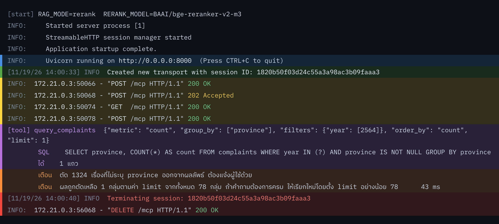

สามบรรทัดที่บอกว่าเป็น MCP จริง ไม่ใช่ REST ธรรมดา

| สิ่งที่เห็น | ตรงกับอะไรในมาตรฐาน |
| --- | --- |
| `172.21.0.3` | IP ภายในเครือข่ายของ Compose **ไม่ใช่** `192.168.65.1` ที่เป็นเครื่อง macOS แปลว่าคนเรียกคือ container `web` ไม่ใช่คนกดจากเบราว์เซอร์ พิสูจน์ว่า Client กับ Server คุยกันข้าม container จริง |
| `202 Accepted` | Client ส่ง notification ซึ่งตามสเปกไม่ต้องมีคำตอบ Server จึงตอบ `202` ไม่ใช่ `200` ถ้าเป็น REST ธรรมดาจะไม่มีความต่างนี้ |
| `GET /mcp` | ช่องทางที่สเปก Streamable HTTP เปิดไว้ให้ Server ส่งข้อความกลับหา Client ได้เอง ไม่ต้องรอให้ Client ถามก่อน |

สี่บรรทัดในแถบม่วงกับส้มคือหัวใจของกลไกอ่านอย่างเดียวและการแก้ผลเอง

| บรรทัด | อ่านว่าอย่างไร |
| --- | --- |
| `[tool] query_complaints {"metric": "count", ... "limit": 1}` | พารามิเตอร์ที่โมเดลส่งมาจริง ไม่ใช่ที่เราคาดว่าโมเดลจะส่ง ดูบรรทัดนี้ก็รู้ทันทีว่าโมเดลเข้าใจคำถามผิดตรงไหน |
| `SQL SELECT province, COUNT(*) ...` | SQL ที่ประกอบขึ้นจากพารามิเตอร์ข้างบนแล้วรันจริง **โมเดลไม่เคยเขียน SQL เอง** |
| `เตือน ตัด 1324 เรื่องที่ไม่ระบุ province` | ข้อมูลจริงมีช่องว่าง `SQL` ตัดแถวที่เป็น `NULL` ทิ้ง เราจึงบังคับให้ส่งคำเตือนกลับไป เพื่อให้คำตอบสุดท้ายบอกผู้ใช้ด้วย |
| `เตือน ผลถูกตัดเหลือ 1 กลุ่ม จากทั้งหมด 78 กลุ่ม` | โมเดลตั้ง `limit: 1` เอง ระบบจึงเตือนว่าผลไม่ครบและบอกตัวเลขที่ควรตั้ง นี่คือกลไก **ส่งผลที่ไม่ผ่านการกรองกลับเป็น input ให้โมเดลแก้เอง** |

คำเตือนสองบรรทัดนั้นไม่ได้ค้างอยู่ใน log เฉย ๆ แต่ถูกส่งกลับไปให้โมเดลและโผล่ในคำตอบบนหน้าเว็บจริง


---

#### สรุปว่าทำไมถึงต้องใช้ Docker ไม่ใช่รัน `python` เฉย ๆ

| เหตุผล | ได้อะไร |
| --- | --- |
| แยก Client กับ Server เป็นคนละโปรเซส | ตรงตามสถาปัตยกรรมของมาตรฐาน MCP จริง ไม่ใช่เรียกฟังก์ชันกันเองแล้วอ้างว่าเป็น MCP |
| `:ro` ตอน mount | ปิดการเขียนที่ระดับ kernel เป็นชั้นเดียวที่บั๊กในโค้ดเราข้ามไม่ได้ |
| ฝังโมเดลและฟอนต์ลง image | รันซ้ำได้ผลเดิม ไม่ต้องต่อเน็ตตอนรัน และตัวอักษรไทยในกราฟไม่เพี้ยน |
| `RAG_MODE` เป็น environment variable | สลับสามขาของการวัดผลด้วย `docker compose up -d mcp` ไม่ต้องแก้โค้ด |
| `restart: unless-stopped` | ถ้า container ล้ม Docker ยกกลับมาเอง |

---

### MCP SDK ทำหน้าที่อะไร


งานนี้ใช้ MCP SDK รุ่น 2.x คลาสชื่อ `MCPServer` เราเขียนแค่ฟังก์ชัน Python แล้วติด `@mcp.tool()`
SDK สร้าง JSON Schema จาก type hint และ docstring ให้เอง และตอบ method ของโปรโตคอลให้ครบ

### ตรงตามมาตรฐาน MCP ตรงไหน

[สถาปัตยกรรม MCP](https://modelcontextprotocol.io/specification/2025-06-18/architecture)
แบ่งเป็นสามบทบาท โครงการนี้แยกครบทั้งสาม และอยู่คนละโปรเซสจริง ไม่ใช่เรียกฟังก์ชันกันเองในโปรเซสเดียว

| บทบาทตามมาตรฐาน | ของเรา | ทำอะไร |
| --- | --- | --- |
| **Host** | `web/app.py` | ถือการเชื่อมต่อ LLM ถือประวัติบทสนทนา เปิดและปิด session |
| **Client** | `agent.py` | `ClientSession` คุยกับ server ด้วยโปรโตคอล หนึ่ง client ต่อหนึ่ง server |
| **Server** | `mcp_server/server.py` | ประกาศ 6 tool กับ 1 resource เสิร์ฟที่ `:8000/mcp` ใน container แยก |

ฝั่ง client ใช้ของจาก SDK ตรง ๆ ไม่ได้เขียน HTTP เอง

```python
from mcp import ClientSession
from mcp.client.streamable_http import streamable_http_client

async with streamable_http_client(MCP_URL) as (read, write):
    async with ClientSession(read, write) as s:
        await s.initialize()                        # จับมือและแลก capability

tools = (await session.list_tools()).tools          # ค้นหา tool จาก server ตอนรัน
res   = await session.read_resource("schema://values")
result = await session.call_tool(name, args)        # เรียกผ่านโปรโตคอล
```

**จุดที่พิสูจน์ว่าเป็นโปรโตคอลจริง** คือ `list_tools()` — agent ไม่ได้ฝังรายชื่อ tool ไว้ในโค้ด
แต่ถาม server ตอนรันว่ามี tool อะไรบ้าง schema หน้าตายังไง แล้วค่อยแปลงเป็นรูปแบบที่ LLM เข้าใจ
เพิ่ม tool ใหม่ที่ฝั่ง server แล้ว agent เห็นทันทีโดยไม่ต้องแก้โค้ดฝั่ง client

#### MCP server คืออะไร ตามนิยามของมาตรฐาน

> **MCP server: a program that provides context to MCP clients**

ของเราคือ `mcp_server/server.py` ซึ่งให้ context สองทาง — **6 tool** สำหรับการกระทำ
และ **1 resource** คือ `schema://values` สำหรับข้อมูลบริบทที่อ่านอย่างเดียว

#### Data Layer กับ Transport Layer

มาตรฐานแบ่งโปรโตคอลเป็นสองชั้น และทั้งสองชั้นเป็นคนละเรื่องกัน

| ชั้น | มาตรฐานกำหนดว่า | ของเราคือ |
| --- | --- | --- |
| **Data Layer** | ภาษาและกติกาที่ client กับ server ใช้คุยกัน<br>MCP ใช้ **JSON-RPC 2.0** เป็นรูปแบบข้อความ | ทุกข้อความระหว่าง `agent.py` กับ server เป็น JSON-RPC 2.0 ทั้งหมด |
| | method สำหรับงานพื้นฐาน เช่น initialization, listing capabilities, calling a tool | `initialize` · `tools/list` · `tools/call` · `resources/read` |
| | lifecycle management | เปิดด้วย `initialize()` ปิดเมื่อออกจาก context manager |
| **Transport Layer** | **stdio** สำหรับ server ที่ host เปิดเองในเครื่อง<br>**HTTP** สำหรับ server ที่อยู่คนละที่ | ใช้ **Streamable HTTP** เป็นหลัก และ**รองรับ stdio ด้วย** |

ข้อความที่วิ่งจริงหน้าตาแบบนี้ ตัว JSON-RPC อยู่ชั้นนอก ส่วนเนื้อในคือ tool กับพารามิเตอร์

```json
{"jsonrpc": "2.0", "id": 7, "method": "tools/call",
 "params": {"name": "query_complaints",
            "arguments": {"metric": "count", "filters": {"year": [2564]}}}}
```

server ตอบกลับด้วย envelope เดียวกัน โดยผลของ tool อยู่ใน `result`

```json
{"jsonrpc": "2.0", "id": 7,
 "result": {"content": [{"type": "text",
                         "text": "{\"rows\": [...], \"sql_used\": \"SELECT ...\"}"}],
            "isError": false}}
```

**เปลี่ยน transport ได้โดยไม่แตะ tool สักตัว** เพราะสองชั้นนี้แยกกันจริง

```python
transport = os.environ.get("MCP_TRANSPORT", "streamable-http")
if transport == "stdio":
    mcp.run(transport="stdio")          # host เปิดเองในเครื่อง คุยผ่าน stdin stdout
else:
    mcp.run(transport="streamable-http",  # คุยผ่านเครือข่ายที่ :8000/mcp
            host=os.environ.get("MCP_HOST", "0.0.0.0"),
            port=int(os.environ.get("MCP_PORT", "8000")))
```

งานนี้เลือก Streamable HTTP เพราะต้องรันใน Docker container แยก ซึ่ง stdio ทำไม่ได้
แต่โค้ดยังรองรับ stdio ไว้ จึงสลับได้ด้วยตัวแปร `MCP_TRANSPORT` ตัวเดียว

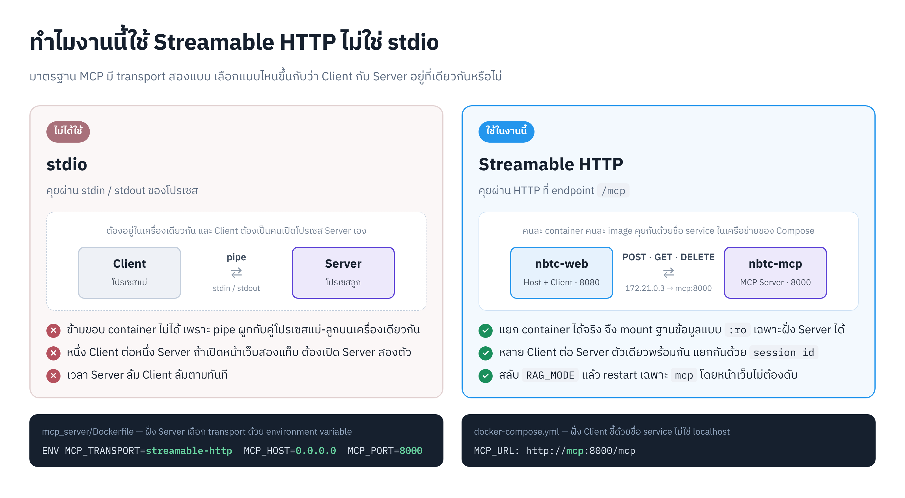

เหตุผลที่ stdio ใช้ไม่ได้คือ transport นั้นคุยผ่าน `stdin` กับ `stdout` ของโปรเซส
ซึ่งแปลว่า **Client ต้องเป็นคนเปิดโปรเซส Server ขึ้นมาเองในเครื่องเดียวกัน** แล้วถือ pipe ไว้
พอแยกเป็นคนละ container ความสัมพันธ์แม่-ลูกนั้นก็หายไป ไม่มี pipe ให้ถือ

การย้ายมาใช้ HTTP ได้อย่างอื่นตามมาด้วย ฐานข้อมูลถูก mount แบบ `:ro` เฉพาะฝั่ง `mcp`
หน้าเว็บหลายแท็บใช้ Server ตัวเดียวกันได้โดยแยกกันที่ `session id`
และตอนวัดผลสามขา สลับ `RAG_MODE` แล้ว restart เฉพาะ container `mcp` โดยหน้าเว็บไม่ต้องดับ

#### ลำดับตามแผนภาพมาตรฐาน

| ขั้นตอนในมาตรฐาน | ของเรา |
| --- | --- |
| Initialize client | Host เปิด session ผ่าน `agent.open_session()` |
| Initialize session with capabilities | `await s.initialize()` |
| Respond with supported capabilities | SDK จัดการให้ |
| Client Requests · `tools/list` `resources/read` | `list_tools()` และ `read_resource()` ตอนเริ่มทุกรอบ |
| Client Requests · `tools/call` | `call_tool()` ทุกครั้งที่ LLM ขอเรียกเครื่องมือ |
| Terminate · End session | ปิดเมื่อออกจาก context manager |

#### ส่วนของมาตรฐานที่ไม่ได้ใช้

| ความสามารถ | ใช้ไหม | เหตุผล |
| --- | --- | --- |
| Server Requests · sampling | ไม่ใช้ | server ไม่เคยขอให้ client รันโมเดลให้ ทุก tool คำนวณเองจบในตัว |
| Notifications · resource updates | ไม่ใช้ | ฐานข้อมูลอ่านอย่างเดียว ไม่มีการเปลี่ยนระหว่าง session |
| Elicitation · ขอข้อมูลเพิ่มจากผู้ใช้ | ไม่ใช้ | การถามกลับทำผ่าน `confidence` ที่ tool คืนมา แล้ว LLM เป็นคนถามเอง |

ทั้งสามอย่างเป็นความสามารถที่มาตรฐานระบุว่าเลือกใช้ได้ ไม่ใช่ข้อบังคับ

### รายการ tool และพารามิเตอร์ทั้งหมด

ทั้งหมดนี้คือสิ่งที่ `tools/list` คืนกลับมาให้ agent เห็น

**`resolve_filter_values`** · แปลงคำผู้ใช้เป็นค่าจริงในฐานข้อมูล

| พารามิเตอร์ | ชนิด | ค่าเริ่มต้น | ความหมาย |
| --- | --- | --- | --- |
| `user_phrase` | `str` | **ต้องใส่** | คำที่ผู้ใช้พิมพ์ เช่น AIS, มือถือ, ภาคเหนือ |
| `field` | `str` หรือ `null` | `null` | ระบุคอลัมน์ถ้ารู้แน่ เช่น `provider` `service_type` `problem_group` `region` `province` `district` `channel` `status` |

**`query_complaints`** · ประกอบ SQL แล้วรันแบบอ่านอย่างเดียว

| พารามิเตอร์ | ชนิด | ค่าเริ่มต้น | ความหมาย |
| --- | --- | --- | --- |
| `metric` | `str` | `count` | `count` · `avg_days_to_close` · `share_pct` |
| `group_by` | `list[str]` หรือ `str` | `null` | คอลัมน์ที่จัดกลุ่ม เช่น `["year"]` `["province"]` |
| `filters` | `dict` หรือ `str` | `null` | เช่น `{"year": [2564], "service_type": ["อินเทอร์เน็ต"]}` |
| `date_from` | `str` | `null` | วันเริ่ม `YYYY-MM-DD` กรองจากวันรับเรื่อง |
| `date_to` | `str` | `null` | วันสิ้นสุด `YYYY-MM-DD` |
| `order_by` | `str` | `null` | ชื่อคอลัมน์เรียงน้อยไปมาก หรือชื่อ metric เรียงมากไปน้อย |
| `limit` | `int` | `100` | จำนวนแถวสูงสุด ไม่เกิน 50,000 |

**`explore_relations`** · เดินกราฟความสัมพันธ์

| พารามิเตอร์ | ชนิด | ค่าเริ่มต้น | ความหมาย |
| --- | --- | --- | --- |
| `value` | `str` | **ต้องใส่** | ค่าจริงในฐานข้อมูล |
| `field` | `str` หรือ `null` | `null` | คอลัมน์ของค่านั้น |
| `to_field` | `str` หรือ `null` | `null` | อยากดูความสัมพันธ์ไปยังคอลัมน์ไหน เว้นว่างได้ |
| `mode` | `str` | `related` | `related` พบร่วมกันบ่อย · `similar` รูปแบบปัญหาคล้ายกัน |
| `top_k` | `int` | `8` | จำนวนรายการสูงสุดต่อคอลัมน์ |

**`analyze_results`** · คำนวณสถิติจากแถวที่ดึงมาแล้ว

| พารามิเตอร์ | ชนิด | ค่าเริ่มต้น | ความหมาย |
| --- | --- | --- | --- |
| `result_id` | `str` หรือ `null` | `null` | รหัสผลลัพธ์จาก `query_complaints` เช่น `r1` |
| `rows` | `list[dict]` หรือ `null` | `null` | ใส่แทน `result_id` ได้ |
| `question` | `str` | `""` | คำถามเดิมของผู้ใช้ |
| `mode` | `str` | `summary` | `summary` · `trend` · `compare` · `share` |

**`render_chart`** · วาดกราฟหนึ่งรูป

| พารามิเตอร์ | ชนิด | ค่าเริ่มต้น | ความหมาย |
| --- | --- | --- | --- |
| `chart_type` | `str` | **ต้องใส่** | `bar` · `barh` · `line` · `pie` ไม่มีสามมิติ |
| `x` | `str` | **ต้องใส่** | ชื่อคอลัมน์หมวดหมู่ เช่น `province` |
| `y` | `str` | **ต้องใส่** | ชื่อคอลัมน์ตัวเลข เช่น `count` |
| `title` | `str` | **ต้องใส่** | หัวกราฟ |
| `result_id` | `str` หรือ `null` | `null` | รหัสผลลัพธ์จาก `query_complaints` |
| `rows` | `list[dict]` หรือ `null` | `null` | ใส่แทน `result_id` ได้ |
| `filename` | `str` หรือ `null` | `null` | ตั้งชื่อไฟล์เองได้ |

**`generate_dashboard`** · รวมหลายกราฟเป็นหน้า HTML เดียว

| พารามิเตอร์ | ชนิด | ค่าเริ่มต้น | ความหมาย |
| --- | --- | --- | --- |
| `title` | `str` | **ต้องใส่** | หัวข้อหน้าสรุป |
| `panels` | `list[dict]` | **ต้องใส่** | แต่ละแผงมี `result_id` `chart_type` `x` `y` `title` |
| `notes` | `list[str]` หรือ `null` | `null` | ข้อความสรุปสั้น ๆ ใต้หัวข้อ |

**resource `schema://values`** · ไม่มีพารามิเตอร์ คืนรายการค่าจริงทุกคอลัมน์พร้อมจำนวนเรื่อง
และช่วงปีที่ฐานข้อมูลมี ให้โมเดลอ่านเป็นบริบทตั้งแต่ต้นรอบ

### กลไกอ่านอย่างเดียว 4 ชั้น

| ชั้น | กลไก | ป้องกันอะไร |
| --- | --- | --- |
| 1 | LLM ไม่เคยเขียน SQL ส่งเฉพาะพารามิเตอร์ | prompt injection ที่สั่งให้เขียน SQL |
| 2 | whitelist คอลัมน์จาก `DIMENSIONS` dict และใช้ parameterized query | SQL injection ผ่านค่าที่ผู้ใช้พิมพ์ |
| 3 | `sqlite3.connect("file:...?mode=ro", uri=True)` | คำสั่งเขียนที่หลุดมาถึงชั้นนี้ |
| 4 | Docker mount `./data/complaints.db:/data/complaints.db:ro` | kernel ปฏิเสธการเขียนทั้งหมด |

ทดสอบแล้วว่า `DELETE` `UPDATE` `DROP` `CREATE` ถูกปฏิเสธทั้งหมดด้วย
`attempt to write a readonly database`

### ชุดข้อมูล


#### ที่มาและเงื่อนไขการใช้

| ฟิลด์ | ค่า |
| --- | --- |
| ชื่อชุดข้อมูล | [สถิติเรื่องร้องเรียนในกิจการโทรคมนาคม](https://datacatalog.nbtc.go.th/dataset/dataset_12_05) |
| หน่วยงานผู้รับผิดชอบ | สำนักรับเรื่องร้องเรียนและคุ้มครองผู้บริโภคในกิจการโทรคมนาคม (รท.) กสทช. |
| อีเมลติดต่อ | `tcp.service@nbtc.go.th` |
| วัตถุประสงค์ | เพื่อการให้บริการประชาชน |
| ประเภทชุดข้อมูล | ข้อมูลสถิติ |
| หมวดหมู่ตามธรรมาภิบาลข้อมูลภาครัฐ | ข้อมูลสาธารณะ |
| **สัญญาอนุญาตให้ใช้ข้อมูล** | **Open Data Common** |
| เงื่อนไขการเข้าถึง | เปิดเผยต่อสาธารณะ ไม่ลับและไม่อ่อนไหว |
| รูปแบบการเก็บข้อมูลต้นทาง | Database เข้าถึงผ่าน CKAN API |
| ความถี่การปรับปรุง | รายเดือน |
| ขอบเขตเชิงพื้นที่ที่ย่อยที่สุด | อำเภอ |
| ภาษา | ไทย |
| ปีข้อมูลที่เริ่มจัดทำ | พ.ศ. 2552 |
| กำหนดเผยแพร่ครั้งแรก | 23 กันยายน 2564 |
| ปรับปรุงครั้งล่าสุดในระบบ | 19 ตุลาคม 2569 |

สัญญาอนุญาตแบบ Open Data Common คือเหตุผลที่โครงการนี้นำข้อมูลมาแปลงและเผยแพร่ซ้ำได้
ส่วนขอบเขตที่ย่อยถึงระดับอำเภอ คือเหตุผลที่ฐานข้อมูลมีคอลัมน์ `district` ให้ถามรายอำเภอได้

#### สามข้อสังเกตจากเมทาดาทา

**ฟิลด์ปีล่าสุดในแคตตาล็อกไม่ตรงกับข้อมูลจริง** หน้าแคตตาล็อกระบุ
`ปีข้อมูลล่าสุดที่เผยแพร่ = 2566` และ `วันที่ปรับปรุงข้อมูลล่าสุด = 27 กรกฎาคม 2566`
แต่ไฟล์ที่ดึงมาจริงมีข้อมูลถึงปี 2569 (ปี 2567 จำนวน 1,088 เรื่อง · ปี 2568 จำนวน 1,301 เรื่อง · ปี 2569 จำนวน 1,118 เรื่อง)
และตัวระเบียนเองถูกปรับปรุงในระบบเมื่อ 19 ตุลาคม 2569

โครงการนี้จึงยึดตามข้อมูลในไฟล์จริง ไม่ยึดตามฟิลด์เมทาดาทา และเขียนช่วงปีที่ระบบรู้จัก
ไว้ใน resource `schema://values` ให้โมเดลอ่านเอง แทนที่จะฝังปีไว้ในโค้ด

**ข้อมูลปรับปรุงรายเดือน** ตัวเลขทุกตัวในเอกสารนี้จึงเป็นภาพ ณ วันที่ดึงข้อมูล
ถ้ารัน `01_fetch_explore.py` ใหม่ จำนวนเรื่องจะเปลี่ยน แต่เฉลยของชุดทดสอบคำนวณจาก SQL ตอนรัน
จึงขยับตามเองโดยไม่ต้องแก้ไฟล์

**เป็นข้อมูลสถิติ ไม่ใช่ข้อมูลระเบียนรายบุคคล** หนึ่งแถวคือหนึ่งเรื่องร้องเรียนที่ถูกจัดหมวดแล้ว
ไม่มีชื่อหรือข้อมูลติดต่อของผู้ร้องเรียน ระบบนี้จึงไม่ได้แตะข้อมูลส่วนบุคคลเลย

#### การตัดสินใจเรื่อง พ.ศ.

ร่างแรกแปลง พ.ศ. เป็น ค.ศ. ตอนสร้างฐานข้อมูล ซึ่งขัดกับเอกสารที่เขียนว่าเก็บตามต้นฉบับ
จึงรื้อสร้างใหม่ให้เก็บ พ.ศ. ตามที่ กสทช. เผยแพร่ และเก็บสตริงวันที่ต้นฉบับไว้ใน
`received_date_raw` กับ `closed_date_raw` ด้วย

การรื้อครั้งนั้นทำให้เจอบั๊กที่ร้ายแรงกว่า คือ `datetime(2559, 2, 29)` โยน `ValueError`
เพราะวันอธิกสุรทินอิงปฏิทิน ค.ศ. **ข้อมูล 39 แถวหายไปเงียบ ๆ**
แก้โดยตรวจความถูกต้องของวันในปฏิทิน ค.ศ. ก่อน แล้วค่อยบวก 543 ตอนแสดงผล

### ชั้นค้นค่าสามขั้น

เรียงจากของถูกไปของแพง แต่ละขั้นทำงานเฉพาะเมื่อขั้นก่อนหน้าหาคำตอบไม่พบ

| ขั้น | วิธี | เกณฑ์รับค่า |
| --- | --- | --- |
| 1 | ไฟล์ `aliases.yaml` ที่คนเขียน | ตรงคำเป๊ะ |
| 2 | เทียบตัวอักษร | เป็นคำย่อยของกัน 0.70 · คล้ายกัน 0.78 |
| 3 | BM25 หลังตัดคำไทยด้วย `pythainlp` | คะแนน 2.0 |
| 4 | cross-encoder `bge-reranker-v2-m3` | คะแนน 0.02 และต้องนำอันดับสอง 0.20 |


ภาพนี้คือชั้นที่สี่ทำงานจริง คำว่า "เน็ตช้า" ไม่มีคำไหนตรงตัวกับค่าในฐานข้อมูลเลย
cross-encoder ให้ `คุณภาพสัญญาณ` 0.662 นำอันดับสอง 0.268
ผ่านทั้งเกณฑ์ `HIGH` ที่ 0.50 และ `MARGIN` ที่ 0.20 ระบบจึงใช้ค่านั้นได้โดยไม่ต้องถามกลับ

**เกณฑ์ทุกตัวตั้งจากคะแนนที่วัดกับค่าจริง ไม่ใช่ค่าที่กำหนดขึ้นเอง**

เกณฑ์ BM25 ที่ 2.0 มาจากช่องว่างระหว่างคำกว้างอย่าง "บริการ" ที่ได้ 1.37
กับคำที่จับถูกซึ่งได้ตั้งแต่ 2.28 ขึ้นไป เกณฑ์ cross-encoder ที่ 0.02 มาจากช่องว่างระหว่าง
เคสที่อันดับหนึ่งผิด (0.0006 ถึง 0.0137) กับเคสที่อันดับหนึ่งถูก (0.0248 ขึ้นไป)

#### ทำไมถึงเปลี่ยนจาก bi-encoder เป็น cross-encoder

| คำทดสอบ | bi-encoder | cross-encoder |
| --- | --- | --- |
| ดาวอังคาร (คำที่ไม่เกี่ยวเลย) | 0.774 | **0.0006** |
| เน็ตช้า ไปหา คุณภาพสัญญาณ | ไม่ติด 3 อันดับแรก | **0.6624** นำอันดับสอง 0.268 |
| โดนคิดเงินเกิน | 0.838 นำ 0.010 | **0.7028** นำ **0.688** |

bi-encoder ให้ช่วงคะแนนทั้งสเกลแค่ 0.774 ถึง 0.873 ระยะห่างระหว่างคำตอบถูกกับผิด
เหลือราว 0.010 ซึ่งตั้งเกณฑ์ไม่ได้

คลังค่าของเรามีอย่างมาก 106 ค่าต่อคอลัมน์ จึงให้คะแนนทุกค่าได้หมด
ไม่ต้องมีขั้นคัดกรองก่อน แปลว่า**ไม่มีคำตอบไหนหลุดก่อนถูกพิจารณา**

#### ชั้นที่สามและสี่ไม่แตะคอลัมน์ชื่อเฉพาะ

วัดแล้วพบว่า "เมืองกรุง" ได้ นครนายก 0.808 แซง กรุงเทพมหานคร 0.807 ห่างกัน 0.001
ชื่อจังหวัดและชื่อนิติบุคคลจึงต้องพึ่ง alias กับการเทียบตัวอักษรเท่านั้น

อีกเคสที่เจอคือ BM25 ตัด "เน็ตช้า" เป็น `เน็ต|ช้า` แล้วคำว่า "เน็ต" ไปชนกับ
"ไตร**เน็ต**" ในชื่อบริษัท ตอบ `บริษัท ดีแทค ไตรเน็ต จำกัด` แบบมั่นใจเต็มที่

### กราฟความสัมพันธ์

สร้างจากฐานข้อมูลเดียวกันด้วย `networkx` ได้ **271 node 1,903 edge**
node คือค่าจริงในคอลัมน์ edge คือจำนวนเรื่องที่ค่าสองค่าปรากฏอยู่ในแถวเดียวกัน

ตัวเลขที่ใช้จริงคือ `lift` ไม่ใช่จำนวนดิบ เพราะผู้ให้บริการรายใหญ่ย่อมมีเรื่องเยอะไปหมด
ทุกหมวด `lift` เทียบกับค่าเฉลี่ยทั้งระบบ จึงบอกได้ว่าเรื่องไหนเยอะผิดปกติสำหรับเจ้านั้น

| ค่าที่ถาม | พบร่วมกับ | จำนวน | สัดส่วน | lift |
| --- | --- | --- | --- | --- |
| ทรู มูฟ เอช | ปัญหาข้อความสั้น SMS | 1,402 | 46.5% | **3.19** |
| อินเทอร์เน็ต | การยกเลิกบริการ | 5,386 | 55.7% | **3.26** |

---

### ชั้นที่สอง ค้นกฎหมายด้วย RAG และกราฟ

ฝั่ง SQL ข้างบนตอบคำถามเชิงสถิติ *"จังหวัดไหนร้องเรียนมากที่สุด"* ได้ แต่ตอบไม่ได้ว่า
*"ร้องเรียนแล้วผู้ให้บริการต้องแก้ภายในกี่วัน"* เพราะคำตอบไม่ได้อยู่ในฐานข้อมูล แต่อยู่ในตัวบทกฎหมาย

**ฝั่ง SQL ไม่ได้ใช้ RAG และไม่ควรใช้** ตัวเลขในคำตอบมาจาก `SELECT` ไม่ได้มาจากข้อความที่ดึงมา
การเอา RAG ไปใส่ตรงนั้นมีแต่เพิ่มความเสี่ยงที่โมเดลจะแต่งตัวเลข
ส่วนกฎหมายเป็น **คลังเอกสารจริง** ซึ่ง RAG เป็นเครื่องมือที่ถูกต้อง

| | ฝั่ง SQL (ของเดิม) | ฝั่งกฎหมาย (ของใหม่) |
| --- | --- | --- |
| แหล่งข้อมูล | SQLite 42,806 แถว | PDF ราชกิจจานุเบกษา 21 ฉบับ |
| หน่วยที่ค้น | ค่าหนึ่งค่าในคอลัมน์ | chunk ของตัวบท |
| ผลลัพธ์เอาไปทำอะไร | ใส่เป็นพารามิเตอร์ของ SQL | ใส่เป็นข้อความใน context ให้ LLM อ่าน |
| chunking · vector DB | **ไม่มี และไม่ต้องมี** | มี pgvector |

#### ภาพรวม LLM ดึงคำตอบจากข้อมูลภายนอกสี่ชุด

ก่อนลงรายละเอียดทีละขั้น ภาพนี้คือทั้งระบบในหน้าเดียว แบ่งเป็นสองชั้นที่ทำงานคนละเวลา
ชั้นบนทำครั้งเดียวตอนติดตั้ง ชั้นล่างทำใหม่ทุกครั้งที่ผู้ใช้ถาม

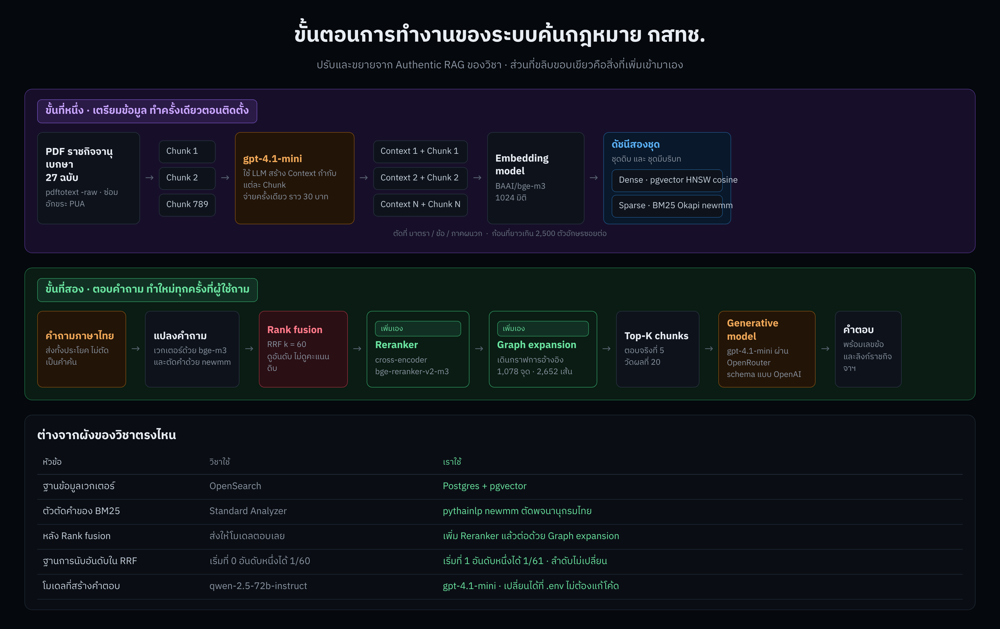

ผังนี้วางตามโครง **Authentic RAG** ที่ใช้ในวิชา เพื่อให้เทียบกันได้ทีละกล่อง
แถบม่วงคือการนำเข้าเอกสารซึ่งทำครั้งเดียว แถบเขียวคือตอนตอบคำถามซึ่งทำใหม่ทุกครั้ง
และ **กล่องที่ขลิบขอบเขียวคือสองขั้นที่เราเพิ่มเข้ามาเอง** ไม่มีในผังต้นแบบ

แถบล่างสุดของภาพเทียบให้เห็นว่าต่างจากผังของวิชาตรงไหนบ้าง ห้าข้อ
ที่สำคัญที่สุดคือ **ตัวตัดคำของ BM25** เพราะ Standard Analyzer แยกคำด้วยช่องว่าง
ซึ่งใช้กับภาษาไทยไม่ได้เลย ทั้งประโยคจะกลายเป็นคำเดียว

ส่วนภาพถัดไปเป็นผังเดียวกันแต่ลงรายละเอียดของแต่ละขั้นมากกว่า

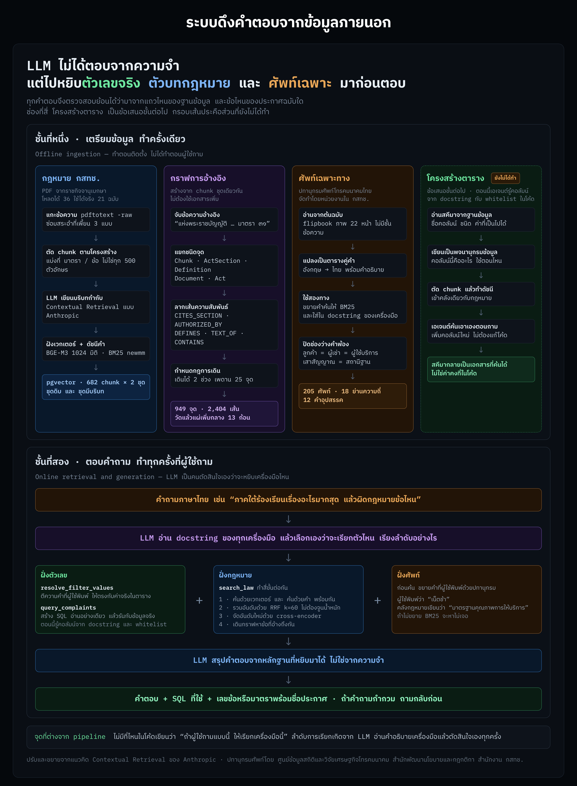

จุดสำคัญคือ **LLM ไม่ได้ตอบจากความจำของตัวเอง** ทุกคำตอบประกอบขึ้นจากของที่หยิบมาได้จริงสี่ชุด

| ชุดข้อมูลภายนอก | เป็นอะไร | เข้าถึงด้วยวิธีไหน |
| --- | --- | --- |
| เรื่องร้องเรียน | SQLite 42,806 แถว | SQL อ่านอย่างเดียว **ไม่ใช่ RAG** |
| ตัวบทกฎหมาย กสทช. | PDF 21 ฉบับ ตัดเป็น 682 chunk | RAG เวกเตอร์ + BM25 + rerank |
| ความสัมพันธ์ระหว่างข้อกฎหมาย | 949 จุด 2,404 เส้น | GraphRAG เดินกราฟการอ้างอิง |
| ศัพท์เฉพาะทางโทรคมนาคม | 205 คำ | ตารางคู่คำ ใช้ขยายคำค้นก่อนค้น |

โครงของภาพปรับจากแผนภาพ Authentic RAG ที่ใช้ในวิชา แล้วขยายเพิ่มสองส่วนที่โจทย์นี้ต้องการ
คือ **ชั้นกราฟ** สำหรับตามข้อที่อ้างถึงกัน และ **ชั้นศัพท์เฉพาะ** สำหรับแปลคำที่ชาวบ้านพิมพ์
ให้ตรงกับคำที่กฎหมายใช้

#### ที่มาของคลังเอกสาร

ต้นทางคือ [ชุดข้อมูลกฎหมายทั้งหมดของสำนักงาน กสทช.](https://datacatalog.nbtc.go.th/dataset/law_data)
ซึ่งเป็นสารบัญ **437 ฉบับ** พร้อมลิงก์ไปราชกิจจานุเบกษา

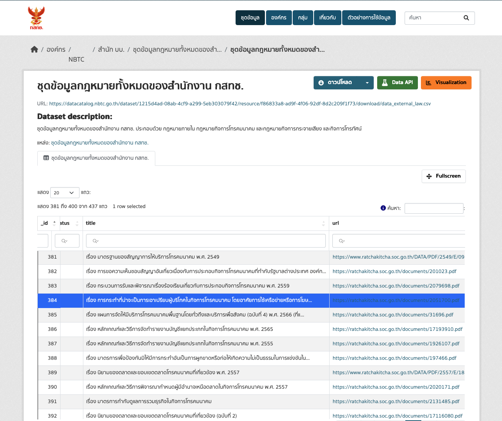

แต่ละแถวมี `applicable_law`, `legal_categories`, `law_types`, `title` และ `url`
ที่ชี้ไปยังไฟล์ PDF ของราชกิจจานุเบกษา ซึ่งเป็นตัวบทฉบับจริง

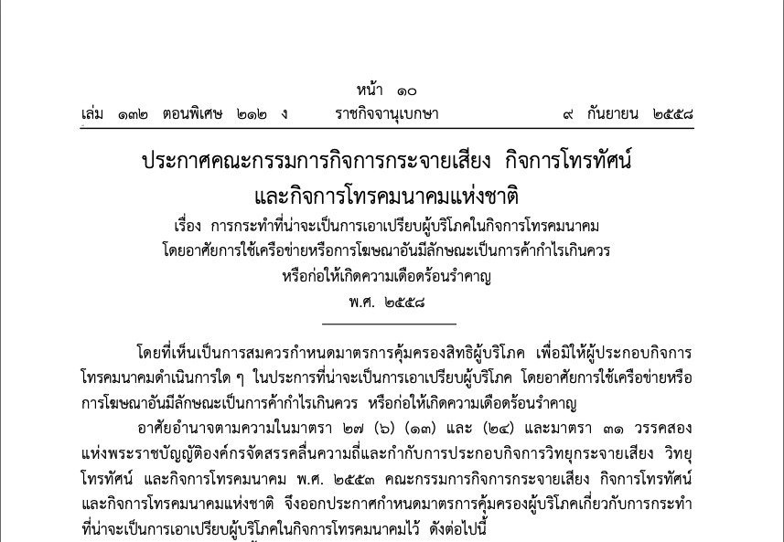

ตัวอย่างแถวที่ใช้จริง แถว 384 คือ **ประกาศเรื่อง การกระทำที่น่าจะเป็นการเอาเปรียบผู้บริโภค
ในกิจการโทรคมนาคม โดยอาศัยการใช้เครือข่ายหรือการโฆษณา** ซึ่งกลายเป็นฉบับที่ถูกค้นเจอบ่อยที่สุด
ตอนทดสอบระบบ

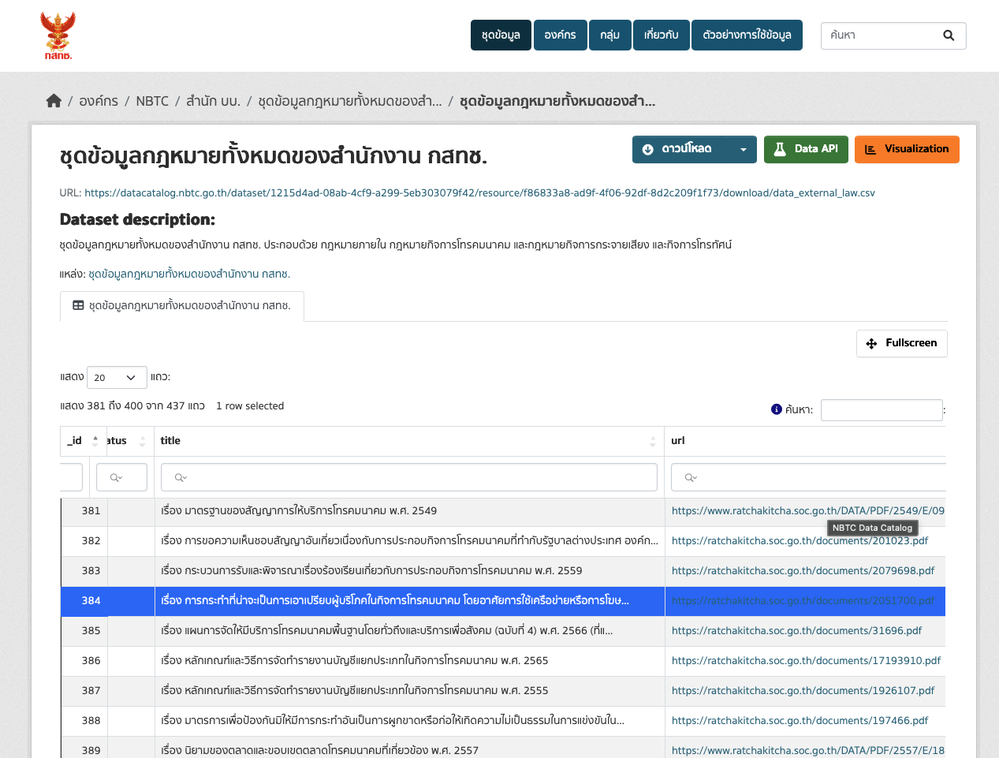

เปิดลิงก์ในแถวนั้นจะได้ตัวบทฉบับเต็ม และท้ายประกาศมี **ภาคผนวก** ที่ลงตัวอย่างการกระทำไว้เป็นข้อ ๆ
ส่วนนี้มีประโยชน์ที่สุดเวลาผู้ใช้ถามว่าเรื่องที่ตัวเองเจอเข้าข่ายหรือเปล่า

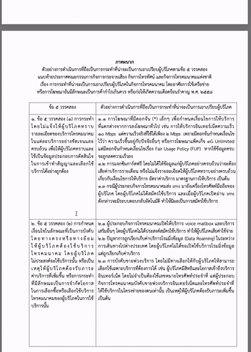

ภาคผนวกนี้เองที่ทำให้ตัวตัด chunk พังรอบแรก เพราะคำว่า ภาคผนวก โผล่เป็นหัวกระดาษซ้ำทุกหน้า
ตัวตัดจึงสลับโหมดเร็วเกินไป แล้วลาก `ข้อ ๕` ของตัวประกาศไปเป็น `ภาคผนวก_5`
วิธีแก้อยู่ในหัวข้อการตัด chunk ด้านล่าง ผลสุดท้ายภาคผนวกนี้กลายเป็น chunk
`33_protect::ข้อ_5_d1` และ `33_protect::ข้อ_5_d2` ซึ่งทั้งคู่ถูกค้นเจอจริงตอนทดสอบ

| ขั้น | เหลือ | เกณฑ์ |
| --- | --- | --- |
| สารบัญทั้งหมด | 437 | |
| คัดที่เกี่ยวกับการร้องเรียนและการคุ้มครองผู้ใช้บริการ | **36** | `พ.ร.บ.` ฐานอำนาจ 9 · หมวด `ส่งเสริม/คุ้มครอง` 11 · ชื่อเรื่องตรงคำสำคัญ 17 |
| แกะข้อความจาก PDF ได้จริง | **21** | ตัดฉบับที่เป็นภาพสแกนและฉบับที่ฟอนต์ไม่ให้รหัสวรรณยุกต์ |
| ตัดเป็น chunk | **682** | 563 หน้า · อักษรไทย 767,783 ตัว |

ฉบับหัวใจของโจทย์อยู่ในกลุ่มที่ใช้ได้ครบ ได้แก่ **ประกาศ กสทช. เรื่อง กระบวนการรับและพิจารณาเรื่องร้องเรียน
เกี่ยวกับการประกอบกิจการโทรคมนาคม พ.ศ. 2559**, มาตรฐานของคุณภาพการให้บริการโทรคมนาคม,
การกระทำที่น่าจะเป็นการเอาเปรียบผู้บริโภค และมาตรการคุ้มครองสิทธิเกี่ยวกับข้อมูลส่วนบุคคล

#### สี่ปัญหาของ PDF ภาษาไทยที่ต้องแก้ก่อน

ขั้นนี้ไม่มี AI เลย แต่ตัดสินคุณภาพของทุกอย่างที่ตามมา บันทึกไว้เพราะเป็นปัญหาที่หาสาเหตุยาก

| ปัญหา | อาการ | ผลถ้าไม่แก้ |
| --- | --- | --- |
| `pdftotext -layout` แทรกช่องว่างกลางคำ | `ผู้ รั บ ใบอนุ ญ าต` | ตัวตัดคำไทยพัง BM25 นับคำผิดทั้งระบบ |
| PDF เข้ารหัสสระอำเป็นสองอักขระ | `ํ` + `า` แทน `ำ` | ค้นคำว่า `สำนักงาน` ได้ **0 ครั้ง** ทั้งที่มีอยู่เต็มไปหมด |
| ฉบับรวมเล่มมี `U+FFFD` คั่นกลางคำ | `กำ�กับ` | ครึ่งหนึ่งของคำที่มีสระอำค้นไม่เจอ |
| ฟอนต์เก่าไม่ให้รหัสวรรณยุกต์ | `ข้อ` กลายเป็น `ขอ` | ตัวตัด chunk หาหัวข้อไม่เจอสักข้อ |

สามข้อแรกแก้ได้ ข้อสุดท้ายแก้ไม่ได้นอกจาก OCR จึงคัดฉบับเหล่านั้นออก

ตัวเลขที่พิสูจน์ว่าแก้แล้วต่างจริง วัดกับ พ.ร.บ. องค์กรจัดสรรคลื่นความถี่ฯ

| คำ | ก่อนแก้ | หลังแก้ |
| --- | --- | --- |
| `กำกับ` | 101 | **270** |
| `สำนักงาน` | 124 | **245** |
| `กำหนด` | 168 | **315** |

#### ตัด chunk ตามโครงสร้างของตัวบท ไม่ใช่ตามจำนวนตัวอักษร

หน่วยที่คนอ้างอิงกฎหมายคือ **ข้อ** สำหรับประกาศ และ **มาตรา** สำหรับ พ.ร.บ.
ถ้าตัดด้วยหน้าต่างเลื่อน 800 ตัวอักษร วรรคท้ายของข้อ ๕ จะไปอยู่ก้อนเดียวกับหัวของข้อ ๖
แล้วโมเดลจะอ้างเลขข้อผิดด้วยความมั่นใจเต็มร้อย

ทุก chunk ถูกเติมหัวเรื่องกลับเข้าไป ซึ่งเป็นบริบทแบบคงที่ที่ได้มาฟรีจากโครงสร้าง

```
[เรื่อง กระบวนการรับและพิจารณาเรื่องร้องเรียนฯ พ.ศ. 2559] [หมวด 2] [ส่วนที่ 2] ข้อ 17
ข้อ ๑๗ กรณีเรื่องร้องเรียนใดเป็นเรื่องร้องเรียนที่คณะกรรมการ...
พร้อมเหตุผลภายในสามสิบวันนับแต่วันที่สำนักงานได้รับเรื่องร้องเรียน
```

| หน่วย | จำนวน | | ขนาด chunk | |
| --- | --- | --- | --- | --- |
| `มาตรา` | 374 | | เล็กสุด | 50 ตัวอักษร |
| `ข้อ` | 260 | | กลาง | **565** |
| อารัมภบท | 26 | | ใหญ่สุด | 2,497 |
| `ภาคผนวก` | 22 | | | |

ภาคผนวกถูกแยกเป็นหน่วยของตัวเอง เพราะถ้าไม่แยก **ข้อสุดท้ายของประกาศจะกวาดตารางตัวชี้วัด
ทั้งหมดเข้ามาเป็นก้อนเดียว 49,370 ตัวอักษร**

#### Contextual Retrieval ให้ LLM เขียนบริบทกำกับทุก chunk

ตามแนวทางที่ Anthropic เสนอ คือ **สร้างคำบรรยายบริบทต่อหน้า chunk ก่อนนำไปทำดัชนี**
เรียกโมเดล `openai/gpt-4.1-mini` 682 ครั้ง ใช้เวลา 185 วินาที

ตัวอย่างที่เห็นผลชัดที่สุด

```
ตัวบท : (๓) ด้านอื่นๆ ที่จะยังประโยชน์ต่อการปฏิบัติหน้าที่ของ กสทช. จำนวนสองคน
        ให้เลขาธิการ กสทช. เป็นเลขานุการ กสทช.

บริบท : การสรรหากรรมการ กสทช. ในอารัมภบทของพระราชบัญญัติองค์กรจัดสรรคลื่นความถี่ฯ
        พ.ศ. 2553 ระบุขั้นตอนและคณะกรรมการที่มีหน้าที่คัดเลือกกรรมการ กสทช.
        คำค้นที่เกี่ยวข้องได้แก่ การแต่งตั้งกรรมการ กสทช. คณะกรรมการสรรหา
```

ตัวบทเพียว ๆ **ค้นยังไงก็ไม่เจอ** ไม่มีคำว่าสรรหา ไม่มีคำว่ากรรมการ ไม่บอกว่าเป็นกฎหมายอะไร

อีกตัวอย่างหนึ่ง ตัวบทเขียนว่า **"ภายในสามสิบวัน"** เป็นตัวหนังสือ แต่บริบทเขียนว่า **"ภายใน 30 วัน"**
เป็นตัวเลข คนที่พิมพ์ค้นว่า *"ต้องตอบภายใน 30 วันไหม"* จึงหาเจอ ทั้งที่ในตัวบทไม่มีเลข 30 อยู่เลย

| ผลตรวจบริบททั้ง 682 ก้อน | |
| --- | --- |
| มีบริบทครบ | 682/682 |
| ความยาว | 205 ถึง 471 · กลาง **338** ตัวอักษร |
| มีรายการคำค้น | 566 ก้อน |
| **บริบทซ้ำกันเป๊ะ** | **0 ก้อน** |

แถวสุดท้ายสำคัญที่สุด ถ้ามีบริบทซ้ำแปลว่าโมเดลเขียนลอย ๆ แบบเดียวกันทั้งคลัง ซึ่งไม่ช่วยแยกอะไรเลย

**จุดที่ปรับจากต้นฉบับของ Anthropic** ต้นฉบับส่งเอกสารทั้งฉบับเข้าไปทุกครั้งแล้วพึ่ง prompt caching
ให้ราคาถูก ฉบับที่ยาวที่สุดของเรามี 364 ก้อน ถ้าส่งสารบัญเต็มทุกครั้งจะต้องส่งราว **22.7 ล้าน token**
จึงเปลี่ยนเป็นส่งสารบัญเฉพาะข้อรอบ ๆ ข้อที่กำลังทำ ±12 ข้อ พร้อมอารัมภบทที่เป็นที่อยู่ของฐานอำนาจ
เหลือ **3.94 ล้าน token**

#### GraphRAG กราฟจากการอ้างอิงในตัวบท

กฎหมายไม่พูดซ้ำ แต่ชี้ไปหากัน ข้อห้ามอยู่ฉบับหนึ่ง บทลงโทษอยู่อีกฉบับ
และมาตราที่ว่าด้วยค่าปรับไม่มีคำว่า `ค่าบริการ` หรือ `เอาเปรียบ` อยู่เลยสักคำ
**สิ่งที่ผูกสองที่นี้เข้าด้วยกันไม่ใช่ความคล้ายของถ้อยคำ แต่เป็นการอ้างอิง**

| ชนิด node | จำนวน | | ชนิดเส้น | จำนวน |
| --- | --- | --- | --- | --- |
| Chunk | 682 | | `CITES_SECTION` | **868** |
| ActSection | 173 | | `CONTAINS` | 682 |
| Definition | 65 | | `TEXT_OF` | 374 |
| Document | 21 | | `SECTION_OF` | 173 |
| Act | 8 | | `AUTHORIZED_BY` | 111 |
| **รวม** | **949 node** | | `DEFINES` · `CITES_CLAUSE` | 108 · 88 · **รวม 2,404 edge** |

**ปัญหาแรก เลขมาตราถูกเขียนก่อนชื่อ พ.ร.บ.**

```
อาศัยอำนาจตามความในมาตรา ๒๗ ... และมาตรา ๕๗ (๔) ประกอบกับ มาตรา ๓๑ และมาตรา ๔๐
   แห่งพระราชบัญญัติองค์กรจัดสรรคลื่นความถี่ฯ พ.ศ. ๒๕๕๓          ← ฉบับที่ 1
ประกอบกับมาตรา ๔๕ มาตรา ๔๖ และมาตรา ๕๐
   แห่งพระราชบัญญัติการประกอบกิจการโทรคมนาคม พ.ศ. ๒๕๔๔          ← ฉบับที่ 2
```

ถ้าจับแค่ `มาตรา ๕๗` โดยไม่ดูว่าตามด้วย `แห่ง` ฉบับไหน จะผูกเส้นผิดฉบับทั้งหมด
ต้องกวาดจากซ้ายไปขวา เก็บเลขที่ค้างไว้ แล้วยกให้ พ.ร.บ. ตัวแรกที่เจอ

**ปัญหาที่สอง node เอกสารเป็นหลุมดำ** เดิน 2 ก้าวจากข้อ ๑๗ แบบไม่มีกติกาได้ 37 node
ซึ่ง 29 ตัวเป็นเพื่อนร่วมฉบับที่ไม่เกี่ยวกันเลย จึงกำหนดทิศทางของทุกเส้น
ขึ้นจาก chunk ไปหาเอกสารได้ แต่**ห้ามลงจากเอกสารไปหา chunk อื่น**

ผลคือเดิน 3 ก้าวจากข้อ ๑๗ แล้วไปถึงฐานอำนาจตามกฎหมายได้จริง

```
ข้อ ๑๗ แจ้งผลภายในสามสิบวัน
  └ hop1 CONTAINS      → ประกาศกระบวนการรับและพิจารณาเรื่องร้องเรียน
      └ hop2 AUTHORIZED_BY → มาตรา 45 46 50 ของ พ.ร.บ. ประกอบกิจการโทรคมนาคม
                           → มาตรา 27 31 40 57 ของ พ.ร.บ. องค์กรจัดสรรฯ
          └ hop3 TEXT_OF   → ตัวบทจริงของมาตรา ๒๗
                             "(๑๓) คุ้มครองสิทธิและเสรีภาพของประชาชน
                              มิให้ถูกเอาเปรียบจากผู้ประกอบกิจการ"
```

บรรทัดสุดท้ายคือฐานอำนาจของกระบวนการร้องเรียนทั้งหมด อยู่คนละฉบับ คนละเล่ม
และ **ไม่มีคำว่าร้องเรียนอยู่เลย** การค้นด้วยเวกเตอร์ล้วนจึงหาไม่เจอ

กราฟถูกเขียนออกเป็น `data/law/law_graph.cypher` ด้วย เผื่อย้ายไป Neo4j ภายหลัง

#### กลไกการค้นทีละขั้น ตั้งแต่คำถามจนได้ chunk

หัวข้อนี้ลงรายละเอียดระดับโค้ดและสูตร ว่าแต่ละขั้นทำอะไรกับข้อมูลจริง

##### ขั้นที่ 1 · Sparse Search ด้วย BM25

**ตอนทำดัชนี** ทำครั้งเดียวใน `lawrag/index.py`

```python
def tokenize(text: str) -> list[str]:
    from pythainlp.tokenize import word_tokenize
    return [w for w in word_tokenize(text, engine="newmm")
            if w.strip() and len(w.strip()) > 1]

corpus = [tokenize(r[field]) for r in rows]     # ตัดคำทั้ง 682 ก้อน
bm25 = BM25Okapi(corpus)                        # นับสถิติ ยังไม่คำนวณคะแนน
pickle.dump({"bm25": bm25, "ids": [r["id"] for r in rows],
             "variant": variant, "field": field}, f)
```

ขั้นนี้ยังไม่คำนวณคะแนน เก็บแค่สถิติสามอย่าง คือ **ความถี่ของคำในแต่ละก้อน**
**จำนวนก้อนที่มีคำนั้น** และ **ความยาวของแต่ละก้อน** คะแนนจะคำนวณตอนค้นเท่านั้น

ต้องเก็บ `ids` ไว้ด้วย เพราะ `BM25Okapi` คืนคะแนนเป็นลิสต์เรียงตามลำดับ corpus
ไม่ได้คืนชื่อเอกสาร ถ้าลำดับเพี้ยนเมื่อไหร่ ผลค้นจะชี้ผิดก้อนทั้งหมดโดยไม่มี error ให้เห็น

**ทำไมไม่ใช้ตัวตัดคำมาตรฐาน** ตัวตัดคำแบบ Standard Analyzer แยกคำด้วยช่องว่าง
ซึ่งใช้กับภาษาไทยไม่ได้เพราะภาษาไทยไม่เว้นวรรคระหว่างคำ ทั้งประโยคจะกลายเป็นคำเดียว
`newmm` ตัดตามพจนานุกรมไทย ผลที่ได้จากคำถามจริงข้อหนึ่งในชุดทดสอบ

```
คำถาม   ร้องเรียนแล้วผู้ให้บริการต้องแก้ปัญหาให้เสร็จภายในกี่วัน

newmm   ร้องเรียน · แล้ว · ผู้ให้บริการ · ต้อง · แก้ปัญหา
        ให้ · เสร็จ · ภายใน · กี่ · วัน
```

ได้ 10 คำที่มีความหมาย โดย `ผู้ให้บริการ` ถูกมองเป็นคำเดียว ไม่ได้แตกเป็น ผู้ + ให้ + บริการ
ส่วนเงื่อนไข `len > 1` ทิ้งเศษอักขระเดี่ยวที่หลงมาจากการแกะ PDF

**ตอนค้น** ใน `lawrag/retrieve.py`

```python
def lexical(self, query: str, variant: str, k: int) -> list[str]:
    from .index import tokenize
    d = self.bm25[variant]
    scores = d["bm25"].get_scores(tokenize(query))
    order = sorted(range(len(scores)), key=lambda i: -scores[i])[:k]
    return [d["ids"][i] for i in order]
```

**สูตรที่ `rank_bm25` ใช้จริง** เป็น BM25Okapi ค่าตั้งต้น `k1 = 1.5` `b = 0.75` `ε = 0.25`

```
score(q, d) = Σ  idf(t) ×  ──────────────────────────────────
             t ∈ q              f(t,d) + k1 × (1 − b + b × |d|/avgdl)

                              f(t,d) × (k1 + 1)

โดยที่
   idf(t)  = log(N − df(t) + 0.5) − log(df(t) + 0.5)
   f(t,d)  = จำนวนครั้งที่คำ t ปรากฏในก้อน d
   |d|     = จำนวนคำในก้อน d
   avgdl   = ความยาวเฉลี่ยของทุกก้อน
   N       = 682 ก้อน
```

`idf` ติดลบได้เมื่อคำนั้นอยู่ในเกินครึ่งหนึ่งของคลัง ซึ่งเกิดขึ้นจริงกับคำอย่าง
`ผู้รับใบอนุญาต` ที่โผล่แทบทุกประกาศ กรณีนั้น `rank_bm25` จะตั้งพื้นให้เป็น `ε × idf เฉลี่ย`
เพื่อไม่ให้คำสามัญกลายเป็นคะแนนติดลบที่ดึงเอกสารตกอันดับ

ส่วน `b = 0.75` คือตัวปรับความยาว ก้อนที่ยาวกว่าค่าเฉลี่ยจะถูกหารมากขึ้น
ป้องกันไม่ให้ `มาตรา ๒๗` ที่ยาว 2,497 ตัวอักษรได้เปรียบ `ข้อ ๒` ที่ยาว 80 ตัวอักษรเพียงเพราะยาวกว่า

##### ขั้นที่ 2 · Dense Search ด้วยเวกเตอร์

```python
def dense(self, query: str, variant: str, k: int) -> list[str]:
    v = self.embed.encode([query], normalize_embeddings=True)[0]
    lit = "[" + ",".join("%.6f" % x for x in v) + "]"
    with self.conn.cursor() as cur:
        # <=> คือระยะ cosine ของ pgvector ยิ่งน้อยยิ่งใกล้
        cur.execute(f"""SELECT chunk_id FROM law_vec_{variant}
                        ORDER BY emb <=> %s::vector LIMIT %s""", (lit, k))
        return [r[0] for r in cur.fetchall()]
```

**สิ่งที่เก็บในฐานข้อมูล**

```sql
CREATE TABLE law_vec_ctx (
    chunk_id text PRIMARY KEY REFERENCES law_chunk(id),
    emb      vector(1024)        -- จาก BAAI/bge-m3
);
CREATE INDEX ON law_vec_ctx USING hnsw (emb vector_cosine_ops);
```

ตัวดำเนินการ `<=>` ของ pgvector คือ **cosine distance** ซึ่งเท่ากับ `1 − cosine similarity`
ค่าอยู่ระหว่าง 0 ถึง 2 โดย **ยิ่งน้อยยิ่งใกล้** จึงเรียง `ORDER BY` จากน้อยไปมาก

เราเรียก `encode(..., normalize_embeddings=True)` ตั้งแต่ตอนทำดัชนีและตอนค้น
เวกเตอร์ทุกตัวจึงมีความยาวเป็น 1 ซึ่งทำให้ cosine distance เทียบกันได้ตรง ๆ
ถ้าลืม normalize ฝั่งใดฝั่งหนึ่ง ผลจะเพี้ยนโดยไม่มี error ให้เห็น

ดัชนี HNSW ทำให้ไม่ต้องเทียบครบทุกแถว แลกกับการที่ผลอาจไม่ใช่เพื่อนบ้านที่ใกล้ที่สุดจริง 100%
ที่ขนาด 682 ก้อน ความต่างแทบไม่มีผล แต่เขียนไว้เพราะถ้าคลังโตเป็นหมื่นก้อนต้องกลับมาดูจุดนี้

##### ขั้นที่ 3 · รวมสองลำดับด้วย RRF

```python
RRF_K = 60

def rrf(rank_lists: list[list[str]]) -> list[tuple[str, float]]:
    score: dict[str, float] = defaultdict(float)
    for lst in rank_lists:
        for rank, cid in enumerate(lst, 1):
            score[cid] += 1.0 / (RRF_K + rank)
    return sorted(score.items(), key=lambda x: -x[1])
```

```
RRF_score(d) = Σ  1 / (k + rank(d))      โดย k = 60
             ทุกลำดับ
```

**ทำไมต้องใช้อันดับ ไม่ใช้คะแนนดิบ** เพราะคะแนน BM25 กับระยะ cosine อยู่คนละหน่วยและคนละช่วง
BM25 เป็นค่าบวกไม่จำกัดเพดาน ส่วน cosine distance อยู่ระหว่าง 0 ถึง 2
จะเอามาบวกกันตรง ๆ ไม่ได้ ถ้าจะทำต้อง normalize แล้วจูนน้ำหนัก ซึ่งต้องมีชุดพัฒนาไว้จูน
RRF ตัดปัญหานี้ทิ้งโดยดูแค่ว่าแต่ละวิธีจัดเอกสารนั้นไว้อันดับที่เท่าไหร่

**ค่า k = 60 ทำอะไร** ยิ่ง k มาก ความต่างระหว่างอันดับต้นกับอันดับท้ายยิ่งแคบ
ที่ k = 60 อันดับ 1 ได้ `1/61 = 0.0164` ส่วนอันดับ 10 ได้ `1/70 = 0.0143` ต่างกันแค่ 14%
แปลว่าเอกสารที่ **ติดทั้งสองลำดับ** จะชนะเอกสารที่ **เด่นมากในลำดับเดียว** ซึ่งเป็นพฤติกรรมที่ต้องการ

**ตัวอย่างการคำนวณ** ตัวเลขอันดับในตารางนี้เป็นตัวอย่างสมมติเพื่อแสดงวิธีคิด

| เอกสาร | อันดับจาก BM25 | อันดับจากเวกเตอร์ | การคำนวณ | คะแนนรวม |
| --- | --- | --- | --- | --- |
| doc_A | 1 | 3 | `1/61 + 1/63` | **0.0323** |
| doc_B | 2 | ไม่ติด | `1/62 + 0` | 0.0161 |
| doc_C | ไม่ติด | 1 | `0 + 1/61` | 0.0164 |

อ่านตารางนี้ได้ว่า **doc_A ชนะทั้งที่ไม่ได้เป็นที่หนึ่งของฝั่งเวกเตอร์** เพราะติดทั้งสองลำดับ
และ **doc_C แซง doc_B** ทั้งที่ doc_B ติดอันดับ 2 ของ BM25 เพราะ doc_C เป็นที่หนึ่งของอีกฝั่ง

> [!NOTE]
> **จุดที่ต่างจากตัวอย่างในสไลด์ของวิชา** สไลด์นับอันดับเริ่มจาก 0 เอกสารอันดับหนึ่งจึงได้ `1/60`
> ส่วนโค้ดของเราใช้ `enumerate(lst, 1)` อันดับหนึ่งจึงได้ `1/61`
>
> **ลำดับผลลัพธ์ไม่เปลี่ยน** เพราะเป็นการเลื่อนเท่ากันทุกตัวในทุกลำดับ
> แต่ตัวเลขคะแนนจะไม่ตรงกับสไลด์ จึงบันทึกไว้เพื่อให้เทียบกันได้ถูก

##### ขั้นที่ 4 · จัดอันดับใหม่ด้วย cross-encoder

```python
CAND = 30     # จำนวนผู้เข้าชิงที่ส่งให้ cross-encoder

def rerank(self, query: str, ids: list[str], variant: str, k: int) -> list[str]:
    if not self.reranker or not ids:
        return ids[:k]
    pairs = [(query, self.meta[i][variant]) for i in ids if i in self.meta]
    valid = [i for i in ids if i in self.meta]
    scores = self.reranker.predict(pairs)
    return [i for _, i in sorted(zip(scores, valid), key=lambda x: -x[0])][:k]
```

**ต่างจากขั้นที่ 2 ตรงไหน** นี่คือจุดที่คนสับสนบ่อยที่สุด

| | bi-encoder (ขั้นที่ 2) | cross-encoder (ขั้นที่ 4) |
| --- | --- | --- |
| อ่านอะไร | คำถามกับเอกสาร **แยกกัน** | คำถามกับเอกสาร **พร้อมกันเป็นคู่** |
| แปลงเอกสารล่วงหน้าได้ไหม | **ได้** ทำครั้งเดียวตอน index | **ไม่ได้** ต้องคำนวณใหม่ทุกคู่ทุกคำถาม |
| งานต่อหนึ่งคำถาม | encode คำถาม 1 ครั้ง แล้วเทียบเวกเตอร์ | forward pass **30 ครั้ง** |
| จับความสัมพันธ์ได้ลึกแค่ไหน | ความคล้ายโดยรวม | **คำไหนในคำถามตรงกับส่วนไหนของเอกสาร** |
| เวลาที่วัดได้จริง | 78 วินาที | **425 วินาที** |

cross-encoder แม่นกว่าเพราะโมเดลได้เห็นคำถามกับตัวบทในหน้าต่างเดียวกัน
มันจึงรู้ได้ว่าคำว่า *กี่วัน* ในคำถาม ตรงกับ *ภายในสามสิบวัน* ในตัวบท
ซึ่ง bi-encoder ที่บีบทั้งก้อนเหลือเวกเตอร์เดียวตั้งแต่ตอน index จับไม่ได้

แลกมาด้วยราคาที่แพง จึงใช้เป็น**ขั้นที่สอง** กับผู้เข้าชิง 30 ตัวที่ผ่านขั้นแรกมาแล้วเท่านั้น
ไม่ใช่ใช้กับทั้ง 682 ก้อน ซึ่งจะกินเวลาราว 22 เท่า

##### ขั้นที่ 5 · ขยายผลด้วยกราฟการอ้างอิง

```python
GRAPH_HOPS = 2
GRAPH_CAP = 25

extra = self.expand(fused[:5])                      # เดินจาก 5 อันดับแรก
fused = fused + [e for e in extra if e not in fused]  # ต่อท้าย ไม่จัดอันดับใหม่
```

**ทำไมต่อท้าย ไม่เอาไปจัดอันดับรวมกัน** เพราะของที่เดินกราฟมาได้
มาด้วยเหตุผลคนละแบบ มัน**เกี่ยวข้องเพราะถูกอ้างถึง ไม่ใช่เพราะข้อความคล้ายคำถาม**
ถ้าเอาไปให้ cross-encoder ให้คะแนนรวมกัน มันจะถูกตัดทิ้งทันทีเพราะข้อความไม่เหมือนคำถาม
ทั้งที่เป็นข้อที่ต้องอ่านประกอบ

**วัดแล้วได้อะไร** สุ่มจุดตั้งต้น 3 ก้อน 300 รอบ

```
แผ่ออกได้ chunk ใหม่   กลาง 13 ก้อน  มากสุด 19
แผ่ไม่ได้เลย            11 รอบ จาก 300
เส้นที่พาของใหม่เข้ามา   TEXT_OF 1,794 · CITES_SECTION 1,320
                       DEFINES 113 · CITES_CLAUSE 96
```

##### ขั้นที่ 6 · ส่งให้ LLM ผ่าน OpenRouter

```python
client = OpenAI(
    base_url="https://openrouter.ai/api/v1",
    api_key=os.environ["OPENROUTER_API_KEY"],
)
```

เราเรียกด้วย SDK ของ OpenAI ทั้งที่ไม่ได้ใช้โมเดลของ OpenAI โดยตรง เพราะ
**OpenRouter ทำหน้าที่เป็นตัวกลางที่แปลง schema ของทุกค่ายให้เป็นรูปแบบเดียวกับ OpenAI**

เอกสารของ OpenRouter ระบุว่า request และ response schema ของเขาคล้ายกับ OpenAI Chat API มาก
และเขา normalize schema ข้ามโมเดลและข้ามผู้ให้บริการ เพื่อให้ผู้ใช้เรียนรู้แค่แบบเดียว
เฉพาะฝั่ง response เขาระบุชัดว่า normalize ให้ตรงตาม OpenAI Chat API
ซึ่งแปลว่า `choices` จะเป็น array เสมอ แม้โมเดลจะคืนคำตอบมาอันเดียว

ผลในทางปฏิบัติคือเปลี่ยนโมเดลได้ด้วยการแก้ค่าเดียวใน `.env`

```
LLM_MODEL=openai/gpt-4.1-mini      →  LLM_MODEL=qwen/qwen-2.5-72b-instruct
```

โดยไม่ต้องแก้โค้ดแม้แต่บรรทัดเดียว เพราะรูปร่างของ `messages`, `tools`, `tool_calls`
และ `choices[0].message` เหมือนกันหมด

> [!WARNING]
> **normalize ไม่ได้แปลว่าทุกโมเดลทำได้เหมือนกัน**
> schema หน้าตาเดียวกัน แต่โมเดลที่ไม่รองรับ tool calling ก็ยังเรียก tool ไม่ได้
> และพารามิเตอร์บางตัวอย่าง `top_p` ไม่ใช่ทุกผู้ให้บริการที่รองรับ
> ถ้าจะเปลี่ยนโมเดลต้องทดสอบว่ายังเรียก tool ได้จริงก่อน ไม่ใช่เปลี่ยนแล้วใช้ได้เลย

##### สรุปต้นทุนแต่ละขั้นจากที่วัดได้จริง

ตัวเลขจาก log ของรอบที่ยกมาในหัวข้อสาธิต

| ขั้น | ความซับซ้อน | เวลาที่วัดได้ | เกิดทุกคำถามไหม |
| --- | --- | --- | --- |
| โหลดโมเดลสองตัว | — | 179 วินาที | ไม่ ครั้งแรกครั้งเดียว |
| ตัดคำคำถามด้วย newmm | O(ความยาวคำถาม) | < 1 วินาที | ใช่ |
| BM25 ให้คะแนน 682 ก้อน | O(จำนวนคำ × 682) | < 1 วินาที | ใช่ |
| encode คำถามเป็นเวกเตอร์ | forward pass 1 ครั้ง | **78 วินาที** | ใช่ |
| ค้น HNSW ใน pgvector | ประมาณ O(log n) | < 1 วินาที | ใช่ |
| RRF | O(k log k) | < 1 วินาที | ใช่ |
| **cross-encoder 30 คู่** | **forward pass 30 ครั้ง** | **425 วินาที** | ใช่ |
| เดินกราฟ 2 ช่วง เพดาน 25 | O(เส้นที่เดินผ่าน) | < 1 วินาที | เฉพาะวิธีที่ใช้กราฟ |
| **รวมทั้งรอบที่ log บันทึก** | | **714,039 ms** | |

**ข้อสรุปที่ได้** งานที่กินเวลาเกือบทั้งหมดคือสองขั้นที่ต้องรันโมเดลบน CPU
ส่วนขั้นที่เป็นการคำนวณล้วนอย่าง BM25 และ RRF เร็วจนวัดแทบไม่ได้
ถ้าจะทำให้ระบบเร็วขึ้น ต้องไปลดงานของโมเดล ไม่ใช่ไปปรับอัลกอริทึมการค้น

ตัวเลขชุดนี้วัดบนเครื่องที่ Docker ได้แรม 3.73 GB และ CPU ถูกใช้ไป 1281% จาก 800% ที่มี
บนเครื่องที่ทรัพยากรพอ ตัวเลขสองแถวที่หนาจะลดลงมาก แต่สัดส่วนระหว่างกันจะยังเป็นแบบเดิม


#### ชั้นศัพท์เฉพาะทาง ปิดช่องว่างระหว่างคำที่คนพิมพ์กับคำที่กฎหมายใช้

การค้นด้วย BM25 ตกง่ายมากเวลาผู้ร้องเรียนพิมพ์คำพูดชาวบ้าน แต่ตัวบทกฎหมายเขียนด้วยศัพท์ราชการ
สองฝั่งนี้พูดถึงเรื่องเดียวกันแต่ไม่มีคำไหนตรงกันเลย ตัวค้นจึงหาไม่เจอ

| ผู้ใช้พิมพ์ว่า | กฎหมายเขียนว่า | ปทานุกรมเรียกว่า |
| --- | --- | --- |
| ลูกค้า | ผู้ใช้บริการ | ผู้เช่า, ผู้รับบริการ (Subscriber) |
| เสาสัญญาณ | — | สถานีฐาน (Base Station) |
| เน็ตช้า | มาตรฐานคุณภาพการให้บริการ | — |
| ย้ายค่ายเบอร์เดิม | บริการคงสิทธิเลขหมาย | สิทธิการคงเลขหมายเดิม (Number portability) |

เราจึงเพิ่มคลังศัพท์เป็นชุดข้อมูลที่สาม ต้นทางคือ **ปทานุกรมศัพท์โทรคมนาคมไทย**

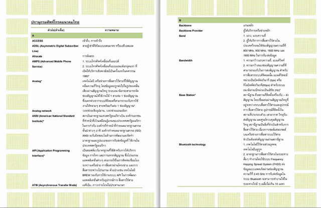

ของดีที่สุดอยู่หน้าสุดท้ายของเล่ม ซึ่งระบุว่า **ผู้จัดทำคือ ศูนย์ข้อมูลสถิติและวิจัยเศรษฐกิจโทรคมนาคม
สำนักพัฒนานโยบายและกฎกติกา** ซึ่งเป็นหน่วยงานใน สำนักงาน กสทช. เอง และอ้างอิง ราชบัณฑิตยสถาน 2546,
วิศวกรรมสถานแห่งประเทศไทย 2541 และ สารานุกรมโทรคมนาคมไทย 2552

แปลว่าศัพท์ชุดนี้ **มาจากต้นทางเดียวกับกฎหมายที่เราใช้** ไม่ใช่เว็บไซต์ต่างประเทศ
จึงอ้างในรายงานได้ว่าเป็นศัพท์ทางการของหน่วยงานกำกับดูแล

| | |
| --- | --- |
| ศัพท์อังกฤษ-ไทย | **205 คำ** ตั้งแต่ A ถึง W |
| ในนั้นมีคำอธิบายยาว | 45 คำ |
| ตารางย่านความถี่ | 18 แถบ ตั้งแต่ VLF ถึง EHF |
| ตารางคำอุปสรรค | 12 ตัว ตั้งแต่ เทระ ถึง พิโก |
| เก็บไว้ที่ | `data/law/telecom_glossary.json` |

ต้นฉบับเป็น flipbook ที่วาดด้วย JavaScript หน้าทั้ง 22 เป็น **ภาพ** ไม่มีชั้นข้อความ
และ endpoint ที่เก็บข้อความถูกปิดไว้ (คืน HTTP 403 ทุกเส้นทาง) จึงดึงเป็นข้อความตรง ๆ ไม่ได้
ต้องเปิดผ่านเบราว์เซอร์แล้วอ่านจากภาพทีละหน้า บันทึกวิธีไว้ในหัว `_meta` ของไฟล์

#### ข้อเสนอขั้นต่อไป ให้เอเจนต์รู้โครงสร้างตารางจาก RAG แทนที่จะฝังไว้ในโค้ด

ตอนนี้เอเจนต์รู้ว่าตารางมีคอลัมน์อะไรจากสองที่ คือ **docstring ของ `query_complaints`**
และ **whitelist `_db.DIMENSIONS`** ทั้งสองอย่างเขียนไว้ตายตัวในซอร์ส

วิธีนี้ทำงานได้และปลอดภัย แต่มีต้นทุนที่เห็นชัดเมื่อข้อมูลเปลี่ยน

| | แบบที่ทำอยู่ | แบบที่เสนอ |
| --- | --- | --- |
| สคีมาอยู่ที่ไหน | ฝังใน docstring และ whitelist | เป็นเอกสารในคลังเดียวกับกฎหมาย |
| เพิ่มคอลัมน์ใหม่ | ต้องแก้โค้ดแล้ว build image ใหม่ | เติมเอกสารแล้วทำดัชนีใหม่ |
| ความยาวของ prompt | คอลัมน์ทั้งหมดถูกส่งไปทุกครั้ง | ส่งเฉพาะคอลัมน์ที่ค้นเจอว่าเกี่ยวกับคำถาม |
| อธิบายคอลัมน์ได้ลึกแค่ไหน | จำกัดด้วยความยาว docstring | เขียนยาวได้ มีตัวอย่าง มีข้อควรระวัง |

ขั้นตอนที่จะทำคือ อ่านสคีมาจากฐานข้อมูลจริง เขียนเป็นพจนานุกรมข้อมูลว่าคอลัมน์ไหนคืออะไร
ใช้ตอนไหน ระวังอะไร แล้วตัด chunk เข้าดัชนีเดียวกับกฎหมาย เวลาผู้ใช้ถาม เอเจนต์จะค้นสคีมา
ที่เกี่ยวข้องมาเองก่อนประกอบ SQL

**ยังไม่ได้ทำ** และตั้งใจไม่เขียนตัวเลขผลลัพธ์ไว้ล่วงหน้า ในแผนภาพด้านบนช่องนี้จึงเป็นกรอบเส้นประ
ข้อควรระวังที่รู้ตัวแล้วคือ whitelist เป็นหนึ่งในสี่ชั้นของกลไกอ่านอย่างเดียว
ถ้าย้ายสคีมาไปอยู่ในคลังเอกสาร **ต้องคงชั้น whitelist ไว้เหมือนเดิม** ไม่ใช่เอาผลจาก RAG
ไปสร้าง SQL ตรง ๆ ไม่งั้นจะเปิดช่องให้ข้อความในเอกสารสั่งงานฐานข้อมูลได้

#### แผนการวัดผล 7 วิธี

วัดแบบเดียวกับที่ Anthropic ใช้ในบทความ Contextual Retrieval คือใช้ `Failed Retrievals @20`
ทั้งสองชุดต่างกัน**ที่ฟิลด์ที่เอาไปทำดัชนีเท่านั้น** โค้ดเดียวกันทั้งหมด

```python
VARIANTS = {"plain": "text", "ctx": "text_contextual"}
```

| กลุ่ม | วิธี |
| --- | --- |
| Standard Retrieval | Embedding · Embedding + BM25 · Reranked embedding + BM25 |
| Contextual Retrieval | Contextual embedding · + contextual BM25 · + Reranked |
| **ของเราเพิ่มเอง** | **Contextual + Reranked + เดินกราฟ** |

แท่งที่ 7 เป็นส่วนที่ Anthropic ไม่ได้วัดไว้ เพราะบทความนั้นไม่มีกราฟ

วัดแล้วจริงว่ากราฟมีของให้เพิ่ม สุ่มจุดตั้งต้น 3 ก้อน 300 รอบ **แผ่ออกได้ chunk ใหม่กลาง 13 ก้อน**
มี 289 รอบจาก 300 ที่แผ่ได้ เส้นที่พาของใหม่เข้ามามากสุดคือ `TEXT_OF` และ `CITES_SECTION`
ผลของกราฟถูกต่อท้ายแถว จึงไม่เปลี่ยนสามอันดับแรก แต่ไปมีผลที่อันดับ 20 ซึ่งเป็นจุดที่เมตริกนี้วัดพอดี

#### แผนการวัดผลชั้นที่สอง ตอบถูกไหม

เมตริกข้างบนวัดว่า **ค้นเจอไหม** ซึ่งตอบไม่ได้ว่าระบบที่ไม่มี RAG เลยจะแย่กว่าแค่ไหน
เพราะถ้าไม่มีการค้น ก็ไม่มีอะไรให้นับ จึงเพิ่มการวัดอีกชั้นที่เทียบกันสามแขน

| แขน | ส่งอะไรให้ LLM | ตอบคำถามว่า |
| --- | --- | --- |
| ไม่มี RAG | ไม่ส่งเอกสารเลย | โมเดลเดาเองได้แค่ไหน |
| มี RAG | top-5 จาก Contextual Retrieval | การค้นช่วยจริงไหม |
| GraphRAG | top-5 ที่ผ่านการเดินกราฟ | กราฟช่วยเพิ่มอีกไหม |

**ให้คะแนนโดยไม่ใช้ LLM ตัดสิน** เช็กตรง ๆ ว่าคำตอบอ้างเลข ข้อ หรือ มาตรา ถูกตัวไหม
เป็นเกณฑ์ที่ตรวจซ้ำได้และไม่มีอคติจากตัวตัดสิน

ค่าใช้จ่ายของทั้งสองชั้นแยกกันชัดเจน ชั้นค้น **ไม่เรียก LLM เลยจึงไม่เสียเงิน** เสียแต่เวลา CPU
ส่วนชั้นตอบเรียก LLM 50 คำถาม × 3 แขน = 150 ครั้ง

#### ผลการวัดชั้นค้น

รันจริงเมื่อ 20-21 พฤศจิกายน 2569 · 50 คำถาม × 7 วิธี = 350 ครั้ง
ใช้เวลา **11,525 วินาที หรือ 3 ชั่วโมง 12 นาที** · **ไม่เสียค่าใช้จ่าย** เพราะไม่เรียก LLM เลย

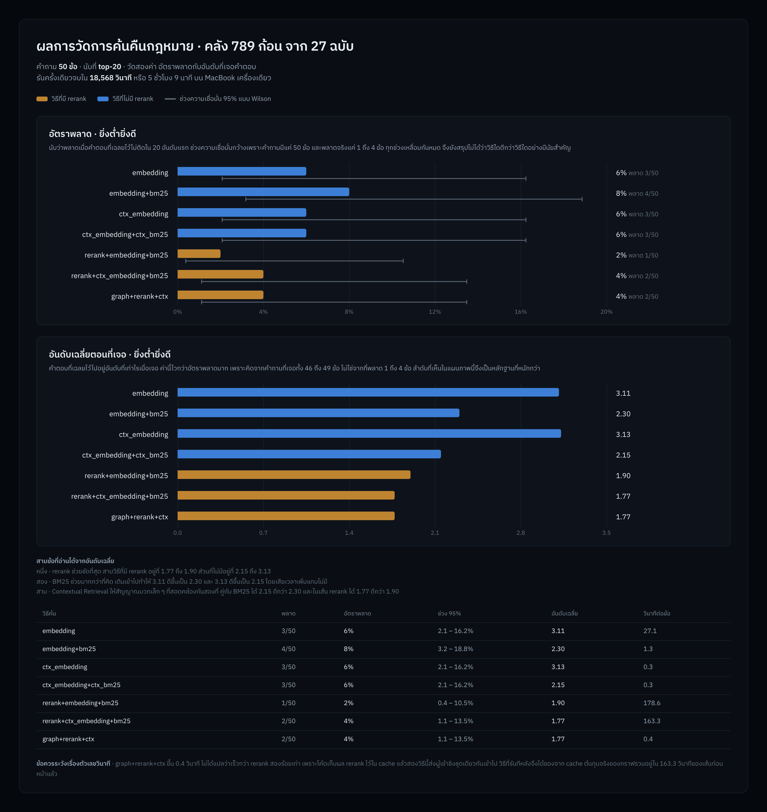

| วิธีค้น | ไม่เจอ | อัตราพลาด | ช่วงความเชื่อมั่น 95% |
| --- | --- | --- | --- |
| embedding | 2/50 | 4.0% | 1.1% – 13.5% |
| embedding + bm25 | 2/50 | 4.0% | 1.1% – 13.5% |
| **rerank + embedding + bm25** | **0/50** | **0.0%** | 0.0% – 7.1% |
| ctx_embedding | 2/50 | 4.0% | 1.1% – 13.5% |
| ctx_embedding + ctx_bm25 | 1/50 | 2.0% | 0.4% – 10.5% |
| rerank + ctx_embedding + bm25 | 1/50 | 2.0% | 0.4% – 10.5% |
| graph + rerank + ctx | 1/50 | 2.0% | 0.4% – 10.5% |

ทำซ้ำได้ด้วย `python3 -m lawrag.rescore` ซึ่งนับคะแนนใหม่จาก id ที่เก็บไว้ ใช้เวลาไม่ถึงวินาที
ไม่ต้องใช้ Docker และไม่ต้องรันโมเดล

##### สามข้อที่อ่านได้จากตัวเลข

**หนึ่ง rerank ช่วย** วิธีเดียวที่ไม่พลาดเลยคือ `rerank + embedding + bm25`
และในสามวิธีที่ต่ำที่สุด สองวิธีมี rerank ซึ่งสอดคล้องกับที่ Anthropic รายงาน

**สอง contextual ไม่ได้ช่วยในชุดนี้** `ctx_embedding` พลาด 4.0% เท่ากับ `embedding` เปล่า ๆ
ขณะที่ Anthropic รายงานว่าลดอัตราพลาดที่ top-20 ได้ 35% และรวมกับ contextual BM25 แล้วลดได้ 49%

นี่คือ**ผลลบที่ต้องรายงานตามจริง** เหตุผลที่น่าจะเป็นมีสองข้อ
คลังของเรามีแค่ 682 ก้อนซึ่งเล็กกว่าที่เขาทดสอบมาก และคำถาม 50 ข้อเราเขียนเอง
จึงใช้คำใกล้เคียงกับตัวบทมากกว่าคำถามของผู้ใช้จริง ระบบจึงอยู่ที่เพดานตั้งแต่วิธีพื้นฐานที่สุด
เมื่อวิธีที่ง่ายที่สุดพลาดแค่ 2 ข้อจาก 50 ก็แทบไม่เหลือที่ให้เทคนิคใดปรับปรุง

**สาม กราฟไม่มีผลกับชุดคำถามนี้** อธิบายแยกไว้ด้านล่าง

##### ข้อควรระวังที่สำคัญที่สุด ความต่างเล็กเกินกว่าจะสรุป

ความต่างระหว่างวิธีคือ **0 ถึง 2 ข้อจาก 50** และช่วงความเชื่อมั่น 95% แบบ Wilson **ทับกันหมดทุกวิธี**
เช่น วิธีที่ดีที่สุดมีช่วง 0.0–7.1% ส่วนวิธีที่แย่ที่สุดมีช่วง 1.1–13.5% ซึ่งคาบเกี่ยวกันเกือบทั้งหมด

แปลว่า **ยังสรุปไม่ได้ว่าวิธีไหนดีกว่ากันอย่างมีนัยสำคัญทางสถิติ** สิ่งที่พูดได้คือแนวโน้ม
ถ้าจะสรุปให้ได้จริงต้องเพิ่มจำนวนคำถามอีกมาก หรือทำให้คำถามยากขึ้นจนระบบหลุดจากเพดาน

##### แยกตามชนิดคำถาม

| วิธีค้น | annex | cross_ref | easy | numeric | vocab_gap |
| --- | --- | --- | --- | --- | --- |
| embedding | 1/3 | 0/3 | 0/20 | 0/6 | 1/18 |
| embedding + bm25 | 0/3 | 1/3 | 1/20 | 0/6 | 0/18 |
| rerank + embedding + bm25 | 0/3 | 0/3 | 0/20 | 0/6 | 0/18 |
| ctx_embedding | 1/3 | 0/3 | 0/20 | 0/6 | 1/18 |
| ctx_embedding + ctx_bm25 | 0/3 | 1/3 | 0/20 | 0/6 | 0/18 |
| rerank + ctx_embedding + bm25 | 0/3 | 1/3 | 0/20 | 0/6 | 0/18 |
| graph + rerank + ctx | 0/3 | 1/3 | 0/20 | 0/6 | 0/18 |

ตัวเลขที่น่าสนใจคือ **คำถามกลุ่ม `easy` 20 ข้อ แทบทุกวิธีตอบได้ครบ** และกลุ่ม `numeric` 6 ข้อไม่มีวิธีไหนพลาดเลย
ซึ่งยืนยันเรื่องเพดานที่พูดไว้ข้างบน ความผิดพลาดที่เหลือกระจุกอยู่ที่ `annex` และ `cross_ref` ซึ่งมีอย่างละ 3 ข้อเท่านั้น

##### สามเรื่องที่พบระหว่างตรวจผล และวิธีจัดการ

**เรื่องที่หนึ่ง เฉลยสองข้อเขียนผิด** ตรวจพบว่า L20 กับ L21 ชี้ไปที่ `33_protect::ข้อ_5_d2`
แต่ค้นทั้งคลัง 682 ก้อนแล้ว คำว่า `voice mail`, `mailbox`, `โรมมิ่ง`, `roaming`
**อยู่ใน `_d1` เท่านั้น ไม่มีใน `_d2` เลยแม้แต่คำเดียว**

ข้อ L21 ทั้ง 7 วิธีค้น `_d1` เจอหมด สามวิธีได้อันดับ 1 แต่ถูกนับว่าพลาดเพราะเฉลยผิด

**แก้เฉลยสองข้อนี้ และบันทึกการแก้ไว้ในหัวไฟล์ `eval/law_questions.yaml`** พร้อมวันที่และเหตุผล
หลักฐานที่ใช้ตัดสินคือคำที่ปรากฏในตัวบท ซึ่งตรวจได้โดยไม่ต้องดูผลการทดลอง

> [!WARNING]
> **สิ่งที่ตั้งใจไม่แก้** L32 และ L45 เป็นกรณีที่ตัวค้นคืนข้ออื่นซึ่งตอบคำถามได้เหมือนกัน
> เช่น L32 ถามว่าย้ายค่ายแล้วร้องเรียนที่ไหน ตัวค้นคืน `32_protect::ข้อ_7` ซึ่งเป็นสิทธิร้องเรียนทั่วไป
> ส่วนเฉลยคือ `11_keyword::ข้อ_24` ที่เจาะจงเรื่องย้ายค่าย ทั้งคู่ตอบคำถามได้
>
> **แต่การตัดสินว่าข้อเหล่านี้ใช้ได้ ต้องเห็นผลการทดลองก่อน** ซึ่งทำให้เฉลยปนเปื้อน
> และ L32 พลาดใน 4 วิธีพอดี การเพิ่มเฉลยจึงยกคะแนนเฉพาะวิธีที่กำลังแพ้ เปลี่ยนอันดับระหว่างวิธี ไม่ใช่แค่ระดับคะแนน
> ถ้าแก้ทั้งหมด จะมี **4 วิธีเสมอกันที่ 0 ความผิดพลาด** และการทดลองจะตอบคำถามของตัวเองไม่ได้อีกต่อไป
>
> ตัวเลขของเกณฑ์หลวมนั้นคำนวณไว้แล้วในคอลัมน์ `sensitivity` ของ `results_scored.json`
> แต่**ไม่ใช้เป็นผลหลัก** และติดป้ายไว้ว่าตัดสินหลังเห็นผล

**เรื่องที่สอง กราฟไม่เคยทำงานเลยตั้งแต่แรก** โค้ดเดิมเขียนว่า

```python
if use_rerank:
    fused = self.rerank(query, fused[:CAND], variant, k)   # คืนมาครบ k ตัวพอดี
if use_graph:
    fused = fused + [e for e in extra if e not in fused]   # ไปอยู่อันดับ k+1
return fused[:k]                                           # ถูกตัดทิ้งทั้งหมด
```

ตรวจแล้วพบว่าแขนกราฟให้ผล**เหมือนแขน `rerank+ctx` เป๊ะทั้ง 50 คำถาม** คือ 50/50
และเกิดในระบบจริงด้วย เพราะ `search_law` เรียกแบบเดียวกันแค่เปลี่ยน k เป็น 5

แก้โดยกันช่องท้ายไว้ให้กราฟอย่างชัดเจน เป็นงบประมาณคงที่ ไม่ใช่ต่อท้ายแล้วหวังว่าจะเหลือที่

```python
extra = [e for e in self.expand(fused[:5]) if e not in fused][:GRAPH_SLOTS]
keep = max(1, k - GRAPH_SLOTS)
fused = fused[:keep] + extra + fused[keep:]
```

ผลหลังแก้คำนวณได้โดย**ไม่ต้องรันโมเดลใหม่** เพราะการเดินกราฟใช้แค่ `law_graph.json`
และจุดตั้งต้นคือ 5 อันดับแรกของแขน `rerank+ctx` ซึ่งเก็บไว้ในไฟล์ผลแล้ว

**และผลคือเท่าเดิม** กราฟยังพลาด 1 ข้อเหมือนเดิม กู้คืนไม่ได้สักข้อ

##### ทำไมกราฟถึงไม่ช่วย และต้องวัดอย่างไรถึงจะรู้

กราฟ**ทำงานได้จริง** วัดแล้วแผ่ของใหม่ได้กลาง 4 ก้อนต่อคำถาม มากสุด 18 ก้อน
มีเพียง 9 จาก 50 ข้อที่แผ่ไม่ได้เลย แต่**ของที่มันแผ่มาได้ ไม่ใช่ของที่คำถามต้องการ**

ดูข้อ L32 ที่ยังพลาดอยู่ กราฟเติมเข้ามา

```
01_act::มาตรา_6      01_act::มาตรา_6_d1    01_act::มาตรา_6_d2
01_act::มาตรา_6_d4   01_act::มาตรา_6_d5
```

เป็น **มาตรา ๖ ของ พ.ร.บ. ซึ่งเป็นฐานอำนาจที่ประกาศอ้างถึง** ไม่ใช่ข้อปฏิบัติที่ตอบคำถาม
นี่คือพฤติกรรมที่ถูกต้องตามที่ออกแบบ กราฟตามเส้น `AUTHORIZED_BY` ไปหาแม่บท

**ข้อสรุปคือชนิดของคำถามไม่ตรงกับสิ่งที่กราฟเก่ง** กราฟเก่งคำถามแบบ
*"ประกาศนี้ออกตามมาตราไหน"* และ *"ข้อนี้อ้างถึงข้อไหน"*
ส่วนคำถาม 50 ข้อของเราเป็นคำถามผู้ร้องเรียนที่ต้องการข้อปฏิบัติตรง ๆ
และกลุ่ม `cross_ref` ที่ตั้งใจให้ข้ามฉบับมีเพียง 3 ข้อ น้อยเกินกว่าจะสรุปอะไรได้

การวัดว่ากราฟช่วยจริงไหมจึงต้องเป็น**การทดลองที่สอง ด้วยชุดคำถามข้ามฉบับโดยเฉพาะ**
ซึ่งยังไม่ได้ทำ และจะต้องประกาศให้ชัดว่าเป็นคนละชุดคำถาม คนละสมมติฐาน
ไม่ใช่การตั้งคำถามใหม่เพื่อให้กราฟชนะ

**เรื่องที่สาม คอลัมน์เวลาในผลดิบอ่านตรง ๆ ไม่ได้** เพราะเราใส่ cache ไว้ลดเวลารัน

```
rerank + embedding + bm25   111.3 วินาที   ← จ่ายจริง
ctx_embedding                 0.2 วินาที   ← ใช้เวกเตอร์ที่ embedding คำนวณไว้แล้ว
graph + rerank + ctx          0.2 วินาที   ← ใช้ผล rerank ที่วิธีก่อนหน้าทำไว้แล้ว
```

ตัวเลขนี้คือ**ต้นทุนส่วนเพิ่มเมื่อรันต่อจากวิธีก่อนหน้า ไม่ใช่ต้นทุนถ้ารันเดี่ยว ๆ**
ถ้าแยกรันวิธีเดียว แขนที่มี rerank จะใช้ราว 118 วินาทีต่อคำถามเท่ากันหมด
บันทึกข้อนี้ไว้ในฟิลด์ `mean_seconds_note` ของไฟล์ผลด้วย

##### สิ่งที่ยังไม่ได้วัด

ชั้นที่สองที่เทียบ ไม่มี RAG / มี RAG / GraphRAG ยังไม่ได้รัน
จะใช้ผลค้นที่เก็บไว้ใน `results_law_retrieval.json` เป็น context ส่งให้ LLM
จึงไม่ต้องค้นใหม่ เหลือแค่ค่าเรียก LLM 50 คำถาม × 3 แขน

> จะไม่เขียนตัวเลขที่ยังไม่ได้วัด


---

## 6. Quick Start

### สิ่งที่ต้องมีก่อน

| อะไร | เวอร์ชัน | ใช้ทำอะไร |
| --- | --- | --- |
| Python | 3.11 ขึ้นไป | สร้างฐานข้อมูลและรัน eval |
| Docker Desktop | รุ่นที่มี `docker compose` | รัน MCP Server และหน้าเว็บ |
| บัญชี OpenRouter | — | เรียก `openai/gpt-4.1-mini` |
| บัญชี Langfuse | — | ไม่บังคับ ใช้เก็บ trace และคะแนน |

### 1. เตรียมฐานข้อมูล ทำครั้งเดียว

```bash
pip install -r requirements.txt
python 01_fetch_explore.py      # ดึงจาก CKAN API ของ กสทช.
python 02_build_db.py           # สร้าง data/complaints.db
```

### 1.1 เตรียมคลังกฎหมาย ทำครั้งเดียว ใช้เวลานาน

```bash
bash data/law/download_pdfs.sh                   # โหลด PDF จากราชกิจจานุเบกษา
python3 lawrag/extract.py                        # แกะข้อความ เหลือ 21 ฉบับที่ใช้ได้
python3 lawrag/chunker.py                        # ตัดเป็น 682 chunk
python3 lawrag/lawgraph.py                       # กราฟ 949 จุด 2,404 เส้น
python3 lawrag/contextualize.py                  # LLM เขียนบริบท  เสียเงินขั้นนี้ขั้นเดียว
docker compose up -d pgvec
docker compose --profile tools run --rm lawrag   # ทำดัชนีสองชุด
```

เวลาที่วัดได้จริงบน MacBook Pro ไม่ได้ใช้การ์ดจอ

| ขั้น | เวลา | ค่าใช้จ่าย |
| --- | --- | --- |
| แกะ PDF และตัด chunk | ราว 1 นาที | 0 |
| สร้างกราฟการอ้างอิง | 10 วินาที | 0 |
| `contextualize.py` เรียก LLM 682 ครั้ง | 3 นาที | **~25 บาท** |
| ฝังเวกเตอร์ชุด plain | **3,369 วินาที** | 0 |
| BM25 ชุด plain | 168 วินาที | 0 |
| ฝังเวกเตอร์ชุด ctx | **5,478 วินาที** | 0 |
| BM25 ชุด ctx | 28 วินาที | 0 |
| **รวม** | **ราว 2 ชั่วโมงครึ่ง** | ~25 บาท |

ชุด ctx ช้ากว่าชุด plain เพราะข้อความยาวกว่า เฉลี่ย 1,242 ตัวอักษรเทียบกับ 899 คือยาวขึ้น 38%
ตัวเลขนี้คือของรอบที่สำเร็จจริง ไม่ใช่การประเมิน รอบก่อนหน้าบนเครื่องที่ว่างกว่าใช้เวลาราวครึ่งเดียว
ดังนั้นเวลาจริงขึ้นกับภาระของเครื่องมาก

ขั้นทำดัชนีเก็บเวกเตอร์ลง `data/law/emb_<ชุด>.npy` ก่อนเขียนฐานข้อมูล
ถ้าขั้นเขียนล้มเหลว รันคำสั่งเดิมซ้ำได้โดยไม่ต้องฝังเวกเตอร์ใหม่

### 2. ตั้งค่า `.env`

```bash
cp .env.example .env
```

เปิดไฟล์แล้วเติมค่าตามนี้ ไฟล์ `.env` อยู่ใน `.gitignore` แล้ว ไม่ขึ้น git

| ตัวแปร | จำเป็น | ความหมาย |
| --- | --- | --- |
| `OPENROUTER_API_KEY` | ใช่ | คีย์สำหรับเรียก LLM |
| `OPENROUTER_MODEL` | ไม่ | โมเดลที่ใช้ ตั้งเป็น `openai/gpt-4.1-mini` |
| `RAG_MODE` | ไม่ | `off` `bm25` หรือ `rerank` ค่าเริ่มต้น `off` |
| `LANGFUSE_PUBLIC_KEY` | ไม่ | ใส่คู่กับ secret ถ้าต้องการบันทึก trace |
| `LANGFUSE_SECRET_KEY` | ไม่ | ถ้าไม่ใส่ ระบบยังรันได้ปกติ แค่ไม่บันทึก |
| `AGENT_MAX_STEPS` | ไม่ | เพดานจำนวนรอบ ค่าเริ่มต้น 8 |

### 3. เปิดทั้งระบบ

```bash
docker compose up -d --build
```

เปิด `http://localhost:8080` แล้วถามได้เลย ดู log ด้วย `docker compose logs -f mcp`

### 4. ทดสอบ

```bash
python -m tests.test_rag          # ชั้นค้นค่าสามขั้น
python -m tests.test_contract     # ยิงค่าผิด 12 แบบผ่าน MCP
python -m tests.test_model        # โมเดลไหนเรียก tool เป็น
python -m tests.test_langfuse     # ตรวจการเชื่อมต่อ Langfuse
```

### 5. ประเมินผล

```bash
python -m eval.run_eval --selftest        # ตรวจเครื่องวัด ต้องได้ 1.00
python -m eval.run_eval --selftest-bad    # ต้องได้ 0.00
```

สลับ `RAG_MODE` ใน `.env` แล้วรันทีละขา ทุกครั้งต้อง `docker compose up -d` ก่อนให้ container รับค่าใหม่

```bash
python -m eval.run_eval --label "ไม่มี RAG"       # RAG_MODE=off
python -m eval.run_eval --label "BM25"            # RAG_MODE=bm25
python -m eval.run_eval --label "มี RAG rerank"   # RAG_MODE=rerank
python -m eval.plot_quadrant
```

`run_eval` อ่าน `RAG_MODE` จาก MCP Server เอง ถ้าชื่อรอบไม่ตรงกับโหมดจริงจะหยุดทันที

---

## 7. Usage Examples

### ตัวอย่างที่ตอบได้ทันที

| คำถาม | tool ที่เรียก | ผลที่คาดหวัง |
| --- | --- | --- |
| `ปี 2564 มีเรื่องร้องเรียนกี่เรื่อง` | `query_complaints` | จำนวนเรื่อง พร้อม SQL |
| `จังหวัดไหนร้องเรียนมากที่สุดปี 2564` | `query_complaints` | 5 อันดับแรก พร้อม SQL |
| `ปัญหาเรื่องมือถือในภาคเหนือมีกี่เรื่อง` | `resolve_filter_values` แล้ว `query_complaints` | 865 เรื่อง พร้อมคำเตือนเรื่องคอลัมน์ว่าง |
| `AIS กับทรู ใครถูกร้องเรียนมากกว่ากัน` | `resolve` 2 ครั้ง แล้ว `query` 2 ครั้ง | เทียบสองค่าย พร้อม SQL ทั้งสองชุด |
| `ทรูถูกร้องเรียนเรื่องอะไรมากที่สุด` | `resolve` แล้ว `query` แบบ `group_by` | กลุ่มปัญหาเรียงตามจำนวน |

### ตัวอย่างที่ระบบต้องถามกลับ

| คำถาม | ทำไมถึงถาม | ระบบตอบ |
| --- | --- | --- |
| `ดาวเทียม` | ตรงได้หลายค่า `confidence = ambiguous` | ถามว่าหมายถึงตัวเลือกไหน พร้อมจำนวนเรื่องของแต่ละตัว |
| `เน็ตช้า` | ตรงทั้ง `service_type` และ `problem_group` | ถามว่าจะนับทุกเรื่องของเน็ต หรือเฉพาะเรื่องสัญญาณ |
| `ค่ายไหนบริการแย่ที่สุด` | คำว่าแย่ไม่มีนิยามในข้อมูล | **ยังทำได้ไม่สม่ำเสมอ** ดูข้อจำกัดในหัวข้อถัดไป |

### ตัวอย่างที่ระบบบอกว่าไม่มีข้อมูล

| คำถาม | ระบบตอบ |
| --- | --- |
| `ยอดร้องเรียนปี 2600` | บอกว่าข้อมูลมีถึงปี 2569 เท่านั้น |
| ค่ายที่ไม่มีอยู่ในฐานข้อมูล | `confidence = none` แล้วเสนอเฉพาะค่าที่มีจริง |

---

## 8. Evaluation & Limitations

### วิธีวัด

วัดสองแกนด้วยสูตรตายตัว **ไม่ใช้ LLM ตัดสิน** เพราะคะแนนจาก LLM อธิบายไม่ได้และเปลี่ยนทุกครั้งที่รัน

| แกน | นิยาม | สูตร |
| --- | --- | --- |
| correctness | คำตอบตรงกับเฉลยที่คำนวณจาก SQL ไหม | เฉลี่ยสัดส่วนของค่าและชื่อกลุ่มที่ต้องปรากฏ |
| faithfulness | ตัวเลขทุกตัวในคำตอบสืบที่มาได้ไหม | 1 ลบ (ตัวเลขที่หาที่มาไม่ได้ หารด้วย ตัวเลขทั้งหมดในคำตอบ) |

ชุดคำถามอยู่ใน [`eval/questions.yaml`](eval/questions.yaml) รวม 30 ข้อ แบ่งสามกลุ่ม

| ชนิด | จำนวน | ต้องทำอะไร | ตัวอย่าง |
| --- | --- | --- | --- |
| `direct` | 12 | ตอบได้ตรง ๆ ไม่ต้องแปลงคำ | `ปี 2564 มีเรื่องร้องเรียนทั้งหมดกี่เรื่อง` |
| `resolve` | 12 | ต้องแปลงคำผู้ใช้เป็นค่าในฐานข้อมูลก่อน | `ปัญหาเรื่องมือถือในภาคเหนือมีกี่เรื่อง` |
| `clarify` | 6 | กำกวม ระบบต้องถามกลับ ไม่ใช่ตอบตัวเลข | `ค่ายไหนบริการแย่ที่สุด` |

**ในไฟล์นั้นไม่มีตัวเลขเฉลยเขียนไว้เลย** คนเขียนแค่คำถามกับพารามิเตอร์ที่ถูกต้อง
ส่วนตัวเลขคำนวณจาก `query_complaints` ตอนรันทุกครั้งด้วย [`eval/truth.py`](eval/truth.py)
ถ้าข้อมูลต้นทางอัปเดต เฉลยอัปเดตตามเอง ไม่ต้องแก้ไฟล์

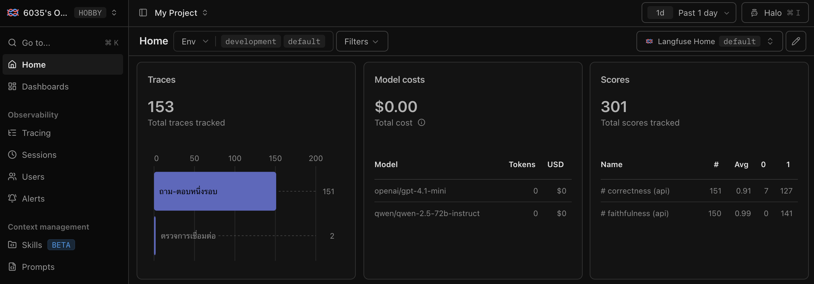


Langfuse แยก span เป็นสามชนิด `AGENT` คือหนึ่งรอบถาม-ตอบ `RETRIEVER` คือ tool ที่ไปเอาข้อมูล
และ `TOOL` คือ tool ที่คำนวณจากข้อมูลที่มีอยู่แล้ว ทำให้ดูได้ว่าเวลาหมดไปกับชั้นไหน

ทุกคะแนนที่ส่งเข้า Langfuse แนบคำอธิบายที่มาไว้ด้วย เปิดดูแล้วคำนวณตามได้โดยไม่ต้องเปิดโค้ด

```
faithfulness ตรวจว่าตัวเลขทุกตัวในคำตอบมาจากข้อมูลที่ดึงมาจริง
สูตร 1 - (ตัวเลขที่หาที่มาไม่ได้ / ตัวเลขทั้งหมดในคำตอบ)
ตัวเลขที่คำตอบอ้าง 3 ตัว [798.0, 172.0, 99999.0]
ที่หาที่มาไม่ได้ 1 ตัว [99999.0]
คะแนน = 1 - 1/3 = 0.6667
```

### เงื่อนไขการประเมิน

| รายการ | ค่า |
| --- | --- |
| วันที่รัน | 15 พฤศจิกายน 2569 เวลา 20:49 · 20:57 · 21:15 |
| โมเดล | `openai/gpt-4.1-mini` ผ่าน OpenRouter |
| ชุดคำถาม | [`eval/questions.yaml`](eval/questions.yaml) · 30 ข้อ · direct 12 · resolve 12 · clarify 6 |
| จำนวนรอบที่รัน | ขาละ 1 รอบ |
| ตัวแปรที่เปลี่ยนระหว่างขา | `RAG_MODE` อย่างเดียว ค่าอื่นคงที่ทั้งหมด |
| เพดานการวนรอบ | 8 รอบต่อหนึ่งคำถาม |
| ฐานข้อมูล | `complaints.db` 42,806 เรื่อง เปิดแบบ `mode=ro` |
| วิธีคิดคะแนน | สูตรตายตัวใน [`eval/score.py`](eval/score.py) ไม่ใช้ LLM ตัดสิน |
| เฉลย | [`eval/truth.py`](eval/truth.py) คำนวณจาก SQL ตอนรันทุกครั้ง ไม่ได้เขียนด้วยมือ |
| เครื่องมือบันทึก | Langfuse คลาวด์ เก็บ complete prompt เต็มและสูตรที่มาของคะแนน |

ทั้งสามขารันต่อกันในวันเดียว ด้วยฐานข้อมูลชุดเดียวกันและโมเดลตัวเดียวกัน
ตัวกันพลาดใน `run_eval` อ่าน `RAG_MODE` จาก MCP Server มาเทียบกับชื่อรอบทุกครั้ง
ถ้าไม่ตรงจะหยุดก่อนรัน เพื่อไม่ให้เกิดกรณีที่เคยพลาดมาแล้วว่ารันคนละชื่อแต่คอนฟิกเดียวกัน

### ผลสามขา

| ขา | `RAG_MODE` | correctness | faithfulness | direct | resolve | clarify |
| --- | --- | --- | --- | --- | --- | --- |
| ไม่มี RAG | `off` | **0.925** | 1.000 | 0.938 | 0.875 | 1.000 |
| BM25 | `bm25` | 0.867 | 0.990 | 0.917 | 0.833 | 0.833 |
| มี RAG rerank | `rerank` | 0.850 | 1.000 | 0.917 | 0.875 | 0.667 |


หนึ่งจุดคือหนึ่งคำถาม กากบาทตัวใหญ่คือค่าเฉลี่ยของขานั้น จุดถูกขยับเล็กน้อยเพื่อให้เห็นว่าซ้อนกันกี่จุด
แกนนอนคือ correctness แกนตั้งคือ faithfulness แบ่งเป็นสี่ช่องที่เส้น 0.5

จุดเกือบทั้งหมดเกาะอยู่ที่ขอบบน แปลว่าตัวเลขในคำตอบสืบที่มาได้เกือบทุกข้อ
สิ่งที่ต่างกันระหว่างขาคือการกระจายตัวตามแกนนอน ไม่ใช่แกนตั้ง

คะแนนรวมลดลงตามที่เพิ่มชั้น RAG เข้าไป แต่ดูแยกกลุ่มแล้วเรื่องไม่ได้เป็นอย่างนั้น

กลุ่ม `resolve` ซึ่งเป็นกลุ่มที่ RAG มีหน้าที่ช่วย ได้ 0.875 แล้ว 0.833 แล้ว 0.875 คือเท่าเดิม
ส่วนที่ร่วงคือกลุ่ม `clarify` ที่ตกจาก 1.000 เหลือ 0.667 ซึ่ง **RAG ไม่ได้เกี่ยวกับกลุ่มนั้นเลย**
คำถามพวกนั้นกำกวมที่เจตนา เช่น "ช่วงล่าสุด" หรือ "ปีนี้" ไม่ได้กำกวมที่ค่าในฐานข้อมูล

### รายข้อที่เห็นชัดว่า RAG ช่วย และที่ทำพัง

**ที่ช่วย** `r09 ปัญหาเรื่องมือถือในภาคเหนือมีกี่เรื่อง`

| off | bm25 | rerank |
| --- | --- | --- |
| 0.00 | 0.00 | **1.00** |

สองขาแรกแปลคำว่า "มือถือ" ไม่ออก เลยวนเรียก `resolve` แล้วหยุด ไม่เคยไปถึงการนับ
ขา rerank แปลงเป็น `โทรศัพท์เคลื่อนที่` ได้แล้วตอบ 865 เรื่อง เป็นขาเดียวที่ทำได้

**ที่ทำพัง** `r02 ทรูถูกร้องเรียนทั้งหมดกี่เรื่อง`

| off | bm25 | rerank |
| --- | --- | --- |
| 12,501 ถูก | 12,501 ถูก | **11,436 ผิด** |

ทั้งสามขาบอกว่ารวม 15 รายการเหมือนกัน แต่ขา rerank ได้คนละ 15 บริษัท
cross-encoder ให้คะแนนบริษัทในเครือทรูต่างจากที่รายการ alias เคยจับได้ หายไป 1,065 เรื่อง

**สองข้อนี้คู่กันคือใจความทั้งหมด** ชั้นความหมายช่วยเรื่องคำพูดคน
แต่ไปรบกวนเรื่องที่รายการตายตัวเคยทำถูกอยู่แล้ว

### แต่ตัวเลขรวมยังสรุปไม่ได้

ระหว่างทางเกิดความผิดพลาดที่กลายเป็นข้อมูลสำคัญ คือลืมแก้ `.env`
ทำให้รันสามรอบด้วย `RAG_MODE=off` เหมือนกันหมด ได้ผลดังนี้

| รอบ | correctness | faithfulness |
| --- | --- | --- |
| ครั้งที่ 1 | 0.975 | 0.986 |
| ครั้งที่ 2 | 0.850 | 0.992 |
| ครั้งที่ 3 | 0.908 | 0.997 |

**คอนฟิกเดียวกันแกว่ง 0.125 ส่วนเบี่ยงเบนราว 0.063**
ส่วนต่างระหว่างขาสูงสุดกับต่ำสุดคือ 0.075 ซึ่ง**เล็กกว่าช่วงที่คอนฟิกเดียวกันแกว่งเอง**

ตัวอย่างที่ชัดคือ `c03 ค่ายไหนบริการแย่ที่สุด` ได้ 1.00 ในขาหนึ่ง แต่ 0.00 ในอีกขา
ทั้งที่คำถามนั้นไม่แตะชั้น RAG เลย ต่างกันแค่โมเดลเลือกคนละเส้นทาง

faithfulness ต่างออกไป ค่านิ่งทุกขาแกว่งแค่ 0.010 เพราะไม่ได้ขึ้นกับวิธีค้นค่า
แต่ขึ้นกับกลไกที่บังคับให้ทุกตัวเลขผ่าน `query_complaints`

รายละเอียดอยู่ใน [`eval/variance_note.md`](eval/variance_note.md)

### ผลทดสอบ contract

รัน `python -m tests.test_contract` ยิงค่าผิด 12 แบบผ่าน MCP จริง

| กรณี | ใครปฏิเสธ | code |
| --- | --- | --- |
| `limit` นอกช่วงหรือใหญ่เกิน | โค้ดเรา | `INVALID_ARG` |
| `metric` ที่ไม่มีอยู่ | โค้ดเรา | `INVALID_ARG` |
| คอลัมน์ที่ไม่มีอยู่ | โค้ดเรา | `INVALID_ARG` |
| `filters` เป็นข้อความธรรมดา | โค้ดเรา | `INVALID_ARG` |
| `result_id` ที่ไม่มีอยู่ | โค้ดเรา | `RESULT_NOT_FOUND` |
| ค่าที่ไม่มีในกราฟ | โค้ดเรา | `VALUE_NOT_IN_GRAPH` |
| `group_by` เป็นสตริง | รับเข้ามาแล้วเตือน | — |

**ไม่มีกรณีไหนที่ถูกชั้น protocol ตัดทิ้งก่อนถึงโค้ดเรา**

### ข้อจำกัดที่รู้ตัว

**ชุดคำถามวัดชั้น BM25 ไม่ได้** ตรวจย้อนแล้วพบว่าคำที่ต้องแปลงทั้ง 12 คำ
จบที่ alias หรือการเทียบตัวอักษรก่อนถึงชั้น BM25 ทุกคำ ชั้นนั้นจึงไม่เคยถูกเรียกใช้
คะแนนที่เท่ากันจึงไม่ได้แปลว่า BM25 ไม่มีประโยชน์ แต่แปลว่าชุดคำถามนี้วัดมันไม่ได้

**ถามกลับได้เฉพาะความกำกวมของค่า ไม่ใช่ของเจตนา** ระบบจับได้เมื่อค่าในฐานข้อมูลตรงได้หลายตัว
แต่คำถามอย่าง "ค่ายไหนบริการแย่ที่สุด" กำกวมที่นิยามของคำว่าแย่ ซึ่งระบบยังเดาตัวชี้วัดเอง

**รันขาละรอบเดียว** ตัวเลขทั้งหมดจึงเป็นแนวโน้ม ไม่ใช่ผลสรุปเชิงสถิติ

**คะแนนติดความสามารถของโมเดลที่เลือกใช้** ไม่ได้สะท้อนแค่คุณภาพของการค้นค่า

### กรณีที่ควรให้คนตรวจคำตอบ

| สถานการณ์ | ทำไม |
| --- | --- |
| คำตอบมี `warnings` เรื่องคอลัมน์ว่าง | เช่นคอลัมน์ภูมิภาคว่าง 52% ตัวเลขจึงไม่ใช่ยอดทั้งประเทศ |
| คำถามที่ต้องตีความว่าอะไรคือดีหรือแย่ | ระบบเลือกตัวชี้วัดเอง ซึ่งอาจไม่ตรงกับที่ผู้ถามหมายถึง |
| ตัวเลขที่จะเอาไปอ้างอิงต่อสาธารณะ | ควรเปิด SQL ที่แนบมาแล้วรันซ้ำเอง |
| คำถามที่รวมหลายบริษัทในเครือ | ตรวจว่ารายชื่อที่ระบบรวมให้ครบและถูกต้อง |

### บั๊กที่เจอระหว่างทำ

| บั๊ก | อาการ | ทำไมอันตราย |
| --- | --- | --- |
| แปลง พ.ศ. เป็น ค.ศ. โดยไม่ได้ตกลงกัน | ข้อมูลไม่ตรงต้นฉบับ | เอกสารเขียนว่าตรงต้นฉบับ ขัดกันเอง |
| `datetime(2559, 2, 29)` โยน `ValueError` | ข้อมูล 39 แถวหายเงียบ | ไม่มี error ให้เห็น |
| warning ตอนผลถูกตัดอยู่ใน `if share_pct` | ถามรายอำเภอได้ 100 จาก 861 แบบเงียบ | **ตัวเลขทุกตัวสืบที่มาได้ faithfulness จึงจับไม่ได้** |
| `except Exception` ดักหมดทุก tool | บั๊กของเราถูกห่อเป็นคำแนะนำ | LLM วนลูปโดยไม่มีใครรู้ |
| `group_by` เป็นสตริงถูก SDK ตัดก่อนเข้า tool | LLM ได้ข้อความดิบที่แก้ต่อไม่ได้ | ข้อความแนะนำที่เขียนไว้ไม่เคยถูกใช้ |
| `observability` ถูก import ก่อน `load_dotenv` | tracer ปิดตัวเองเงียบ | eval 90 ข้อไม่มี trace เลยสักอัน |
| `set_current_trace_io` ไม่มีในบางเวอร์ชัน | ทุกคำถามพังตอนปิด trace | เงียบจนกว่าจะเปิด Langfuse แล้วว่าง |
| ลืมแก้ `.env` ก่อนรัน eval | สามขาเป็นคอนฟิกเดียวกัน | **เกือบรายงานว่า RAG ดีกว่า ทั้งที่ไม่ได้เปิด RAG** |

บั๊กสองอันที่อันตรายที่สุดคืออันที่ **ตัวเลขทุกตัวถูกต้องแต่คำตอบผิด**
เพราะเครื่องมือวัดฝั่งคำตอบจับไม่ได้ ต้องแก้ที่ tool เท่านั้น

---

## 9. Roadmap

### ทำแล้ว

- [x] บังคับให้ทุกตัวเลขผ่าน `query_complaints`
- [x] แยก error สองระดับ ด้วยทูเพิลเดียวใช้ทั้ง 6 tool
- [x] ชั้นค้นค่าสามขั้น พร้อมเกณฑ์จากข้อมูลจริง
- [x] กราฟความสัมพันธ์พร้อม lift
- [x] หน้าเว็บที่แสดงที่มาของทุกตัวเลข
- [x] วัด correctness และ faithfulness ด้วยสูตรตายตัว
- [x] บันทึกความแปรปรวนของการรันซ้ำ
- [x] เก็บ complete prompt เต็ม tool call และสูตรที่มาของคะแนนลง Langfuse

### จะทำต่อ

- เปิด `search_law` เป็น MCP tool ตัวที่เจ็ด ให้ LLM เรียกค้นกฎหมายได้เอง
- วัดผลสองชั้น ชั้นค้น 7 วิธี และชั้นตอบ 3 แขน แล้วทำกราฟเทียบ
- ย้ายสคีมาของตารางไปอยู่ในคลังเอกสาร โดยคงชั้น whitelist ไว้เหมือนเดิม

- [ ] รันแต่ละขาหลายรอบเพื่อสรุปผลของ RAG ได้จริง
- [ ] เพิ่มคำถามที่ใช้คำพูดของคน เพื่อให้วัดชั้น BM25 และ reranker ได้
- [ ] ถามกลับเมื่อกำกวมที่เจตนา ไม่ใช่แค่กำกวมที่ค่า
- [ ] ตรวจย้อนว่า `filters` ที่ใช้ตรงกับที่ `resolve` คืนมาจริงไหม
- [ ] ชุดคำถามที่ต้องเดินกราฟหลายทอด เพื่อวัด `explore_relations`
- [ ] หาสาเหตุที่ cross-encoder รวมบริษัทในเครือได้ไม่ตรงกับ alias

---

## โครงสร้างไฟล์

```
nbtc-agent/
├── 01_fetch_explore.py      ดึงข้อมูลจาก CKAN API
├── 02_build_db.py           สร้าง SQLite เก็บปีเป็น พ.ศ.
├── agent.py                 Agent Core วนรอบเรียก tool
├── observability.py         ห่อ Langfuse ต่อตอนใช้ครั้งแรก
├── aliases.yaml             กลุ่มชื่อผู้ให้บริการที่คนเขียน
├── tools/
│   ├── db.py                whitelist คอลัมน์ และการต่อแบบอ่านอย่างเดียว
│   ├── resolve.py           แปลคำผู้ใช้เป็นค่าจริง สามขั้น
│   ├── bm25.py              ตัดคำไทยแล้วนับคำซ้ำ
│   ├── rerank.py            cross-encoder ให้คะแนนทุกค่า
│   ├── graph.py             กราฟความสัมพันธ์ และ lift
│   ├── query.py             ประกอบ SQL และ warnings
│   ├── analyze.py           คำนวณสถิติจากผลที่ดึงมา
│   ├── chart.py             วาดกราฟ รองรับฟอนต์ไทย
│   └── dashboard.py         รวมกราฟเป็นหน้า HTML เดียว
├── mcp_server/server.py     ประกาศ 6 tool และ resource
├── lawrag/
│   ├── extract.py           แกะ PDF กฎหมาย ซ่อมสระอำที่เพี้ยน 3 แบบ
│   ├── sara_am_fix.json     ตารางซ่อมสระอำ 3,363 คู่ สร้างจากพจนานุกรมไทย
│   ├── chunker.py           ตัด chunk ตามมาตรา ข้อ ภาคผนวก
│   ├── contextualize.py     ให้ LLM เขียนบริบทกำกับทุก chunk
│   ├── lawgraph.py          สร้างกราฟการอ้างอิง และกฎการเดิน
│   ├── index.py             ฝังเวกเตอร์ลง pgvector และทำดัชนี BM25
│   ├── retrieve.py          ค้น 7 วิธี เทียบกันด้วยโค้ดชุดเดียว
│   └── Dockerfile           ฝังโมเดล embedding และ reranker ไว้ใน image
├── data/law/
│   ├── manifest.csv         สารบัญ 437 ฉบับ และฉบับที่คัดมา
│   ├── chunks.json          682 chunk พร้อมเลขมาตรา ข้อ และการอ้างอิง
│   ├── law_graph.json       949 จุด 2,404 เส้น
│   └── telecom_glossary.json  ศัพท์โทรคมนาคม 205 คำ จากปทานุกรมของ กสทช.
├── web/                     หน้าเว็บที่แสดง trace
├── eval/
│   ├── questions.yaml       ชุดคำถาม 30 ข้อ ไม่มีตัวเลขเฉลย
│   ├── truth.py             คำนวณเฉลยจาก SQL ตอนรัน
│   ├── score.py             สูตร correctness และ faithfulness
│   ├── run_eval.py          รันทั้งชุด ส่งคะแนนเข้า Langfuse
│   ├── plot_quadrant.py     วาดแผนภาพสี่ช่อง
│   └── variance_note.md     บันทึกความแปรปรวนของการรันซ้ำ
├── tests/                   ทดสอบแต่ละชั้น
├── docs/images/             ภาพประกอบและแผนผังการทำงาน
└── docker-compose.yml       mcp และ web
```

---

เอกสารนี้เป็นงานเรียน ไม่ใช่ระบบที่พร้อมใช้งานจริง
