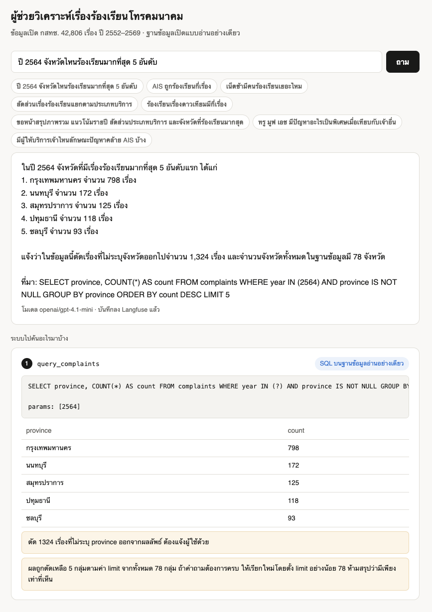
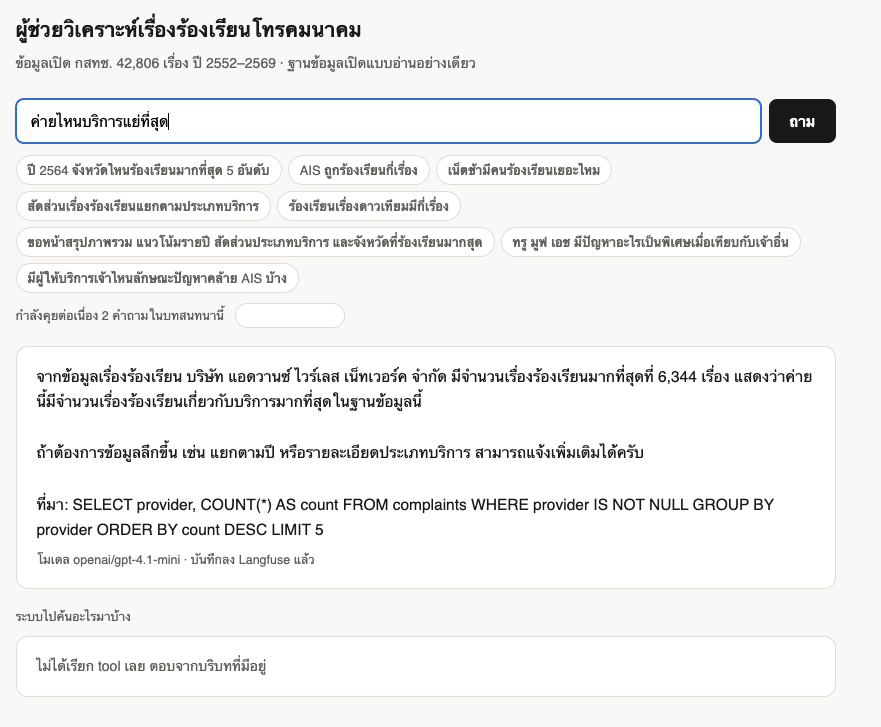
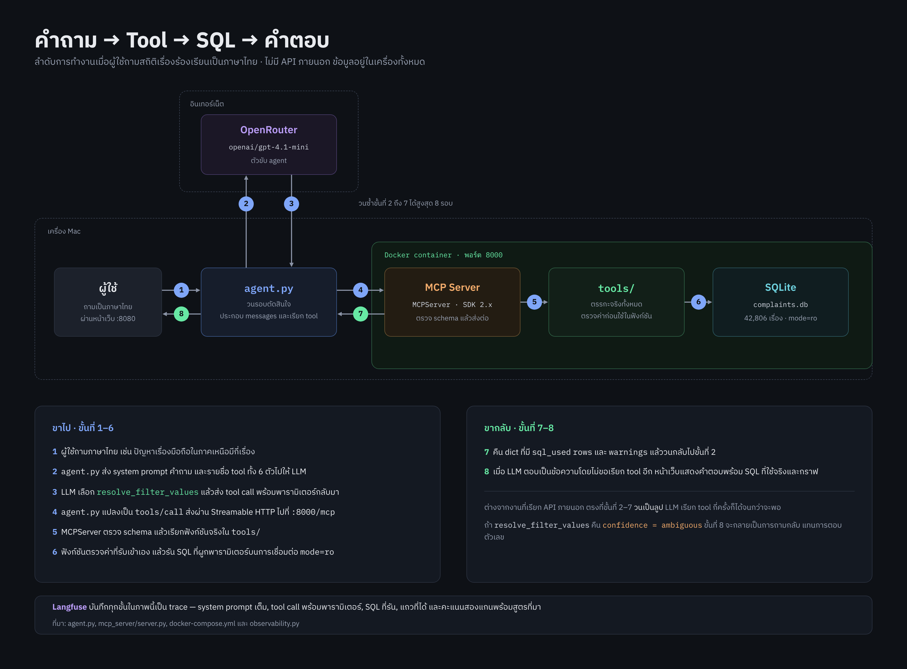
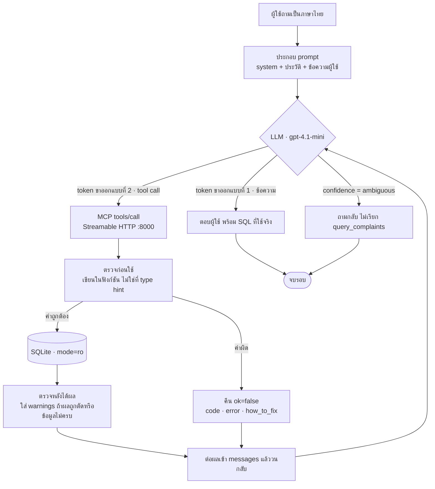
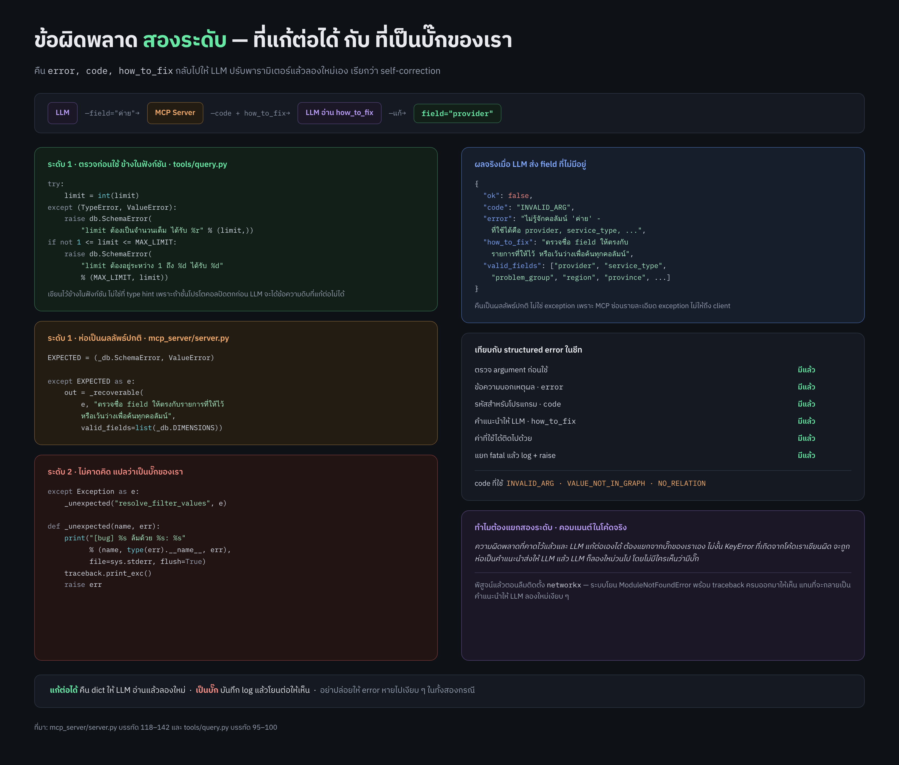
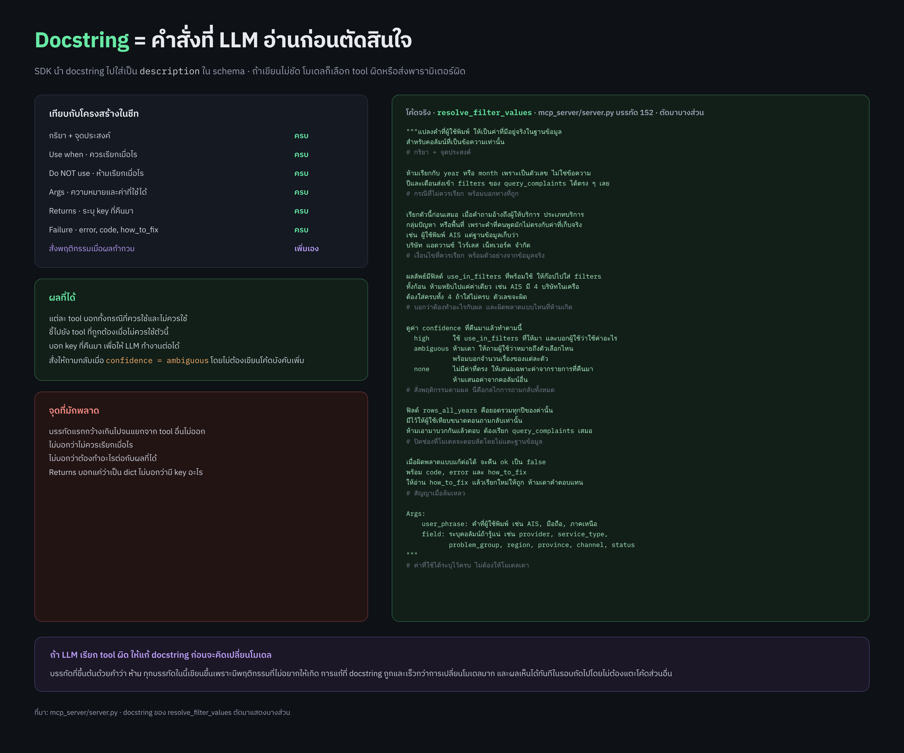
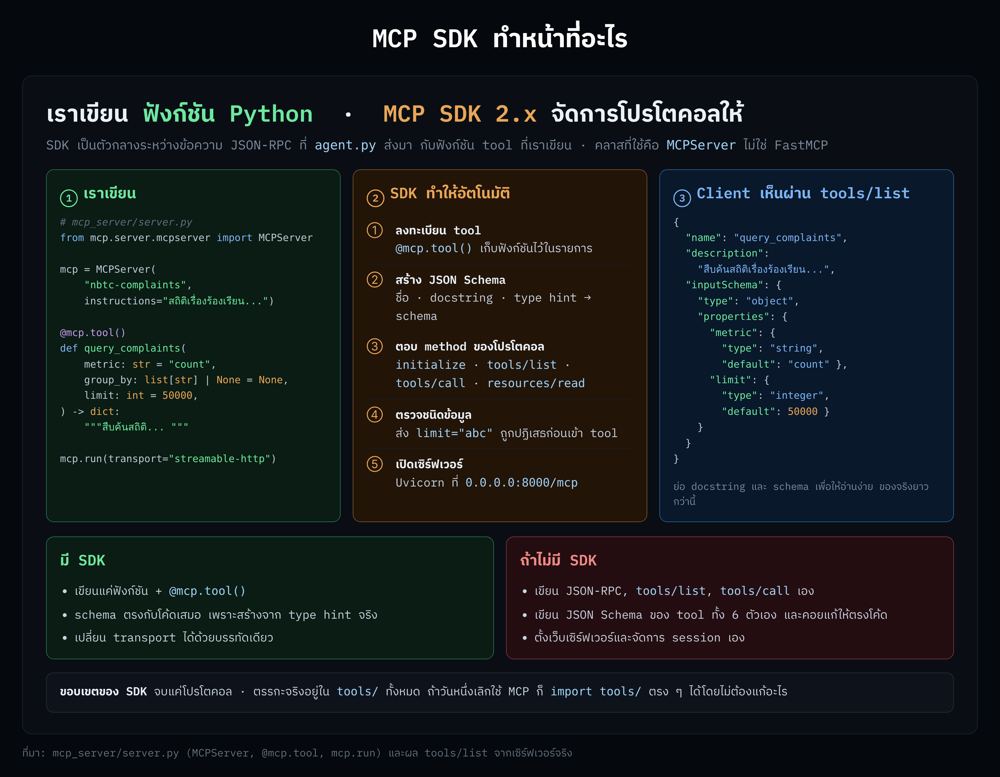
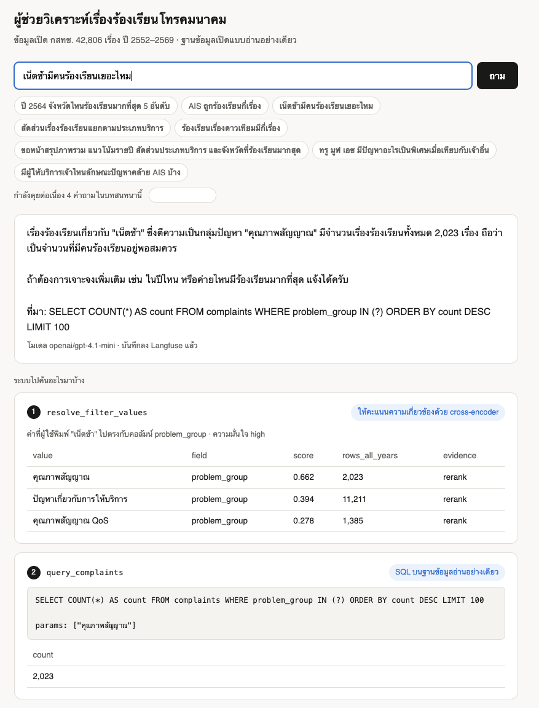
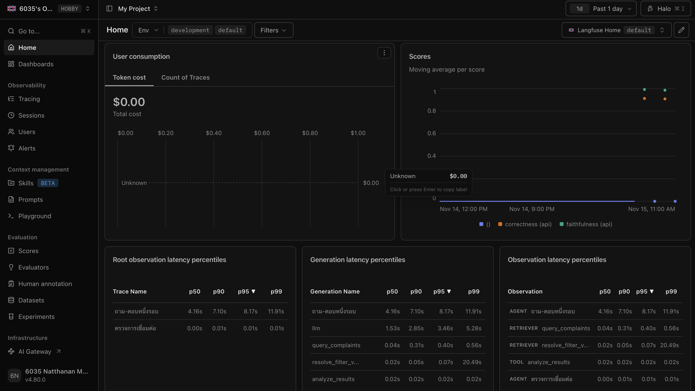
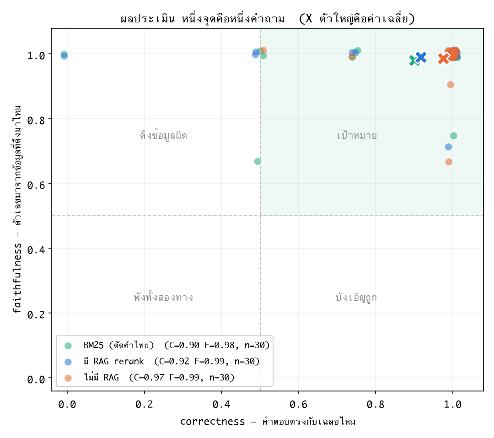

# ผู้ช่วยวิเคราะห์เรื่องร้องเรียนโทรคมนาคม — Agentic AI Application

ช่วยคนที่ต้องตอบคำถามจากสถิติเรื่องร้องเรียนของ กสทช. ให้ถามเป็นภาษาไทยธรรมดาแล้วได้ตัวเลขจริง
พร้อม SQL ที่ใช้คำนวณแนบมาทุกครั้ง ถ้าคำถามกำกวมระบบจะถามกลับแทนการเดา

**KDAI · NLP Project (พฤศจิกายน 2569)**


[Overview](#1-overview) · [Demo](#2-demo) · [Key Features](#3-key-features) · [Agent Workflow](#4-agent-workflow) · [System Architecture](#5-system-architecture) · [Quick Start](#6-quick-start) · [Usage Examples](#7-usage-examples) · [Evaluation](#8-evaluation--limitations) · [Roadmap](#9-roadmap)

> **ผลสรุปหนึ่งบรรทัด** ระบบตอบถูก 0.85 ถึง 0.93 และตัวเลขในคำตอบสืบที่มาได้ 0.99 ถึง 1.00
> แต่ **การเพิ่มชั้นค้นค่าด้วย BM25 และ cross-encoder ยังพิสูจน์ไม่ได้ว่าทำให้ดีขึ้น**
> เพราะส่วนต่างระหว่างขาเล็กกว่าความแปรปรวนของการรันซ้ำคอนฟิกเดียวกัน
> ตัวเลขเต็ม กราฟ และเงื่อนไขการประเมินอยู่ใน [หัวข้อ 8](#8-evaluation--limitations)

---

## 1. Overview

### ปัญหาที่ต้องการแก้

กสทช. เปิดเผยสถิติเรื่องร้องเรียนในกิจการโทรคมนาคมเป็นข้อมูลเปิด **42,806 เรื่อง ปี พ.ศ. 2552 ถึง 2569**
แต่การจะตอบคำถามง่าย ๆ อย่าง *"ปัญหาเรื่องมือถือในภาคเหนือมีกี่เรื่อง"* ต้องเขียน SQL เองทุกครั้ง

อุปสรรคที่แท้จริงไม่ใช่การเขียน SQL แต่เป็น**ช่องว่างระหว่างคำที่คนพูดกับค่าที่ฐานข้อมูลเก็บ**

| คนพิมพ์ | ฐานข้อมูลเก็บว่า |
| --- | --- |
| AIS | `บริษัท แอดวานซ์ ไวร์เลส เน็ทเวอร์ค จำกัด` และอีก 3 บริษัทในเครือ |
| มือถือ | `โทรศัพท์เคลื่อนที่` |
| โทรศัพท์บ้าน | `โทรศัพท์ประจำที่` |
| เน็ตช้า | `อินเทอร์เน็ต` หรือ `คุณภาพสัญญาณ` — ตรงทั้งสองคอลัมน์ |

ถ้าตอบด้วย LLM เฉย ๆ โมเดลจะเดาค่าเหล่านี้แล้วแต่งตัวเลขออกมาอย่างมั่นใจ
โจทย์ของโครงการจึงเป็น **ทำให้ตัวเลขทุกตัวในคำตอบสืบที่มากลับไปหา SQL ได้จริง และกำกวมเมื่อไหร่ต้องถาม ไม่ใช่เดา**

### กลุ่มผู้ใช้และกรณีใช้งานหลัก

| ใคร | ใช้ทำอะไร |
| --- | --- |
| เจ้าหน้าที่ดูแลเรื่องร้องเรียน | ถามยอดรายจังหวัด รายค่าย รายปี โดยไม่ต้องเขียน SQL |
| นักวิเคราะห์นโยบาย | หาว่าปัญหาแบบไหนเยอะผิดปกติกับผู้ให้บริการรายไหน |
| ผู้สื่อข่าวหรือนักวิจัย | ขอตัวเลขพร้อมที่มาที่ตรวจสอบย้อนกลับได้ |

### ทำไมถึงเรียกว่า Agentic ไม่ใช่ pipeline

การมีเครื่องมือหลายตัวไม่ได้ทำให้ระบบเป็น Agentic ส่วนที่ทำให้เป็นคือ
**LLM เลือกเองว่าจะเรียกอะไร ด้วยพารามิเตอร์อะไร และจะหยุดเมื่อไหร่**

| สิ่งที่ตัดสินใจ | ใครตัดสิน |
| --- | --- |
| จะเรียก tool ไหน เรียงลำดับยังไง | LLM |
| พารามิเตอร์ที่ส่งเข้า tool | LLM |
| จะเรียกซ้ำอีกรอบ หรือพอแล้ว | LLM |
| จะถามกลับหรือจะตอบ | LLM ตามสัญญาที่ tool คืนมา |
| ค่าไหนใช้ได้ ค่าไหนไม่ได้ | **โค้ดเรา ไม่ใช่ LLM** |

เส้นแบ่งอยู่ตรงบรรทัดสุดท้าย — LLM ตัดสินใจเรื่องเส้นทาง แต่ไม่เคยตัดสินใจเรื่องความถูกต้องของข้อมูล

---

## 2. Demo

### ถามแล้วได้คำตอบพร้อม SQL



ทุกคำตอบแนบ SQL ที่รันจริง จำนวนแถว และคำเตือนถ้ามี กดดู trace ด้านข้างได้ว่าเรียก tool อะไรไปบ้าง

### คุยต่อเนื่องหลายคำถาม



### ถามกลับเมื่อคำถามกำกวม


คำว่า "ดาวเทียม" ตรงได้หลายค่า ระบบ**ไม่เรียก `query_complaints` เลย** แล้วถามกลับก่อน

### ตัวอย่างคำสั่งและผลลัพธ์จริง

| ผู้ใช้พิมพ์ | ระบบทำ | ได้ |
| --- | --- | --- |
| `ปัญหาเรื่องมือถือในภาคเหนือมีกี่เรื่อง` | แปลง "มือถือ" เป็น `โทรศัพท์เคลื่อนที่` แล้วนับ | **865 เรื่อง** พร้อมเตือนว่าคอลัมน์ภูมิภาคว่าง 52% |
| `ทรูถูกร้องเรียนทั้งหมดกี่เรื่อง` | รวม 15 บริษัทในเครือทรู | **12,501 เรื่อง** |
| `จังหวัดไหนร้องเรียนมากที่สุดปี 2564` | `group_by=province` เรียงแล้วตัด 5 อันดับ | ตารางพร้อม SQL |
| `ดาวเทียม` | ได้ `confidence = ambiguous` | **ถามกลับ ไม่ตอบตัวเลข** |

### log ของ MCP Server


ทุกการเรียก tool ถูกพิมพ์ลง log พร้อม SQL ที่รันจริง จำนวนแถว และเวลาที่ใช้

---

## 3. Key Features

### งานหลักที่ผู้ใช้ทำได้

- ถามยอดและสัดส่วนเรื่องร้องเรียน แยกตามปี จังหวัด ภูมิภาค ผู้ให้บริการ ประเภทบริการ กลุ่มปัญหา ช่องทาง สถานะ
- ถามด้วยคำพูดของคน เช่น "AIS" "มือถือ" "เน็ตช้า" โดยไม่ต้องรู้ชื่อนิติบุคคลเต็ม
- ถามความสัมพันธ์ เช่น ค่ายนี้มักเจอปัญหาแบบไหนผิดปกติ
- ขอกราฟหรือหน้าสรุปหลายกราฟ
- ตรวจย้อนได้ว่าตัวเลขแต่ละตัวมาจาก SQL บรรทัดไหน

### เครื่องมือที่ Agent เรียกใช้ได้

| กลุ่ม | Tool | หน้าที่ |
| --- | --- | --- |
| ตีความคำถาม | `resolve_filter_values` | แปลงคำผู้ใช้เป็นค่าจริงในฐานข้อมูล พร้อมระดับความมั่นใจ |
| สำรวจความสัมพันธ์ | `explore_relations` | เดินกราฟที่สร้างจากฐานข้อมูล ตอบว่าค่าหนึ่งพบร่วมกับอะไรบ่อย |
| ดึงข้อมูล | `query_complaints` | ประกอบ SQL ภายในแล้วรันแบบอ่านอย่างเดียว คืนทั้งผลและ SQL ที่ใช้ |
| วิเคราะห์ | `analyze_results` | คำนวณสถิติจากแถวที่ดึงมาแล้ว ไม่ไปหาข้อมูลใหม่ |
| นำเสนอ | `render_chart` | วาดกราฟหนึ่งรูป |
| นำเสนอ | `generate_dashboard` | รวมหลายกราฟเป็นหน้า HTML เดียว ฝังรูปไว้ในไฟล์ |

นอกจาก 6 tool ยังมี **resource** อีกหนึ่งตัวคือ `schema://values`
ส่งรายการค่าจริงของทุกคอลัมน์ให้โมเดลอ่านเป็นบริบท

เป็น resource ไม่ใช่ tool เพราะเป็นข้อมูลให้อ่าน ไม่ใช่การกระทำ
โมเดลจึงไม่ต้องเสียรอบเรียก tool เพื่อถามว่าในฐานข้อมูลมีค่าอะไรบ้าง


---

## 4. Agent Workflow

### ภาพรวมหนึ่งรอบถาม-ตอบ



### เส้นทางการทำงาน



### ข้อความของผู้ใช้ไปรวมอยู่ใน prompt ตรงไหน

`agent.py` ประกอบ `messages` ทุกรอบเป็นลำดับเดิมเสมอ

```python
messages = [
    {"role": "system",    "content": system_prompt},   # กติกา + รายการค่าจาก schema://values
    {"role": "user",      "content": question},        # ข้อความผู้ใช้ ต่อท้าย system เสมอ
    {"role": "assistant", "tool_calls": [...]},        # สิ่งที่โมเดลขอเรียก
    {"role": "tool",      "content": result},          # ผลที่ tool คืนมา ต่อท้ายไปเรื่อย ๆ
]
```

**ข้อความของผู้ใช้อยู่ต่อจาก system prompt เสมอ ไม่ย้ายไปท้ายสุด**
สิ่งที่ยาวขึ้นเรื่อย ๆ คือผลของ tool ที่ต่อท้ายเข้าไปทีละรอบ

แบบนี้ทำให้ย้อนดูได้ว่าโมเดลเห็นอะไรก่อนตัดสินใจ และไม่ต้องเดาว่าคำถามเดิมถูกดันไปอยู่ตรงไหน

### token ขาออกมีสองประเภท

หลังโมเดลตัดคำเป็น token แล้วผ่าน embedding, attention และ inference สิ่งที่ส่งออกมามีสองแบบ

| แบบ | ความหมาย | ระบบทำอะไรต่อ |
| --- | --- | --- |
| ข้อความธรรมดา | โมเดลคิดว่ารู้พอแล้ว | จบรอบ ส่งคำตอบให้ผู้ใช้ |
| `tool_calls` | โมเดลรู้ว่าความรู้ไม่พอ ขอเรียกเครื่องมือ | ส่งต่อเป็น MCP `tools/call` แล้ววนกลับ |

`agent.py` ตัดสินจากตรงนี้ตรง ๆ ไม่ได้เดาจากข้อความ

```python
if not msg.tool_calls:
    answer = msg.content          # แบบที่ 1 จบรอบ
    break
for call in msg.tool_calls:       # แบบที่ 2 เรียกจริงแล้ววนต่อ
    ...
```

### สัญญาก่อนใช้และหลังใช้ เขียนด้วยโค้ดเรา ไม่ใช่ฝากโมเดล



**ตรวจก่อนใช้** เขียนไว้ในฟังก์ชันเอง ไม่ฝากกับ type hint เพราะถ้าชั้น protocol
ปฏิเสธก่อนเข้ามา LLM จะได้ข้อความดิบที่แก้ต่อไม่ได้

```python
if not 1 <= limit <= MAX_LIMIT:
    raise db.SchemaError("limit ต้องอยู่ระหว่าง 1 ถึง %d ได้รับ %d" % (MAX_LIMIT, limit))
```

**ตรวจหลังได้ผล** คืน `warnings` ที่บอกสิ่งที่ LLM ต้องแจ้งผู้ใช้ เช่นจำนวนแถวที่ถูกตัดทิ้ง
หรือคอลัมน์ที่มีค่าว่างมากจนตัวเลขไม่ครบ

**การกรองเป็นแบบ dynamic ไม่ได้เขียนเงื่อนไขทีละ tool**

| กลไก | ขับด้วยอะไร | ครอบคลุม |
| --- | --- | --- |
| whitelist คอลัมน์ | `DIMENSIONS` dict ใน `db.py` | ทุก tool ที่แตะคอลัมน์ เพิ่มคอลัมน์ใหม่ก็ครอบคลุมทันที |
| แยกข้อผิดพลาดสองระดับ | ทูเพิล `EXPECTED` ตัวเดียว | ทั้ง 6 tool ใช้ชุดเดียวกัน |
| ห่อเป็นคำแนะนำ | ฟังก์ชัน `_recoverable` ตัวเดียว | ทุก tool คืนรูปแบบเดียวกัน |

```python
EXPECTED = (_db.SchemaError, ValueError)      # ประกาศครั้งเดียว ใช้ทั้ง 6 tool

except EXPECTED as e:                          # ระดับ 1 แก้ต่อได้
    out = _recoverable(e, "ตรวจชื่อ field ให้ตรงกับรายการที่ให้ไว้",
                       valid_fields=list(_db.DIMENSIONS))
except Exception as e:                         # ระดับ 2 บั๊กของเรา
    _unexpected("resolve_filter_values", e)    # พิมพ์ traceback แล้ว raise ต่อ
```

ถ้าไม่แยกสองระดับ บั๊กอย่าง `ModuleNotFoundError` จะถูกห่อเป็น `how_to_fix` ส่งให้ LLM
แล้ว LLM ก็จะลองใหม่วนไปโดยไม่มีใครรู้ว่าลืมติดตั้ง package

**ข้อจำกัดที่ต้องพูดให้ชัด** tool ของระบบนี้อ่านฐานข้อมูลของตัวเองเท่านั้น
ไม่ได้ยิง API ภายนอกที่อาจคืนเรื่องผิดหมวดกลับมา การกรองหลังใช้จึงเป็นเรื่อง
**ความครบถ้วนและความกำกวม** ไม่ใช่เรื่องผลลัพธ์ผิดโดเมน

### ผลที่ไม่ผ่านการกรอง ถูกส่งกลับเป็น input ให้โมเดลแก้เอง

เมื่อ tool คืน `ok: false` ผลนั้นถูกต่อเข้า `messages` เป็น `role: "tool"` ตามปกติ
แล้ววนกลับเข้า LLM ในรอบถัดไป โมเดลอ่าน `how_to_fix` แล้วเรียกใหม่ให้ถูกเอง

```json
{
  "ok": false,
  "code": "INVALID_ARG",
  "error": "ไม่รู้จักคอลัมน์ 'ค่าย' - ที่ใช้ได้คือ provider, service_type, ...",
  "how_to_fix": "ตรวจชื่อ field ให้ตรงกับรายการที่ให้ไว้ หรือเว้นว่างเพื่อค้นทุกคอลัมน์",
  "valid_fields": ["provider", "service_type", "problem_group", "region", "province", "..."]
}
```

คืนเป็นผลลัพธ์ธรรมดา ไม่ใช่ exception เพราะ MCP ซ่อนรายละเอียด exception ไม่ให้ถึง client
โมเดลจะเห็นแค่ `Error executing tool ...` ซึ่งแก้ตัวเองไม่ได้

### Agent หยุดเมื่อไหร่ และขอให้ผู้ใช้ยืนยันเมื่อไหร่

| สถานการณ์ | ระบบทำ |
| --- | --- |
| โมเดลตอบเป็นข้อความ ไม่ขอเรียก tool อีก | จบรอบ |
| `resolve_filter_values` คืน `confidence = ambiguous` | **หยุด ถามกลับ** ไม่เรียก `query_complaints` |
| `confidence = none` | บอกตรง ๆ ว่าไม่มีค่านี้ แล้วเสนอเฉพาะค่าที่มีจริง |
| วนครบ 8 รอบแล้วยังไม่ได้คำตอบ | หยุด แล้วบอกผู้ใช้ว่าหยุดเพราะอะไร |

```python
MAX_STEPS = int(os.environ.get("AGENT_MAX_STEPS", "8"))
```

เพดานนี้กันกรณีที่โมเดลอ่าน `how_to_fix` แล้วยังแก้ไม่ถูกสักที จะได้ไม่วนไม่จบ

### การตัดสินใจถามกลับ

`resolve_filter_values` คืน `confidence` สามระดับ และ prompt กำหนดว่าต้องทำอะไรกับแต่ละระดับ

| `confidence` | ความหมาย | agent ต้องทำ |
| --- | --- | --- |
| `high` | ตรงชัดเจน | ใช้ `use_in_filters` ที่ให้มาทั้งก้อน |
| `ambiguous` | ตรงได้หลายค่า | **หยุด ถามกลับ** พร้อมบอกจำนวนเรื่องของแต่ละตัวเลือก |
| `none` | ไม่มีค่านี้ | บอกตรง ๆ และเสนอเฉพาะค่าที่มีจริง |

กรณีที่ออกแบบไว้เป็นพิเศษคือ **คำเดียวตรงได้หลายคอลัมน์** เช่น "เน็ตช้า"
ตรงทั้ง `service_type = อินเทอร์เน็ต` และ `problem_group = คุณภาพสัญญาณ`

สองอันนี้ตอบคนละคำถาม กรองที่ประเภทบริการได้ทุกเรื่องของเน็ตรวมค่าบริการผิด
ส่วนกรองที่กลุ่มปัญหาได้เฉพาะเรื่องสัญญาณ ตัวเลขต่างกันหลายพัน แต่ SQL ถูกทั้งคู่
ระบบจึงถูกบังคับให้ถามกลับแทนการเลือกข้าง

### คำสั่งทั้งหมดอยู่ใน docstring ไม่ได้อยู่ในโค้ด



SDK นำ docstring ไปใส่เป็น `description` ใน schema กลไกการถามกลับทั้งหมดจึงอยู่ในข้อความนี้
ถ้า LLM เรียก tool ผิด การแก้ที่ docstring ถูกและเร็วกว่าการเปลี่ยนโมเดลมาก

---

## 5. System Architecture

### ส่วนประกอบที่ใช้จริง

```
ผู้ใช้ (ภาษาไทย)
      |
      v
Web UI  port 8080                          แสดงคำตอบ SQL กราฟ และ trace สด
      |
      v
Agent Core  agent.py                       ----HTTPS---->  OpenRouter
  ประกอบ messages = system + history + user                 gpt-4.1-mini
  ตัดสินใจว่าจะเรียก tool ไหน                                function calling
  วนจนกว่าจะได้คำตอบ หรือครบ 8 รอบ
      |
      | MCP protocol (streamable-http)
      v
MCP Server  Docker container  port 8000
  resolve_filter_values     แปลคำผู้ใช้เป็นค่าจริง
  explore_relations         เดินกราฟความสัมพันธ์
  query_complaints          ประกอบ SQL แล้วรันแบบอ่านอย่างเดียว
  analyze_results           คำนวณสถิติจากผลที่ดึงมา
  render_chart              วาดกราฟ
  generate_dashboard        รวมหลายกราฟเป็นหน้าสรุป
  schema://values           resource บอกค่าจริงทุกคอลัมน์
      |
      v
complaints.db   mount แบบ :ro
```

**การตัดสินใจอยู่ที่ Agent Core ที่เดียว** ส่วน tool ทำงานที่กำหนดไว้เท่านั้น ไม่มี tool ไหนเรียก tool อื่น

### เทคโนโลยีและหน้าที่ของแต่ละส่วน

| ส่วน | เทคโนโลยี | หน้าที่ |
| --- | --- | --- |
| UI | เว็บใน container `web` | รับคำถาม แสดงคำตอบ SQL กราฟ และ trace |
| Agent Core | Python + OpenAI client | ประกอบ prompt วนรอบเรียก tool ตัดสินใจหยุด |
| LLM | `openai/gpt-4.1-mini` ผ่าน OpenRouter | เลือก tool และเขียนคำตอบ |
| Tool layer | MCP SDK 2.x `MCPServer` | ประกาศ tool ตรวจ schema เสิร์ฟผ่าน Streamable HTTP |
| ตรรกะ | Python ใน `tools/` | ตรวจค่า ประกอบ SQL คำนวณ วาดกราฟ |
| ฐานข้อมูล | SQLite เปิดแบบ `mode=ro` | เก็บเรื่องร้องเรียน 42,806 แถว |
| ค้นค่าภาษาไทย | `pythainlp` BM25 + `bge-reranker-v2-m3` | แปลงคำพูดคนเป็นค่าจริง |
| กราฟความสัมพันธ์ | `networkx` | 271 node 1,903 edge |
| Observability | Langfuse | เก็บ prompt เต็ม tool call SQL และคะแนน |
| Deploy | Docker Compose | สอง service คือ `mcp` และ `web` |

### MCP SDK ทำหน้าที่อะไร



งานนี้ใช้ MCP SDK รุ่น 2.x คลาสชื่อ `MCPServer` เราเขียนแค่ฟังก์ชัน Python แล้วติด `@mcp.tool()`
SDK สร้าง JSON Schema จาก type hint และ docstring ให้เอง และตอบ method ของโปรโตคอลให้ครบ

### กลไกอ่านอย่างเดียว 4 ชั้น

| ชั้น | กลไก | ป้องกันอะไร |
| --- | --- | --- |
| 1 | LLM ไม่เคยเขียน SQL ส่งเฉพาะพารามิเตอร์ | prompt injection ที่สั่งให้เขียน SQL |
| 2 | whitelist คอลัมน์จาก `DIMENSIONS` dict และใช้ parameterized query | SQL injection ผ่านค่าที่ผู้ใช้พิมพ์ |
| 3 | `sqlite3.connect("file:...?mode=ro", uri=True)` | คำสั่งเขียนที่หลุดมาถึงชั้นนี้ |
| 4 | Docker mount `./data/complaints.db:/data/complaints.db:ro` | kernel ปฏิเสธการเขียนทั้งหมด |

ทดสอบแล้วว่า `DELETE` `UPDATE` `DROP` `CREATE` ถูกปฏิเสธทั้งหมดด้วย
`attempt to write a readonly database`

### ชุดข้อมูล


#### ที่มาและเงื่อนไขการใช้

| ฟิลด์ | ค่า |
| --- | --- |
| ชื่อชุดข้อมูล | [สถิติเรื่องร้องเรียนในกิจการโทรคมนาคม](https://datacatalog.nbtc.go.th/dataset/dataset_12_05) |
| หน่วยงานผู้รับผิดชอบ | สำนักรับเรื่องร้องเรียนและคุ้มครองผู้บริโภคในกิจการโทรคมนาคม (รท.) กสทช. |
| อีเมลติดต่อ | `tcp.service@nbtc.go.th` |
| วัตถุประสงค์ | เพื่อการให้บริการประชาชน |
| ประเภทชุดข้อมูล | ข้อมูลสถิติ |
| หมวดหมู่ตามธรรมาภิบาลข้อมูลภาครัฐ | ข้อมูลสาธารณะ |
| **สัญญาอนุญาตให้ใช้ข้อมูล** | **Open Data Common** |
| เงื่อนไขการเข้าถึง | เปิดเผยต่อสาธารณะ ไม่ลับและไม่อ่อนไหว |
| รูปแบบการเก็บข้อมูลต้นทาง | Database เข้าถึงผ่าน CKAN API |
| ความถี่การปรับปรุง | รายเดือน |
| ขอบเขตเชิงพื้นที่ที่ย่อยที่สุด | อำเภอ |
| ภาษา | ไทย |
| ปีข้อมูลที่เริ่มจัดทำ | พ.ศ. 2552 |
| กำหนดเผยแพร่ครั้งแรก | 23 กันยายน 2564 |
| ปรับปรุงครั้งล่าสุดในระบบ | 19 ตุลาคม 2569 |

สัญญาอนุญาตแบบ Open Data Common คือเหตุผลที่โครงการนี้นำข้อมูลมาแปลงและเผยแพร่ซ้ำได้
ส่วนขอบเขตที่ย่อยถึงระดับอำเภอ คือเหตุผลที่ฐานข้อมูลมีคอลัมน์ `district` ให้ถามรายอำเภอได้

#### สามข้อสังเกตจากเมทาดาทา

**ฟิลด์ปีล่าสุดในแคตตาล็อกไม่ตรงกับข้อมูลจริง** หน้าแคตตาล็อกระบุ
`ปีข้อมูลล่าสุดที่เผยแพร่ = 2566` และ `วันที่ปรับปรุงข้อมูลล่าสุด = 27 กรกฎาคม 2566`
แต่ไฟล์ที่ดึงมาจริงมีข้อมูลถึงปี 2569 (ปี 2567 จำนวน 1,088 เรื่อง · ปี 2568 จำนวน 1,301 เรื่อง · ปี 2569 จำนวน 1,118 เรื่อง)
และตัวระเบียนเองถูกปรับปรุงในระบบเมื่อ 19 ตุลาคม 2569

โครงการนี้จึงยึดตามข้อมูลในไฟล์จริง ไม่ยึดตามฟิลด์เมทาดาทา และเขียนช่วงปีที่ระบบรู้จัก
ไว้ใน resource `schema://values` ให้โมเดลอ่านเอง แทนที่จะฝังปีไว้ในโค้ด

**ข้อมูลปรับปรุงรายเดือน** ตัวเลขทุกตัวในเอกสารนี้จึงเป็นภาพ ณ วันที่ดึงข้อมูล
ถ้ารัน `01_fetch_explore.py` ใหม่ จำนวนเรื่องจะเปลี่ยน แต่เฉลยของชุดทดสอบคำนวณจาก SQL ตอนรัน
จึงขยับตามเองโดยไม่ต้องแก้ไฟล์

**เป็นข้อมูลสถิติ ไม่ใช่ข้อมูลระเบียนรายบุคคล** หนึ่งแถวคือหนึ่งเรื่องร้องเรียนที่ถูกจัดหมวดแล้ว
ไม่มีชื่อหรือข้อมูลติดต่อของผู้ร้องเรียน ระบบนี้จึงไม่ได้แตะข้อมูลส่วนบุคคลเลย

#### การตัดสินใจเรื่อง พ.ศ.

ร่างแรกแปลง พ.ศ. เป็น ค.ศ. ตอนสร้างฐานข้อมูล ซึ่งขัดกับเอกสารที่เขียนว่าเก็บตามต้นฉบับ
จึงรื้อสร้างใหม่ให้เก็บ พ.ศ. ตามที่ กสทช. เผยแพร่ และเก็บสตริงวันที่ต้นฉบับไว้ใน
`received_date_raw` กับ `closed_date_raw` ด้วย

การรื้อครั้งนั้นทำให้เจอบั๊กที่ร้ายแรงกว่า คือ `datetime(2559, 2, 29)` โยน `ValueError`
เพราะวันอธิกสุรทินอิงปฏิทิน ค.ศ. **ข้อมูล 39 แถวหายไปเงียบ ๆ**
แก้โดยตรวจความถูกต้องของวันในปฏิทิน ค.ศ. ก่อน แล้วค่อยบวก 543 ตอนแสดงผล

### ชั้นค้นค่าสามขั้น

เรียงจากของถูกไปของแพง แต่ละขั้นทำงานเฉพาะเมื่อขั้นก่อนหน้าหาคำตอบไม่พบ

| ขั้น | วิธี | เกณฑ์รับค่า |
| --- | --- | --- |
| 1 | ไฟล์ `aliases.yaml` ที่คนเขียน | ตรงคำเป๊ะ |
| 2 | เทียบตัวอักษร | เป็นคำย่อยของกัน 0.70 · คล้ายกัน 0.78 |
| 3 | BM25 หลังตัดคำไทยด้วย `pythainlp` | คะแนน 2.0 |
| 4 | cross-encoder `bge-reranker-v2-m3` | คะแนน 0.02 และต้องนำอันดับสอง 0.20 |



ภาพนี้คือชั้นที่สี่ทำงานจริง คำว่า "เน็ตช้า" ไม่มีคำไหนตรงตัวกับค่าในฐานข้อมูลเลย
cross-encoder ให้ `คุณภาพสัญญาณ` 0.662 นำอันดับสอง 0.268
ผ่านทั้งเกณฑ์ `HIGH` ที่ 0.50 และ `MARGIN` ที่ 0.20 ระบบจึงใช้ค่านั้นได้โดยไม่ต้องถามกลับ

**เกณฑ์ทุกตัวตั้งจากคะแนนที่วัดกับค่าจริง ไม่ใช่ค่าที่กำหนดขึ้นเอง**

เกณฑ์ BM25 ที่ 2.0 มาจากช่องว่างระหว่างคำกว้างอย่าง "บริการ" ที่ได้ 1.37
กับคำที่จับถูกซึ่งได้ตั้งแต่ 2.28 ขึ้นไป เกณฑ์ cross-encoder ที่ 0.02 มาจากช่องว่างระหว่าง
เคสที่อันดับหนึ่งผิด (0.0006 ถึง 0.0137) กับเคสที่อันดับหนึ่งถูก (0.0248 ขึ้นไป)

#### ทำไมถึงเปลี่ยนจาก bi-encoder เป็น cross-encoder

| คำทดสอบ | bi-encoder | cross-encoder |
| --- | --- | --- |
| ดาวอังคาร (คำที่ไม่เกี่ยวเลย) | 0.774 | **0.0006** |
| เน็ตช้า ไปหา คุณภาพสัญญาณ | ไม่ติด 3 อันดับแรก | **0.6624** นำอันดับสอง 0.268 |
| โดนคิดเงินเกิน | 0.838 นำ 0.010 | **0.7028** นำ **0.688** |

bi-encoder ให้ช่วงคะแนนทั้งสเกลแค่ 0.774 ถึง 0.873 ระยะห่างระหว่างคำตอบถูกกับผิด
เหลือราว 0.010 ซึ่งตั้งเกณฑ์ไม่ได้

คลังค่าของเรามีอย่างมาก 106 ค่าต่อคอลัมน์ จึงให้คะแนนทุกค่าได้หมด
ไม่ต้องมีขั้นคัดกรองก่อน แปลว่า**ไม่มีคำตอบไหนหลุดก่อนถูกพิจารณา**

#### ชั้นที่สามและสี่ไม่แตะคอลัมน์ชื่อเฉพาะ

วัดแล้วพบว่า "เมืองกรุง" ได้ นครนายก 0.808 แซง กรุงเทพมหานคร 0.807 ห่างกัน 0.001
ชื่อจังหวัดและชื่อนิติบุคคลจึงต้องพึ่ง alias กับการเทียบตัวอักษรเท่านั้น

อีกเคสที่เจอคือ BM25 ตัด "เน็ตช้า" เป็น `เน็ต|ช้า` แล้วคำว่า "เน็ต" ไปชนกับ
"ไตร**เน็ต**" ในชื่อบริษัท ตอบ `บริษัท ดีแทค ไตรเน็ต จำกัด` แบบมั่นใจเต็มที่

### กราฟความสัมพันธ์

สร้างจากฐานข้อมูลเดียวกันด้วย `networkx` ได้ **271 node 1,903 edge**
node คือค่าจริงในคอลัมน์ edge คือจำนวนเรื่องที่ค่าสองค่าปรากฏอยู่ในแถวเดียวกัน

ตัวเลขที่ใช้จริงคือ `lift` ไม่ใช่จำนวนดิบ เพราะผู้ให้บริการรายใหญ่ย่อมมีเรื่องเยอะไปหมด
ทุกหมวด `lift` เทียบกับค่าเฉลี่ยทั้งระบบ จึงบอกได้ว่าเรื่องไหนเยอะผิดปกติสำหรับเจ้านั้น

| ค่าที่ถาม | พบร่วมกับ | จำนวน | สัดส่วน | lift |
| --- | --- | --- | --- | --- |
| ทรู มูฟ เอช | ปัญหาข้อความสั้น SMS | 1,402 | 46.5% | **3.19** |
| อินเทอร์เน็ต | การยกเลิกบริการ | 5,386 | 55.7% | **3.26** |

---

## 6. Quick Start

### สิ่งที่ต้องมีก่อน

| อะไร | เวอร์ชัน | ใช้ทำอะไร |
| --- | --- | --- |
| Python | 3.11 ขึ้นไป | สร้างฐานข้อมูลและรัน eval |
| Docker Desktop | รุ่นที่มี `docker compose` | รัน MCP Server และหน้าเว็บ |
| บัญชี OpenRouter | — | เรียก `openai/gpt-4.1-mini` |
| บัญชี Langfuse | — | ไม่บังคับ ใช้เก็บ trace และคะแนน |

### 1. เตรียมฐานข้อมูล ทำครั้งเดียว

```bash
pip install -r requirements.txt
python 01_fetch_explore.py      # ดึงจาก CKAN API ของ กสทช.
python 02_build_db.py           # สร้าง data/complaints.db
```

### 2. ตั้งค่า `.env`

```bash
cp .env.example .env
```

เปิดไฟล์แล้วเติมค่าตามนี้ ไฟล์ `.env` อยู่ใน `.gitignore` แล้ว ไม่ขึ้น git

| ตัวแปร | จำเป็น | ความหมาย |
| --- | --- | --- |
| `OPENROUTER_API_KEY` | ใช่ | คีย์สำหรับเรียก LLM |
| `OPENROUTER_MODEL` | ไม่ | โมเดลที่ใช้ ตั้งเป็น `openai/gpt-4.1-mini` |
| `RAG_MODE` | ไม่ | `off` `bm25` หรือ `rerank` ค่าเริ่มต้น `off` |
| `LANGFUSE_PUBLIC_KEY` | ไม่ | ใส่คู่กับ secret ถ้าต้องการบันทึก trace |
| `LANGFUSE_SECRET_KEY` | ไม่ | ถ้าไม่ใส่ ระบบยังรันได้ปกติ แค่ไม่บันทึก |
| `AGENT_MAX_STEPS` | ไม่ | เพดานจำนวนรอบ ค่าเริ่มต้น 8 |

### 3. เปิดทั้งระบบ

```bash
docker compose up -d --build
```

เปิด `http://localhost:8080` แล้วถามได้เลย ดู log ด้วย `docker compose logs -f mcp`

### 4. ทดสอบ

```bash
python -m tests.test_rag          # ชั้นค้นค่าสามขั้น
python -m tests.test_contract     # ยิงค่าผิด 12 แบบผ่าน MCP
python -m tests.test_model        # โมเดลไหนเรียก tool เป็น
python -m tests.test_langfuse     # ตรวจการเชื่อมต่อ Langfuse
```

### 5. ประเมินผล

```bash
python -m eval.run_eval --selftest        # ตรวจเครื่องวัด ต้องได้ 1.00
python -m eval.run_eval --selftest-bad    # ต้องได้ 0.00
```

สลับ `RAG_MODE` ใน `.env` แล้วรันทีละขา ทุกครั้งต้อง `docker compose up -d` ก่อนให้ container รับค่าใหม่

```bash
python -m eval.run_eval --label "ไม่มี RAG"       # RAG_MODE=off
python -m eval.run_eval --label "BM25"            # RAG_MODE=bm25
python -m eval.run_eval --label "มี RAG rerank"   # RAG_MODE=rerank
python -m eval.plot_quadrant
```

`run_eval` อ่าน `RAG_MODE` จาก MCP Server เอง ถ้าชื่อรอบไม่ตรงกับโหมดจริงจะหยุดทันที

---

## 7. Usage Examples

### ตัวอย่างที่ตอบได้ทันที

| คำถาม | tool ที่เรียก | ผลที่คาดหวัง |
| --- | --- | --- |
| `ปี 2564 มีเรื่องร้องเรียนกี่เรื่อง` | `query_complaints` | จำนวนเรื่อง พร้อม SQL |
| `จังหวัดไหนร้องเรียนมากที่สุดปี 2564` | `query_complaints` | 5 อันดับแรก พร้อม SQL |
| `ปัญหาเรื่องมือถือในภาคเหนือมีกี่เรื่อง` | `resolve_filter_values` แล้ว `query_complaints` | 865 เรื่อง พร้อมคำเตือนเรื่องคอลัมน์ว่าง |
| `AIS กับทรู ใครถูกร้องเรียนมากกว่ากัน` | `resolve` 2 ครั้ง แล้ว `query` 2 ครั้ง | เทียบสองค่าย พร้อม SQL ทั้งสองชุด |
| `ทรูถูกร้องเรียนเรื่องอะไรมากที่สุด` | `resolve` แล้ว `query` แบบ `group_by` | กลุ่มปัญหาเรียงตามจำนวน |

### ตัวอย่างที่ระบบต้องถามกลับ

| คำถาม | ทำไมถึงถาม | ระบบตอบ |
| --- | --- | --- |
| `ดาวเทียม` | ตรงได้หลายค่า `confidence = ambiguous` | ถามว่าหมายถึงตัวเลือกไหน พร้อมจำนวนเรื่องของแต่ละตัว |
| `เน็ตช้า` | ตรงทั้ง `service_type` และ `problem_group` | ถามว่าจะนับทุกเรื่องของเน็ต หรือเฉพาะเรื่องสัญญาณ |
| `ค่ายไหนบริการแย่ที่สุด` | คำว่าแย่ไม่มีนิยามในข้อมูล | **ยังทำได้ไม่สม่ำเสมอ** ดูข้อจำกัดในหัวข้อถัดไป |

### ตัวอย่างที่ระบบบอกว่าไม่มีข้อมูล

| คำถาม | ระบบตอบ |
| --- | --- |
| `ยอดร้องเรียนปี 2600` | บอกว่าข้อมูลมีถึงปี 2569 เท่านั้น |
| ค่ายที่ไม่มีอยู่ในฐานข้อมูล | `confidence = none` แล้วเสนอเฉพาะค่าที่มีจริง |

---

## 8. Evaluation & Limitations

### วิธีวัด

วัดสองแกนด้วยสูตรตายตัว **ไม่ใช้ LLM ตัดสิน** เพราะคะแนนจาก LLM อธิบายไม่ได้และเปลี่ยนทุกครั้งที่รัน

| แกน | นิยาม | สูตร |
| --- | --- | --- |
| correctness | คำตอบตรงกับเฉลยที่คำนวณจาก SQL ไหม | เฉลี่ยสัดส่วนของค่าและชื่อกลุ่มที่ต้องปรากฏ |
| faithfulness | ตัวเลขทุกตัวในคำตอบสืบที่มาได้ไหม | 1 ลบ (ตัวเลขที่หาที่มาไม่ได้ หารด้วย ตัวเลขทั้งหมดในคำตอบ) |

ชุดคำถามอยู่ใน [`eval/questions.yaml`](eval/questions.yaml) รวม 30 ข้อ แบ่งสามกลุ่ม

| ชนิด | จำนวน | ต้องทำอะไร | ตัวอย่าง |
| --- | --- | --- | --- |
| `direct` | 12 | ตอบได้ตรง ๆ ไม่ต้องแปลงคำ | `ปี 2564 มีเรื่องร้องเรียนทั้งหมดกี่เรื่อง` |
| `resolve` | 12 | ต้องแปลงคำผู้ใช้เป็นค่าในฐานข้อมูลก่อน | `ปัญหาเรื่องมือถือในภาคเหนือมีกี่เรื่อง` |
| `clarify` | 6 | กำกวม ระบบต้องถามกลับ ไม่ใช่ตอบตัวเลข | `ค่ายไหนบริการแย่ที่สุด` |

**ในไฟล์นั้นไม่มีตัวเลขเฉลยเขียนไว้เลย** คนเขียนแค่คำถามกับพารามิเตอร์ที่ถูกต้อง
ส่วนตัวเลขคำนวณจาก `query_complaints` ตอนรันทุกครั้งด้วย [`eval/truth.py`](eval/truth.py)
ถ้าข้อมูลต้นทางอัปเดต เฉลยอัปเดตตามเอง ไม่ต้องแก้ไฟล์




Langfuse แยก span เป็นสามชนิด `AGENT` คือหนึ่งรอบถาม-ตอบ `RETRIEVER` คือ tool ที่ไปเอาข้อมูล
และ `TOOL` คือ tool ที่คำนวณจากข้อมูลที่มีอยู่แล้ว ทำให้ดูได้ว่าเวลาหมดไปกับชั้นไหน

ทุกคะแนนที่ส่งเข้า Langfuse แนบคำอธิบายที่มาไว้ด้วย เปิดดูแล้วคำนวณตามได้โดยไม่ต้องเปิดโค้ด

```
faithfulness ตรวจว่าตัวเลขทุกตัวในคำตอบมาจากข้อมูลที่ดึงมาจริง
สูตร 1 - (ตัวเลขที่หาที่มาไม่ได้ / ตัวเลขทั้งหมดในคำตอบ)
ตัวเลขที่คำตอบอ้าง 3 ตัว [798.0, 172.0, 99999.0]
ที่หาที่มาไม่ได้ 1 ตัว [99999.0]
คะแนน = 1 - 1/3 = 0.6667
```

### เงื่อนไขการประเมิน

| รายการ | ค่า |
| --- | --- |
| วันที่รัน | 15 พฤศจิกายน 2569 เวลา 20:49 · 20:57 · 21:15 |
| โมเดล | `openai/gpt-4.1-mini` ผ่าน OpenRouter |
| ชุดคำถาม | [`eval/questions.yaml`](eval/questions.yaml) · 30 ข้อ · direct 12 · resolve 12 · clarify 6 |
| จำนวนรอบที่รัน | ขาละ 1 รอบ |
| ตัวแปรที่เปลี่ยนระหว่างขา | `RAG_MODE` อย่างเดียว ค่าอื่นคงที่ทั้งหมด |
| เพดานการวนรอบ | 8 รอบต่อหนึ่งคำถาม |
| ฐานข้อมูล | `complaints.db` 42,806 เรื่อง เปิดแบบ `mode=ro` |
| วิธีคิดคะแนน | สูตรตายตัวใน [`eval/score.py`](eval/score.py) ไม่ใช้ LLM ตัดสิน |
| เฉลย | [`eval/truth.py`](eval/truth.py) คำนวณจาก SQL ตอนรันทุกครั้ง ไม่ได้เขียนด้วยมือ |
| เครื่องมือบันทึก | Langfuse คลาวด์ เก็บ prompt เต็มและสูตรที่มาของคะแนน |

ทั้งสามขารันต่อกันในวันเดียว ด้วยฐานข้อมูลชุดเดียวกันและโมเดลตัวเดียวกัน
ตัวกันพลาดใน `run_eval` อ่าน `RAG_MODE` จาก MCP Server มาเทียบกับชื่อรอบทุกครั้ง
ถ้าไม่ตรงจะหยุดก่อนรัน เพื่อไม่ให้เกิดกรณีที่เคยพลาดมาแล้วว่ารันคนละชื่อแต่คอนฟิกเดียวกัน

### ผลสามขา

| ขา | `RAG_MODE` | correctness | faithfulness | direct | resolve | clarify |
| --- | --- | --- | --- | --- | --- | --- |
| ไม่มี RAG | `off` | **0.925** | 1.000 | 0.938 | 0.875 | 1.000 |
| BM25 | `bm25` | 0.867 | 0.990 | 0.917 | 0.833 | 0.833 |
| มี RAG rerank | `rerank` | 0.850 | 1.000 | 0.917 | 0.875 | 0.667 |



หนึ่งจุดคือหนึ่งคำถาม กากบาทตัวใหญ่คือค่าเฉลี่ยของขานั้น จุดถูกขยับเล็กน้อยเพื่อให้เห็นว่าซ้อนกันกี่จุด
แกนนอนคือ correctness แกนตั้งคือ faithfulness แบ่งเป็นสี่ช่องที่เส้น 0.5

จุดเกือบทั้งหมดเกาะอยู่ที่ขอบบน แปลว่าตัวเลขในคำตอบสืบที่มาได้เกือบทุกข้อ
สิ่งที่ต่างกันระหว่างขาคือการกระจายตัวตามแกนนอน ไม่ใช่แกนตั้ง

คะแนนรวมลดลงตามที่เพิ่มชั้น RAG เข้าไป แต่ดูแยกกลุ่มแล้วเรื่องไม่ได้เป็นอย่างนั้น

กลุ่ม `resolve` ซึ่งเป็นกลุ่มที่ RAG มีหน้าที่ช่วย ได้ 0.875 แล้ว 0.833 แล้ว 0.875 คือเท่าเดิม
ส่วนที่ร่วงคือกลุ่ม `clarify` ที่ตกจาก 1.000 เหลือ 0.667 ซึ่ง **RAG ไม่ได้เกี่ยวกับกลุ่มนั้นเลย**
คำถามพวกนั้นกำกวมที่เจตนา เช่น "ช่วงล่าสุด" หรือ "ปีนี้" ไม่ได้กำกวมที่ค่าในฐานข้อมูล

### รายข้อที่เห็นชัดว่า RAG ช่วย และที่ทำพัง

**ที่ช่วย** `r09 ปัญหาเรื่องมือถือในภาคเหนือมีกี่เรื่อง`

| off | bm25 | rerank |
| --- | --- | --- |
| 0.00 | 0.00 | **1.00** |

สองขาแรกแปลคำว่า "มือถือ" ไม่ออก เลยวนเรียก `resolve` แล้วหยุด ไม่เคยไปถึงการนับ
ขา rerank แปลงเป็น `โทรศัพท์เคลื่อนที่` ได้แล้วตอบ 865 เรื่อง เป็นขาเดียวที่ทำได้

**ที่ทำพัง** `r02 ทรูถูกร้องเรียนทั้งหมดกี่เรื่อง`

| off | bm25 | rerank |
| --- | --- | --- |
| 12,501 ถูก | 12,501 ถูก | **11,436 ผิด** |

ทั้งสามขาบอกว่ารวม 15 รายการเหมือนกัน แต่ขา rerank ได้คนละ 15 บริษัท
cross-encoder ให้คะแนนบริษัทในเครือทรูต่างจากที่รายการ alias เคยจับได้ หายไป 1,065 เรื่อง

**สองข้อนี้คู่กันคือใจความทั้งหมด** ชั้นความหมายช่วยเรื่องคำพูดคน
แต่ไปรบกวนเรื่องที่รายการตายตัวเคยทำถูกอยู่แล้ว

### แต่ตัวเลขรวมยังสรุปไม่ได้

ระหว่างทางเกิดความผิดพลาดที่กลายเป็นข้อมูลสำคัญ คือลืมแก้ `.env`
ทำให้รันสามรอบด้วย `RAG_MODE=off` เหมือนกันหมด ได้ผลดังนี้

| รอบ | correctness | faithfulness |
| --- | --- | --- |
| ครั้งที่ 1 | 0.975 | 0.986 |
| ครั้งที่ 2 | 0.850 | 0.992 |
| ครั้งที่ 3 | 0.908 | 0.997 |

**คอนฟิกเดียวกันแกว่ง 0.125 ส่วนเบี่ยงเบนราว 0.063**
ส่วนต่างระหว่างขาสูงสุดกับต่ำสุดคือ 0.075 ซึ่ง**เล็กกว่าช่วงที่คอนฟิกเดียวกันแกว่งเอง**

ตัวอย่างที่ชัดคือ `c03 ค่ายไหนบริการแย่ที่สุด` ได้ 1.00 ในขาหนึ่ง แต่ 0.00 ในอีกขา
ทั้งที่คำถามนั้นไม่แตะชั้น RAG เลย ต่างกันแค่โมเดลเลือกคนละเส้นทาง

faithfulness ต่างออกไป ค่านิ่งทุกขาแกว่งแค่ 0.010 เพราะไม่ได้ขึ้นกับวิธีค้นค่า
แต่ขึ้นกับกลไกที่บังคับให้ทุกตัวเลขผ่าน `query_complaints`

รายละเอียดอยู่ใน [`eval/variance_note.md`](eval/variance_note.md)

### ผลทดสอบ contract

รัน `python -m tests.test_contract` ยิงค่าผิด 12 แบบผ่าน MCP จริง

| กรณี | ใครปฏิเสธ | code |
| --- | --- | --- |
| `limit` นอกช่วงหรือใหญ่เกิน | โค้ดเรา | `INVALID_ARG` |
| `metric` ที่ไม่มีอยู่ | โค้ดเรา | `INVALID_ARG` |
| คอลัมน์ที่ไม่มีอยู่ | โค้ดเรา | `INVALID_ARG` |
| `filters` เป็นข้อความธรรมดา | โค้ดเรา | `INVALID_ARG` |
| `result_id` ที่ไม่มีอยู่ | โค้ดเรา | `RESULT_NOT_FOUND` |
| ค่าที่ไม่มีในกราฟ | โค้ดเรา | `VALUE_NOT_IN_GRAPH` |
| `group_by` เป็นสตริง | รับเข้ามาแล้วเตือน | — |

**ไม่มีกรณีไหนที่ถูกชั้น protocol ตัดทิ้งก่อนถึงโค้ดเรา**

### ข้อจำกัดที่รู้ตัว

**ชุดคำถามวัดชั้น BM25 ไม่ได้** ตรวจย้อนแล้วพบว่าคำที่ต้องแปลงทั้ง 12 คำ
จบที่ alias หรือการเทียบตัวอักษรก่อนถึงชั้น BM25 ทุกคำ ชั้นนั้นจึงไม่เคยถูกเรียกใช้
คะแนนที่เท่ากันจึงไม่ได้แปลว่า BM25 ไม่มีประโยชน์ แต่แปลว่าชุดคำถามนี้วัดมันไม่ได้

**ถามกลับได้เฉพาะความกำกวมของค่า ไม่ใช่ของเจตนา** ระบบจับได้เมื่อค่าในฐานข้อมูลตรงได้หลายตัว
แต่คำถามอย่าง "ค่ายไหนบริการแย่ที่สุด" กำกวมที่นิยามของคำว่าแย่ ซึ่งระบบยังเดาตัวชี้วัดเอง

**รันขาละรอบเดียว** ตัวเลขทั้งหมดจึงเป็นแนวโน้ม ไม่ใช่ผลสรุปเชิงสถิติ

**คะแนนติดความสามารถของโมเดลที่เลือกใช้** ไม่ได้สะท้อนแค่คุณภาพของการค้นค่า

### กรณีที่ควรให้คนตรวจคำตอบ

| สถานการณ์ | ทำไม |
| --- | --- |
| คำตอบมี `warnings` เรื่องคอลัมน์ว่าง | เช่นคอลัมน์ภูมิภาคว่าง 52% ตัวเลขจึงไม่ใช่ยอดทั้งประเทศ |
| คำถามที่ต้องตีความว่าอะไรคือดีหรือแย่ | ระบบเลือกตัวชี้วัดเอง ซึ่งอาจไม่ตรงกับที่ผู้ถามหมายถึง |
| ตัวเลขที่จะเอาไปอ้างอิงต่อสาธารณะ | ควรเปิด SQL ที่แนบมาแล้วรันซ้ำเอง |
| คำถามที่รวมหลายบริษัทในเครือ | ตรวจว่ารายชื่อที่ระบบรวมให้ครบและถูกต้อง |

### บั๊กที่เจอระหว่างทำ

| บั๊ก | อาการ | ทำไมอันตราย |
| --- | --- | --- |
| แปลง พ.ศ. เป็น ค.ศ. โดยไม่ได้ตกลงกัน | ข้อมูลไม่ตรงต้นฉบับ | เอกสารเขียนว่าตรงต้นฉบับ ขัดกันเอง |
| `datetime(2559, 2, 29)` โยน `ValueError` | ข้อมูล 39 แถวหายเงียบ | ไม่มี error ให้เห็น |
| warning ตอนผลถูกตัดอยู่ใน `if share_pct` | ถามรายอำเภอได้ 100 จาก 861 แบบเงียบ | **ตัวเลขทุกตัวสืบที่มาได้ faithfulness จึงจับไม่ได้** |
| `except Exception` ดักหมดทุก tool | บั๊กของเราถูกห่อเป็นคำแนะนำ | LLM วนลูปโดยไม่มีใครรู้ |
| `group_by` เป็นสตริงถูก SDK ตัดก่อนเข้า tool | LLM ได้ข้อความดิบที่แก้ต่อไม่ได้ | ข้อความแนะนำที่เขียนไว้ไม่เคยถูกใช้ |
| `observability` ถูก import ก่อน `load_dotenv` | tracer ปิดตัวเองเงียบ | eval 90 ข้อไม่มี trace เลยสักอัน |
| `set_current_trace_io` ไม่มีในบางเวอร์ชัน | ทุกคำถามพังตอนปิด trace | เงียบจนกว่าจะเปิด Langfuse แล้วว่าง |
| ลืมแก้ `.env` ก่อนรัน eval | สามขาเป็นคอนฟิกเดียวกัน | **เกือบรายงานว่า RAG ดีกว่า ทั้งที่ไม่ได้เปิด RAG** |

บั๊กสองอันที่อันตรายที่สุดคืออันที่ **ตัวเลขทุกตัวถูกต้องแต่คำตอบผิด**
เพราะเครื่องมือวัดฝั่งคำตอบจับไม่ได้ ต้องแก้ที่ tool เท่านั้น

---

## 9. Roadmap

### ทำแล้ว

- [x] บังคับให้ทุกตัวเลขผ่าน `query_complaints`
- [x] แยก error สองระดับ ด้วยทูเพิลเดียวใช้ทั้ง 6 tool
- [x] ชั้นค้นค่าสามขั้น พร้อมเกณฑ์จากข้อมูลจริง
- [x] กราฟความสัมพันธ์พร้อม lift
- [x] หน้าเว็บที่แสดงที่มาของทุกตัวเลข
- [x] วัด correctness และ faithfulness ด้วยสูตรตายตัว
- [x] บันทึกความแปรปรวนของการรันซ้ำ
- [x] เก็บ prompt เต็ม tool call และสูตรที่มาของคะแนนลง Langfuse

### จะทำต่อ

- [ ] รันแต่ละขาหลายรอบเพื่อสรุปผลของ RAG ได้จริง
- [ ] เพิ่มคำถามที่ใช้คำพูดของคน เพื่อให้วัดชั้น BM25 และ reranker ได้
- [ ] ถามกลับเมื่อกำกวมที่เจตนา ไม่ใช่แค่กำกวมที่ค่า
- [ ] ตรวจย้อนว่า `filters` ที่ใช้ตรงกับที่ `resolve` คืนมาจริงไหม
- [ ] ชุดคำถามที่ต้องเดินกราฟหลายทอด เพื่อวัด `explore_relations`
- [ ] หาสาเหตุที่ cross-encoder รวมบริษัทในเครือได้ไม่ตรงกับ alias

---

## โครงสร้างไฟล์

```
nbtc-agent/
├── 01_fetch_explore.py      ดึงข้อมูลจาก CKAN API
├── 02_build_db.py           สร้าง SQLite เก็บปีเป็น พ.ศ.
├── agent.py                 Agent Core วนรอบเรียก tool
├── observability.py         ห่อ Langfuse ต่อตอนใช้ครั้งแรก
├── aliases.yaml             กลุ่มชื่อผู้ให้บริการที่คนเขียน
├── tools/
│   ├── db.py                whitelist คอลัมน์ และการต่อแบบอ่านอย่างเดียว
│   ├── resolve.py           แปลคำผู้ใช้เป็นค่าจริง สามขั้น
│   ├── bm25.py              ตัดคำไทยแล้วนับคำซ้ำ
│   ├── rerank.py            cross-encoder ให้คะแนนทุกค่า
│   ├── graph.py             กราฟความสัมพันธ์ และ lift
│   ├── query.py             ประกอบ SQL และ warnings
│   ├── analyze.py           คำนวณสถิติจากผลที่ดึงมา
│   ├── chart.py             วาดกราฟ รองรับฟอนต์ไทย
│   └── dashboard.py         รวมกราฟเป็นหน้า HTML เดียว
├── mcp_server/server.py     ประกาศ 6 tool และ resource
├── web/                     หน้าเว็บที่แสดง trace
├── eval/
│   ├── questions.yaml       ชุดคำถาม 30 ข้อ ไม่มีตัวเลขเฉลย
│   ├── truth.py             คำนวณเฉลยจาก SQL ตอนรัน
│   ├── score.py             สูตร correctness และ faithfulness
│   ├── run_eval.py          รันทั้งชุด ส่งคะแนนเข้า Langfuse
│   ├── plot_quadrant.py     วาดแผนภาพสี่ช่อง
│   └── variance_note.md     บันทึกความแปรปรวนของการรันซ้ำ
├── tests/                   ทดสอบแต่ละชั้น
├── docs/images/             ภาพประกอบและแผนผังการทำงาน
└── docker-compose.yml       mcp และ web
```

---

เอกสารนี้เป็นงานเรียน ไม่ใช่ระบบที่พร้อมใช้งานจริง
